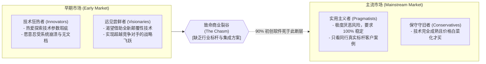
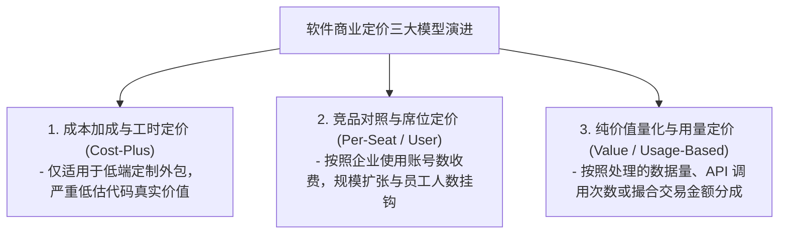

# Lec 07 软件产品营销与跨越鸿沟：定位法则与定价体系 (Software Marketing, Positioning & Crossing the Chasm)

> 授课教师：Prof. Michael A. Cusumano · MIT Sloan School of Management

## TL;DR

- 高科技软件营销核心在于识别技术采纳生命周期中的“裂谷（Chasm）”。
- 史蒂夫·卡尔与查尔斯·德威特指出企业级软件定位必须聚焦于杀手级应用。
- 软件定价从传统的永久授权加维保演变为基于价值与席位的多层级阶梯定价。
- 成功跨越裂谷要求企业集中全部营销兵力攻克首个细分垂直保龄球道。

## 技术采纳的悬崖：为什么早期热销的产品会突然滞销？

许多软件创业团队在刚刚推出新版本时，往往会经历一段极其令人振奋的甜蜜期：硅谷的技术极客们在科技论坛上疯狂讨论，少数前卫科技大厂的技术副总裁纷纷自发注册试用，媒体报道连篇累牍，天使投资人蜂拥而至。然而，当这批狂热的技术爱好者尝鲜之后，销售团队突然发现：**无论他们怎么打推销电话，主流的企业级客户根本不为所动，销售业绩断崖式下滑，公司陷入可怕的增长停滞**。

麻省理工学院本讲联合特邀嘉宾——高盛前副总裁史蒂夫·卡尔（Steve Kahl）与 i2 战略前副总裁查尔斯·德威特（Charles DeWitt），深度解构杰弗里·摩尔（Geoffrey Moore）经典的“跨越鸿沟（Crossing the Chasm）”理论，探讨软件企业如何完成从技术概念炒作向主流商业价值变现的惊险跳跃。

::: definition 技术采纳生命周期裂谷 (The Technology Adoption Chasm)
在技术采纳生命周期中，存在于“早期市场（由追求新技术酷炫体验的革新者与尝鲜远见者构成）”与“主流市场（由追求降低风险、成熟稳定与同行口碑的实用主义者构成）”之间深不见底的断层。由于两类客户的采购决策心理与价值评判标准存在根本对立，无法自然平滑过渡。
:::

## 裂谷两侧的深层认知与采购心理大碰撞

理解软件营销与产品定位，必须深刻洞察裂谷两侧客户群体的心理异质性：

| 客户群体特征 | 早期远见尝鲜者 (Visionaries) | 主流实用主义者 (Pragmatists) | 营销策略应对法则 |
| :--- | :--- | :--- | :--- |
| **购买核心动机** | 寻找能够改变行业格局的根本性战略突破 | 寻求经过充分验证、能可靠解决日常痛点的稳妥工具 | 停止宣讲宏大颠覆，转向强调稳健投资回报率（ROI） |
| **对待技术缺陷** | 极度宽容，甚至乐于自行动手写补丁与脚本 | 零容忍；任何小 Bug 都会被视为供应商不可信赖的证据 | 必须提供经过严苛质量测试、开箱即用的完整方案 |
| **参考背书依赖** | 喜欢跨行业寻找最前沿灵感，不看重同行 | **只相信同一垂直细分行业内直接竞争对手的口碑背书** | 集中全部兵力在某一个狭窄垂直赛道树立首个标杆 |
| **服务与支持诉求** | 拥有强大内部研发，仅需原始接口支持 | 要求全天候技术热线、本地集成商实施与长达数年服务承诺 | 联合成熟系统集成商（SI）共同交付“完整产品” |

## 跨越鸿沟的“诺曼底登陆”与保龄球道战术

摩尔指出，面对主流市场实用主义者坚固的防线，软件企业绝不能盲目四面出击、搞全行业的泛泛营销。必须采取**保龄球道战术（The Bowling Alley Strategy）**：

### 1. 锁定唯一的第一保龄球瓶（Beachhead Market）
挑选一个虽然规模有限、但客户痛点极深、且在位大软件巨头不屑于专门定制的细分赛道（例如：专门针对生物医药研发实验室的合规数据归档软件）。在该细分领域集中全公司 100% 的营销与工程兵力，打穿该赛道。

### 2. 借助第一瓶击倒整个保龄球瓶阵列
当你在生物医药领域拿下 80% 的市场份额后，你便在主流实用主义者群体中赢得了“不可动摇的行业领导者”声誉。此时，再以此为跳板，借助相似的应用场景顺势向医疗器械制造、高端食品检测等相邻赛道进行横向连环击倒。

## 软件产品的战略定价模型演进

软件营销的核心落脚点在于定价策略（Pricing Strategy）。软件的零边际成本特性赋予了定价极大的艺术空间：

在现代软件商业化中，单一价格通吃已经彻底破产。优秀的企业通常设计三级阶梯定价漏斗（Good-Better-Best）：
- **基础版（Starter）**：低价甚至免费提供，核心功能受限，用于极低摩擦获取海量早期开发者与中小企业；
- **专业版（Professional）**：针对成长型团队，按活跃席位阶梯计费，满足日常核心生产力诉求；
- **企业旗舰版（Enterprise）**：针对大型集团，提供单点登录（SSO）、军工级数据加密、专属客户成功经理（CSM）与定制化审计日志，享受极高溢价。

::: insight
许多初创企业最容易犯的错误就是“把价格定得太低”。创始团队往往以为便宜是最好的竞争武器，然而在主流企业级采购中，**过低的价格往往被 CIO 和采购主管直接解读为“二流劣质、随时可能倒闭的业余玩具”**。高价格本身就是一种强有力的定位信号，它向大客户传递了供应商有足够的利润空间来提供世界一流长期服务保障的郑重承诺。
:::

## 落地跨越鸿沟营销的四大实战戒律

1. **确立极其具体的“定位陈述（Positioning Statement）”**：用一句话填空：“对于【面临特定痛点的目标客户】，我们的产品是【唯一能够提供某种核心价值】的【产品类别】，不同于【主要竞争对手的传统方案】，我们拥有【无可替代的核心杀手锏】。”全员在对外交谈时必须严格保持口径一致。
2. **严防“过早宣称胜利与战线拉长”**：在拿下前三个大客户后，切忌盲目扩充行业线。继续深耕该细分领域，直到当地行业展会上所有人都在讨论你的产品为止。
3. **将售前资料全面向“商业价值文档（Business Case）”转型**：彻底清除非技术决策人看不懂的晦涩算法代码讲解，将销售幻灯片全面重构为图文并茂的“客户成功降本增效财务测算模型”。

::: pitfall
千万不要在没有建立“完整产品”的前提下强行攻打主流市场！如果你的核心软件虽然强大，但缺乏导出为 Excel 的简单按钮，或者缺乏与 SAP/Oracle 遗留系统的同步接口，实用主义者会在试用第一天就彻底抛弃你，并向整个行业圈子宣告你们的产品是一堆无法落地的半成品。
:::
