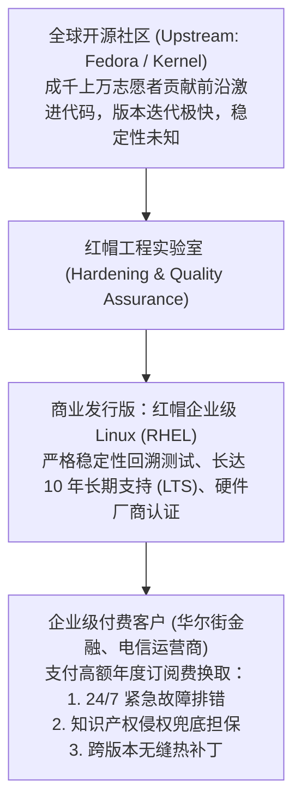

# Lec 08 开源商业模式与商业化：红帽、双重授权与服务生态 (Open Source Business Models & Commercialization)

> 授课教师：Prof. Michael A. Cusumano · MIT Sloan School of Management

## TL;DR

- 哈佛商学院麦科马克教授深度解析开源软件从极客反叛向商业主流的蜕变。
- 红帽公司（Red Hat）首创了依托开源 Linux 操作系统提供企业级订阅服务模式。
- 双重许可（Dual-Licensing）与开放核心（Open-Core）构筑了现代开源商业变现闭环。
- 开源生态治理必须在社区开发者的无偿贡献与商业公司的利润获取间保持平衡。

## 商业的奇迹之谜：免费开放源代码究竟如何赚取数十亿美元？

在传统知识产权与版权法律理论中，软件的商业价值来源于对其底层源代码的绝对私有化封锁。企业耗费数亿美元雇佣程序员编写代码，随后通过加密编译为二进制可执行文件，任何未经授权的拷贝与反编译都会遭遇严厉的跨国诉讼打压。

然而，在 1990 年代，一场源自黑客社区的革命彻底打碎了这一长达数十年的垄断信条。由理查德·斯托曼（Richard Stallman）开创的自由软件运动、林纳斯·托瓦兹（Linus Torvalds）发布的 Linux 内核以及阿帕奇（Apache）Web 服务器，将全部源代码免费、公开、无条件地暴露在互联网上，全球数以万计的极客志愿者自发协同修复漏洞并贡献代码。

哈佛商学院知名教授**艾伦·麦科马克（Alan MacCormack）**作为特邀演讲人加盟本讲，与库苏马诺教授共同解剖商业史上最反直觉的奇迹：**如何围绕人人皆可免费复制的开源代码，打造出市值数百亿美元的商业帝国？**

::: definition 开源商业化机制 (Commercial Open Source Software, COSS)
企业以开放源代码项目作为底层技术吸引力与开发者生态捕获引擎，通过提供企业级高可用加固、官方技术支持与维保订阅、高级专有功能插件（Open-Core）或云端全托管服务，将庞大的开源社区声誉转化为确定性商业营收的商业模型。
:::

## 经典案例解构：红帽公司（Red Hat）的订阅制商业神话

### 1. 摆脱廉价光盘零售的泥潭
在创立初期，红帽（Red Hat）和其他小作坊一样，把公开的 Linux 源代码编译打包刻录进光盘，配上一本纸质说明书，在零售书店以 29 美元一套的价格售卖。然而，随着网络下载速度的提升，这种“卖盒装光盘”的模式迅速走向死胡同，毛利微薄。

### 2. 模式颠覆：从卖代码到卖“安心（Assurance）与合规”
红帽创始人鲍勃·扬（Bob Young）与马修·斯兹里克（Matthew Szulik）敏锐洞察到了大企业首席技术官（CTO）深层的恐惧：
- 华尔街顶级银行和电信巨头非常渴望使用稳定、免费的 Linux 替代极其昂贵且被厂商绑架的 Sun Unix 服务器；
- 但大企业有三大致命顾虑：第一，一旦系统在半夜两点宕机，谁来兜底？第二，开源代码如果存在侵犯专利版权的风险，谁来替大企业承担连带赔偿责任？第三，硬件厂商（如 IBM、HP 服务器）是否愿意为该 Linux 发行版提供官方驱动兼容认证？

红帽以此为契机，开创了革命性的**红帽企业级 Linux（Red Hat Enterprise Linux, RHEL）订阅模式**：
- 代码依然遵循 GPL 协议完全开源；
- 但客户支付的不再是软件所有权，而是按年计费的“企业级服务订阅（Subscription）”：包含 7x24 小时电话排错保障、严格的每季度安全补丁推送、硬件厂商认证兼容测试，以及**全额知识产权无害担保（IP Indemnification）**！

凭此模式，红帽在 2012 年成为全球第一家年营收突破 10 亿美元的纯开源软件巨头，并在 2018 年被 IBM 以 **340 亿美元全额现金并购**。

## 主流开源商业化模式横向对比

麦科马克教授在调研中系统梳理了过去二十年间开源技术企业最经典的三大变现范式：

| 开源变现模型 | 核心变现载体 | 典型代表企业 | 核心竞争优势与潜在陷阱 |
| :--- | :--- | :--- | :--- |
| **纯支持与服务订阅型** (Pure Support & Services) | 100% 开源全部代码，仅通过企业级 SLA 维保、定制咨询与专业认证培训收费 | 早期 Red Hat、SUSE | 客户信任度极高，社区凝聚力最强；但毛利率低于纯软件产品，人均产值受限 |
| **开放核心模式** (Open-Core Model) | 基础核心功能完全开源；高级企业级特性（如分布式高可用、SSO 单点登录、审计日志）保持专有闭源商业授权 | GitLab、Elasticsearch、MongoDB | 商业变现路径极短，毛利极高；容易引发社区开发者的背叛感与代码分支（Fork） |
| **双重许可模型** (Dual-Licensing) | 针对开源社区采用极具传染性的强 Copyleft 协议（如 GPL）；若企业客户想闭源商用，必须花巨资购买商业许可 | 早期 MySQL、Qt | 法律壁垒严密，强制倒逼商业客户付费；但对现代云端 SaaS 服务隔离规避的穿透力减弱 |

::: insight
开源从来不是一种商业模式，**开源是一种颠覆性的“软件分发与获客渠道（Go-To-Market Channel）”**。在传统闭源软件时代，一家初创公司需要耗费数千万美元雇佣数百名销售代表去一家家企业敲门做 POC；而在开源时代，底层的技术极客直接在 GitHub 上点赞克隆，在周末就完成了系统集成。当商业销售进场时，软件实际上已经自下而上渗透进了大企业的核心产线。
:::

## 开源商业生态治理的四大生死法则

1. **清晰界定“社区版”与“企业版”的价值护城河**：如果采用开放核心模式，切忌在核心基础功能上玩弄小聪明。确保社区开源版足够好用、能够在单机环境下极其流畅地解决基础问题，仅对大型集群治理与企业级合规审计收取企业版费用。
2. **警惕“云厂商吸血寄生陷阱”**：随着亚马逊 AWS 等公有云巨头的崛起，云巨头往往直接抓取开源项目的免费代码，包装为自己的云托管服务高价售卖，却不向开源社区贡献一分钱代码或利润。现代开源企业必须建立严格的云服务防寄生许可（如 SSPL 或 BSL 协议）构筑反哺护城河。
3. **保持对上游开源社区的崇高敬畏**：商业公司切忌把开源社区当成免费雇佣兵。定期将自研的核心性能补丁回流（Upstream）至主干代码库，积极赞助社区黑客松与基金会，才能在商业利益与技术理想之间维系持久的生态共生。

::: pitfall
绝不要试图在开源协议上朝令夕改！历史上许多开源企业在拿到融资后，背信弃义地单方面收紧原本宣布永久免费的开源模块，这种举措会在 24 小时内引发全球极客的愤怒抵制。开源社区会在瞬间发起代码硬分叉（Hard Fork），另立新的纯粹开源项目，直接将违约的原商业公司彻底架空。
:::
