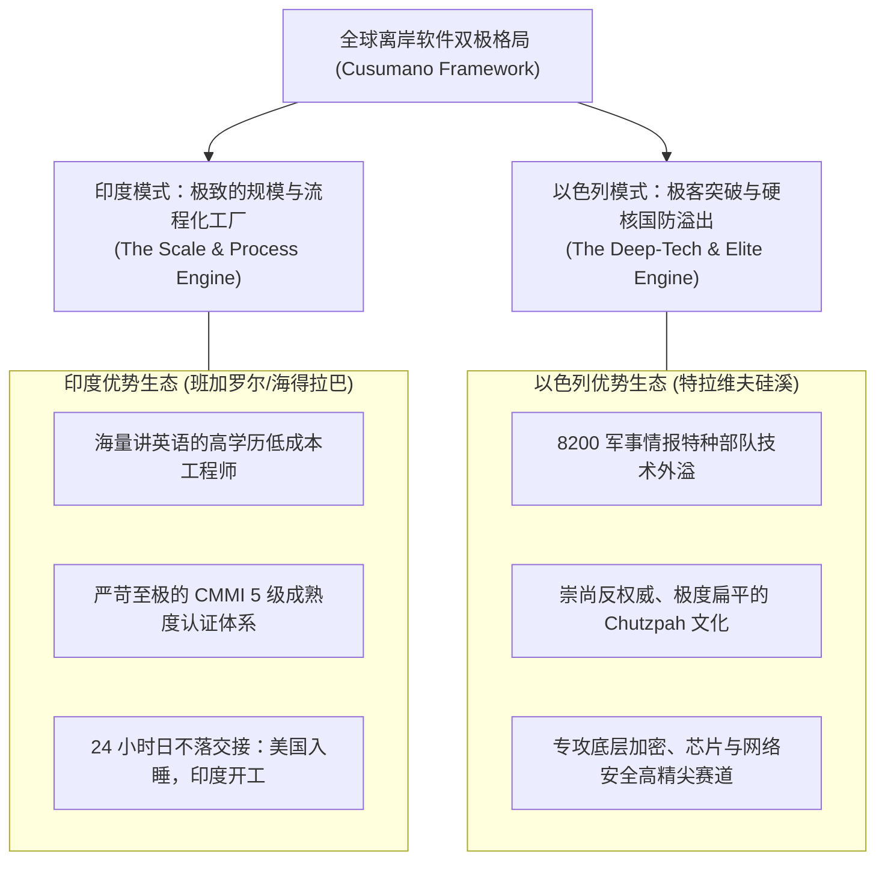
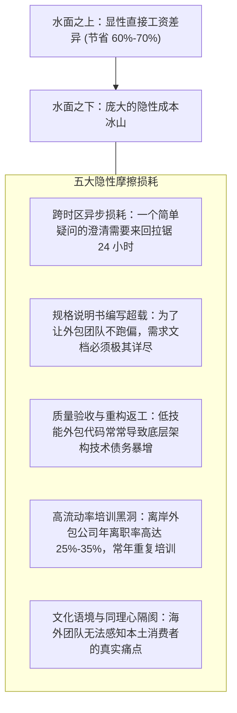

# Lec 09 全球化软件外包与离岸工厂：印度、以色列与分布式研发 (Global Software Business: Offshore & Innovation)

> 授课教师：Prof. Michael A. Cusumano · MIT Sloan School of Management

## TL;DR

- 全球软件产业形成了基于成本套利与特定技能集群的国际大分工格局。
- 印度凭借“软件工厂（Software Factory）”标准化流程与 CMMI 5 级认证崛起。
- 以色列凭借国防军事情报技术外溢（Unit 8200）开创了高精尖网络安全高地。
- 跨国离岸软件外包的深层挑战在于隐性协同成本、时区损耗与文化语境隔阂。

## 扁平的世界：软件研发的全球化地理重组

在 1970 年代，软件工程几乎是美国和西欧少数工业强国的绝对特权。然而，伴随跨洋海底光缆的铺设、互联网带宽的爆炸式增长以及全球高等工程教育的普及，托马斯·弗里德曼（Thomas Friedman）笔下“世界是平的”图景在软件产业最先化为现实。

曾经高高在上的硅谷与波士顿高科技巨头，开始将成千上万行代码的编写、维护与测试工作，大举转移至万里之外的班加罗尔、特拉维夫、都柏林与大连。全球软件产业迅速分化为截然不同的区域创新高地：**美国牢牢主导顶层平台架构与商业模式创新；印度确立了无可匹敌的规模化交付“软件工厂”；以色列则蜕变为全球高精尖底层算法与网络安全的心脏**。

麻省理工学院本讲联合查尔斯河风险投资（Charles River Ventures）合伙人伊扎尔·阿莫尼（Izhar Armoney）与伊姆兰·萨伊德，深度剖析全球化离岸软件外包（Offshore Outsourcing）的运作机制与系统性管理陷阱。

::: definition 软件工厂模型 (The Software Factory Concept)
由迈克尔·库苏马诺教授最早系统研究日本日立与东芝、随后在印度印孚瑟斯（Infosys）与塔塔咨询（TCS）发扬光大的工程管理范式：将原本高度依赖少数天才个人手艺的软件开发，彻底解构为类似现代汽车流水线一样标准化的装配作业。通过严格的代码复用库、精细的工时测算与 CMMI 5 级质量控制，实现大规模、低成本、高可靠性的代码量产。
:::

## 离岸外包的两大极点：印度工厂 vs 以色列创新高地

库苏马诺与阿莫尼在课堂上对全球两颗最具代表性的离岸技术明珠进行了深刻的比较研究：

| 国家与区域模式 | 核心产业定位与代表企业 | 组织与文化特征 | 核心竞争优势与潜在瓶颈 |
| :--- | :--- | :--- | :--- |
| **印度：全球软件工厂** | 巨型 IT 咨询与系统集成服务 (Infosys, TCS, Wipro) | 极度严守规范手册、层级严密、服从指令、注重流程合规 | 成本优势与超大规模团队交付力极其强大；但缺乏原创颠覆性产品创新动力 |
| **以色列：创业的国度** | 深度硬科技与网络安全领军者 (Check Point, Waze, Mobileye) | 反叛传统、质疑权威、敢冒极大风险、快速试错 | 底层算法与攻防技术无与伦比；但本土市场狭小，高度依赖被欧美巨头并购退出 |
| **爱尔兰：欧洲分发税务港** | 跨国软件巨头欧洲研发与合规总部 (Google, Microsoft) | 享受欧盟极低企业所得税、高质量英语人才与欧盟护照 | 跨国合规与企业级分销枢纽；但研发自主权易受母国战略摇摆波及 |

## 离岸外包的隐性成本冰山模型

许多美国科技公司的首席财务官（CFO）在最初做出离岸外包决策时，往往基于极其幼稚的数学计算：“美国工程师的时薪是 100 美元，班加罗尔工程师的时薪是 20 美元，我们把研发全部搬过去，研发成本就能直降 80%！”

然而，现实中无数跨国软件项目的惨痛教训表明，**名义工资的节约，往往被庞大的隐性协同成本彻底吞噬**：

::: insight
“廉价的劳动力往往造就最昂贵的软件”。离岸外包只适合于那些**“需求边界已经 100% 确定、架构接口完全冻结、且缺乏技术探索不确定性”**的确定性模块（如陈旧系统的跨平台数据迁移、常规回归测试用例编写）。如果你试图把从 0 到 1 的敏捷探索性创新外包给万里之外按工时计费的外包团队，其结果必然是一场耗尽所有资金与时间的灾难。
:::

## 管理全球分布式研发团队的五大纪律

1. **坚持“功能垂直切割，杜绝水平碎片化”**：绝不要让美国团队写前端、印度团队写后端、东欧团队写数据库。必须将某一独立业务模块（如支付清算模块）的端到端完整所有权，全权授予特定海外研发中心，使其具备闭环交付权。
2. **强制推行“重叠工作时钟（Golden Hours）”**：无论相隔多少个时区，全球分布式团队之间每天必须保留至少 2 至 3 个小时的实时在线重叠窗口，用于高频敏捷站会与架构对齐。
3. **建立全球工程师平等文化**：坚决消灭将海外研发中心视为“二等公民或纯外包码农”的傲慢偏见。让海外核心架构师拥有代码评审的绝对否决权，并定期组织跨国轮岗与总部的线下深度融合。

::: pitfall
绝不要试图在缺乏严格自动化持续集成（CI）与代码静态分析工具的前提下搞离岸大协同！如果海外团队提交的代码无法在合并入库的第一时间自动运行单元测试与性能跑分，几百人协同产生的大规模代码冲突会在版本发布前夜引发全盘崩溃。
:::
