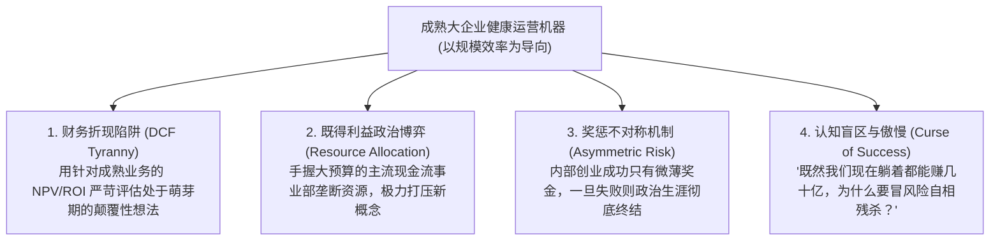

# Lec 01 大企业病成因与内部创业阻碍：为什么大公司缺乏创新精神？ (Why Aren't Established Firms More Entrepreneurial?)

> 授课教师：Prof. Aleksandra J. Kacperczyk & Prof. Charles Kiefer · MIT Sloan School of Management

## TL;DR

- 每一家成熟的跨国巨头在创立之初都曾是极具侵略性的初创企业。
- 随着规模膨胀，核心能力演化为核心刚性（Core Rigidities），扼杀非共识创新。
- 传统财务折现模型（DCF）对短期确定性业务的偏好导致颠覆性项目被系统性过滤。
- 内部创业（Intrapreneurship）的本质是打破组织的制度化防御抗体。

## 巨人的黄昏：为什么大企业无法保持创业精神？

在商业史的长河中，存在一个极具悲剧色彩的普遍规律：几乎所有曾经以无所畏惧的颠覆性技术横扫行业、摧毁在位垄断者的初创明星（从当年的通用电气、宝洁、施乐，到柯达与诺基亚），在其成长为年营收数百亿美元、员工数万名的跨国巨头之后，都会无可挽回地蜕变为行动迟缓、官僚森严、极度规避风险的守成者。

麻省理工学院斯隆管理学院本课程特邀前宝洁（P&G）高管露西娅·卡姆（Lucia Kamm）与前通用电气（GE）高管乔恩·加里蒂（Jon Garrity）共同开篇，探讨大企业内部创新的终极命题：**为什么拥有全行业最充沛的研发资本、最顶尖的专利资产与最庞大分销渠道的成熟巨头，反而失去了发明未来的能力？**

::: definition 核心刚性 (Core Rigidities)
由哈佛商学院多萝西·伦纳德（Dorothy Leonard）提出的组织理论：企业在过去长期成功中沉淀下的核心竞争优势（包括专有技能、管理流程、激励标准与主导价值观），随着外部技术与竞争环境的迁移，演化为阻碍组织学习、排斥异质性新思想并拒绝变革的坚固制度枷锁。
:::

## 扼杀创新的四大体制性隐形杀手

卡姆与加里蒂根据数十年的大企业管理沉浮，归纳了四种在潜意识中绞杀内部创业的体制机制：

### 1. 传统财务折现模型（DCF）的暴政
成熟大企业的资本预算委员会习惯于要求每一份立项报告提交严密的净现值（NPV）与内部收益率（IRR）测算。对于一个全新的颠覆性技术（如早期的个人电脑或互联网电商），早期的市场规模极其微小甚至无法量化。按照财务模型测算，投资一个百亿美元成熟产品线的边际优化，其纸面财务回报永远百倍于投资一个前沿探索项目。

### 2. 奖惩机制的极端不对称
在外部初创企业中，创业者承担巨大的破产风险，但一旦成功可以享受数千万美元的股权爆发；而在大企业内部，一位中层骨干冒着身败名裂的风险推进内部创新，成功了往往只获得一张奖状和 10% 的年终奖，一旦失败则会被贴上“好高骛远、执行不力”的标签被打入冷宫。这种制度设计，必然筛选出全员“不求有功、但求无过”的防御性平庸。

## 外部创业者 vs 内部创业者生存环境大对比

| 比较维度 | 外部独立创业者 (External Entrepreneur) | 大企业内部创业者 (Corporate Intrapreneur) |
| :--- | :--- | :--- |
| **初期资源约束** | 极度匮乏，经常面临下个月发不出工资的生死绝境 | 名义上拥有母体庞大的实验室、资金池与现成渠道 |
| **政治与沟通摩擦** | 极少政治内耗，创始人团队一锤定音，执行速度极快 | **90% 的精力消耗在向上汇报、跨部门拉通与消除部门猜忌上** |
| **失败容忍度** | 失败被风险投资生态视为宝贵的学费与勋章 | 失败往往被官僚系统作为政治清洗与问责追究的把柄 |
| **商业化自主权** | 拥有绝对的定价权、产品定义权与架构重写权 | 受到公司统一品牌规范、法务合规与现有渠道排他协议的严重捆绑 |

::: insight
大企业里最可怕的不是坏人，而是“尽职尽责的好人”。大企业的风控部门、法务总监与财务审核官，每个人都在恪尽职守地遵循公司的规章手册，他们在每一次签字时都在努力为公司规避哪怕 1% 的潜在法律或运营风险。然而，**正是这一百个尽职尽责的合规好人加在一起，构筑了一套没有任何人犯错、但全公司走向安乐死的坚固墓碑**。
:::

## 激发内部创业活力的破局法则

1. **设立“创新期权与不对称容错底线”**：在制度上明确规定：内部创业团队的探索性失败，不影响其在母体内的正常职级晋升与绩效基准评定。对于取得突破性商业化的内部业务，打破传统薪酬总额限制，给予类似外部风险投资的虚拟股权与分红激励。
2. **剥离“早期财务指标考核”**：建立专门的创新委员会，由 CEO 或首席创新官直管。在前两年的孵化期内，严禁财务部用成熟业务的利润率或 ROI 来审核项目，只考核用户学习速度、概念原型迭代频次与关键技术卡点突破。
3. **识别并驯服组织抗体**：在项目启动之初，主动将主流现金流部门的副总裁拉入顾问委员会，将新业务未来的部分潜在收益或期权与老部门的利益进行捆绑，变阻力源为保护伞。

::: pitfall
绝不要试图在原有臃肿的职能审批链路内搞所谓的“内部赛马”！如果你要求内部创业者每写一份代码、报销一笔差旅费都要找大部门的 5 位经理层层会签，这种内部创业从第一天起就注定是一场消耗激情的滑稽自嗨。
:::
