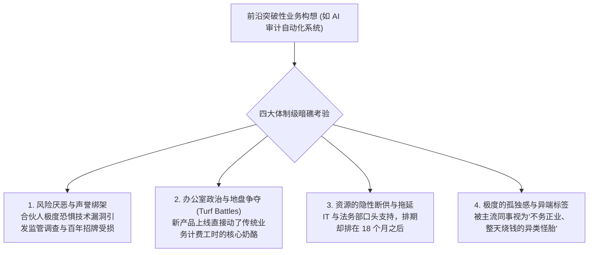

# Lec 02 内部创业者实操指南：在保守官僚架构中穿行与生存 (The Entrepreneur Inside: Navigating Corporate Politics)

> 授课教师：Prof. Aleksandra J. Kacperczyk & Prof. Charles Kiefer · MIT Sloan School of Management

## TL;DR

- 普华永道美国创新领袖米特拉·贝斯特分享在高度保守组织中突围的生存哲学。
- 内部创业者必须同时扮演“叛逆极客”与“老练政治家”的双重精神分裂角色。
- 构建跨部门政治联盟：将创新成果的功劳让渡给关键中层以化解官僚阻力。
- 隐形探索（Stealth Mode）与小步快跑：在没有引起巨头免疫系统警觉前完成验证。

## 在雷区中跳舞：内部创业者的双重人格

在创业神话中，人们往往推崇那种砸碎一切规则、敢于直接跟老板掀桌子的孤胆英雄。然而，在成熟大型企业、特别是在银行、保险、会计审计以及军工等高度注重声誉、极度规避法律责任的保守组织中，这种狂热的堂吉诃德式冲锋，通常会在三个月内被官僚体系以违反合规为由彻底碾碎。

麻省理工学院本讲特邀普华永道（PwC）美国创新负责人**米特拉·贝斯特（Mitra Best）**走上讲台。贝斯特在自主创业 12 年后加盟普华永道，在以严谨死板著称的四大会计师事务所内部成功推动了长达 15 年的颠覆性数字化转型。

贝斯特指出：**真正的卓越内部创业者，必须具备一种罕见的‘双重精神分裂人格’——内心深处流淌着打破一切现状的狂热技术理想，外表行为上却必须表现为深谙组织政治微操、极具同理心且步步为营的资深外交官！**

::: definition 内部创业政治资本 (Intrapreneurial Political Capital)
内部创业者在母体组织中，凭借过往过硬的业务战功、深厚的人际信任网络以及对各大派系核心利益的精准洞察，所积累的能够调动跨部门资源、抵御官僚非议并在灰色地带推行试验的合法性资本。
:::

## 保守组织中内部创业的四大核心阵痛

贝斯特在课堂上系统剖析了身处保守大企业内部推行变革时必然遭遇的四大地狱级关隘：

### 1. 动了传统按工时计费的核心奶酪
在专业服务业，合伙人的收入直接取决于手下审计师每小时向客户收取的工时费。如果一位内部创业者研发出了一套几分钟内就能全自动扫描财务异常的算法，合伙人不仅不会欢呼，反而会暗中敌视：因为这直接砸掉了原本可以计费数百小时的高额工时收入！

### 2. 隐形拖延的官僚太极
在大企业中，没有人会公开跳出来反对“创新”这一崇高词汇。官僚们扼杀创新的最高手法是“程序性推诿”：法务部表示需要进行长达半年的跨国数据安全评估；IT 部表示今年的技术栈接口升级尚未冻结；财务部要求补充提供未来五年的敏感性收益分析。任何一个环节卡上两个月，创业团队的激情就会被彻底耗尽。

## 内部创业者的生存兵法：四项核心政治技巧

为了在保守大企业的雷区中穿行，贝斯特系统总结了一套行之有效的突围战术：

| 政治生存战术 | 核心实操心法 | 常见业余错误 (严禁触犯) |
| :--- | :--- | :--- |
| **隐形探索模式 (Stealth Mode)** | 在原型未达到令人惊艳的稳定度之前，坚决不对外高调宣讲；用边角料资源秘密攻坚 | 八字还没一撇就召开全员发布会、大肆吹嘘要颠覆传统业务 |
| **功劳让渡法 (Credit Giving)** | 将实验成果的功劳包装为合作业务部门的政绩，让关键中层在向董事会汇报时充当第一宣讲人 | 争功抢位，向最高层表功时暗示老业务部门全是保守笨蛋 |
| **寻找权威政治教父 (Executive Sponsor)** | 锁定一位拥有董事会席位、渴望留下战略遗产的高级副董事长充当直接后盾 | 孤立无援，企图仅凭中层骨干的一腔热血去挑战全公司体制 |
| **将创新翻译为“防守盾牌”** | 停止宣扬“我们要激进颠覆”，而是向高管论证：“如果我们不先做，竞品下半年就会用这个武器彻底吃掉我们的老客户！” | 用极具侵略性的技术狂热词汇去刺激传统保守派的防御神经 |

::: insight
“在大公司里，请求原谅永远比请求许可容易一百倍（It's easier to ask for forgiveness than permission）”。贝斯特给所有技术人员的忠告是：如果你想做一次微小的概念原型试验，千万不要正式向大委员会打申请报告；一旦你打了报告，就会触发全套合规审查机器。动用你手中的自由度，在周末直接把原型捏出来；当你带着运转良好的真实数据去向高管道歉时，所有人都会成为你的朋友。
:::

## 内部创业者的心理韧性建设

内部创业是一场旷日持久的心理消耗战。许多优秀的极客因为无法承受官僚体系的冷嘲热讽而愤然离职。合格的内部创业者必须建立强大的心理防御：
1. **深刻理解官僚的恐惧**：官僚之所以阻碍你，不是因为他们仇视你，而是因为他们害怕承担责任。为你遇到的每一个阻碍者准备一套“免责防火墙”，帮他们把潜在的合规风险摘干净，阻力就会瞬间减半。
2. **在体制外建立极客情感同盟**：多参加麻省理工等前沿创新社区的交流，定期与外部创业者保持连接，从同类中汲取精神养分，防止自己的认知被母体内部狭隘的办公室政治所同化。

::: pitfall
绝不要把“玩弄政治”当成终极目的！高超的政治手腕只是护送技术原型的防弹衣。如果你整天忙于拉帮结派、请客送礼，却拿不出任何硬核的工程交付成果与客户量化价值，你最终只会蜕变为你最初所痛恨的平庸政客。
:::
