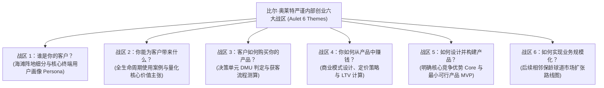

# Lec 03 企业内部创业系统框架：比尔·奥莱特严谨创新流程 (Corporate Entrepreneurship Frameworks: Bill Aulet)

> 授课教师：Prof. Aleksandra J. Kacperczyk & Prof. Charles Kiefer · MIT Sloan School of Management

## TL;DR

- MIT 马丁·信托创业中心主任比尔·奥莱特将创业转化为 24 步可复现工程学科。
- 内部创业同样需要严格界定海滩阵地市场、核心终端用户画像与全面价值主张。
- 利用母体现有资产（销售渠道、品牌信用与供应链）建立不对称竞争壁垒。
- 防范母体资源带来的虚假安全感：内部初创团队必须在市场真空中独立验证 PMF。

## 创业不是玄学：把内部探索转化为严谨工程

长期以来，无论是在硅谷的风险投资圈，还是在跨国大企业的董事会中，创业与创新往往被笼罩在一层神秘的浪漫主义面纱之下：人们将其描绘为不可复制的天才顿悟、不可捉摸的领袖魅力或纯粹的运气使然。这种认知导致大企业在开展内部创业时，往往采取极其松散的管理：拨付几百万美元，任由几位明星员工天马行空，一年后发现钱烧光了却没有任何可量化的成果。

麻省理工学院马丁·信托创业中心（Martin Trust Center for MIT Entrepreneurship）主任**比尔·奥莱特（Bill Aulet）**教授登台指出：**创业绝不是不可捉摸的艺术，创业是一门可以被严格教学、系统拆解并工程化落地的高阶管理学科！**

奥莱特早年在 IBM 历练多年，随后作为连续创业家带领两家麻省理工硬科技分拆企业成功上市并实现高额并购。在本讲中，他将著名的《严谨创业》（Disciplined Entrepreneurship: 24 Steps to a Successful Startup）框架系统移植入大企业内部创业场景。

::: definition 严谨内部创业框架 (Disciplined Corporate Entrepreneurship)
将大企业内部的探索性创新过程，系统解构为六大核心主题、二十四个逻辑严密的递进工程决策步阶。通过严谨的微观客户画像、海滩阵地锁定与单位经济学测算，消除大企业在创新中的拍脑袋与自嗨假象。
:::

## 奥莱特 24 步法则在企业内部的六大核心决策战区

奥莱特教授指出，大企业内部团队在推进新业务时，必须在以下六个关键战区依序交出严谨的工程答卷：

### 1. 战区一：海滩阵地市场（Beachhead Market）的残酷筛选
大企业最常犯的毛病是“由于自己体量大，所以看不起小市场”。内部团队往往一上来就宣称要进攻一个 100 亿美元的超大市场，结果资源被迅速摊薄。奥莱特严厉警告：必须逼迫团队挑选一个极其狭窄但痛点极深的细分市场（海滩阵地）。该市场必须满足：**客户拥有高度一致的采购逻辑，且客户之间拥有紧密的口口相传参考效应**。打穿这个细分市场，拿下 50% 以上份额，团队才被允许向外扩张。

### 2. 战区五：界定不可复制的核心竞争优势（The Core）
内部团队必须向创新委员会明确回答：你的核心护城河究竟是什么？是超低成本的生产工艺？是独特的网络效应？还是客户极高的转换成本？**切记：母体公司的品牌和资金绝对不能作为初创业务的核心护城河！** 如果离开母体的庇护你的产品在市场上就毫无竞争力，这种业务本质上就是寄生虫。

## 内部创业的双刃剑：如何借力母体而不被压死？

内部创业团队拥有外部创业者梦寐以求的母体资产，但也常常被这些资产反噬：

| 母体资产维度 | 积极借力策略 (Unfair Advantages) | 潜在致命反噬 (The Toxic Trap) |
| :--- | :--- | :--- |
| **母体品牌声誉** | 借助母体背书，轻松敲开财富 500 强大客户的大门 | 承担过高的公关风险，产品稍微有点 Bug 就会被媒体放大为全公司丑闻 |
| **现有销售渠道** | 让母体现成的数千名销售代表顺带推广新产品 | 老销售习惯了卖几百万的大单，根本瞧不上新产品几万块钱的微薄佣金 |
| **充沛的预算资金** | 无需整日奔波向外部 VC 路演乞讨资金 | 缺乏外部创业者“不成功就断粮饿死”的绝境饥饿感，滋生花钱大手大脚的恶习 |
| **成熟的研发实验室** | 免费调用母体顶级超算集群、分析仪器与专利库 | 必须遵循母体极其缓慢的排期审批流程，丧失极速试错灵活性 |

::: insight
“不要让母体的怀抱成为温水煮青蛙的温床”。比尔·奥莱特指出：**检验一个内部创业项目是否成功的唯一金标准，是看外部真实客户是否愿意自掏腰包签下支票！** 如果一个项目的用户全部是母体内部各个兄弟部门因为人情面子强行采购的，这种内部循环完全是自欺欺人的财务游戏。必须把新业务推向冰冷残酷的外部竞争市场，让真实的风雨检验其成色。
:::

## 落实严谨内部创业的四项管理纪律

1. **确立极其具体的单一“终端用户画像（Persona）”**：严禁使用泛泛而谈的统计学人口特征（如“25-45 岁白领”）。选定一个真实的、有名字有照片的代表性人物，深入剖析其工作日每天早晨醒来面临的最焦虑的痛点，确保产品的所有功能设计全部围绕解决这位特定用户的痛苦展开。
2. **严格定义最小可行商业产品（MVBP）**：不同于一般的技术原型，MVBP 必须满足三个底线：第一，客户能够从使用中获得系统价值；第二，客户愿意为此支付真金白银；第三，产品能够建立起足够紧密的反馈闭环用于指导后续迭代。
3. **建立“基于里程碑的阶段门径拨款制（Metered Funding）”**：坚决摒弃传统大企业“一次性批复三年预算”的官僚做法。借鉴现代风险投资机制，将资金拆分为种子轮、A 轮与 B 轮。团队只有在达成具体的量化指标（如完成 100 位深度用户访谈、付费转化率突破 15%）后，才能解锁下一笔研发资金。

::: pitfall
绝不要试图跳过奥莱特 24 步中的任何一个核心环节！许多工程师出身的团队极其厌恶花时间去研究“客户决策单元（DMU）”或“销售周期时长”，急不可耐地直接扑进实验室写代码。这种没有摸清客户采购链路就盲目开工的盲动，最终必然在面对复杂的客户采购流程时撞得粉身碎骨。
:::
