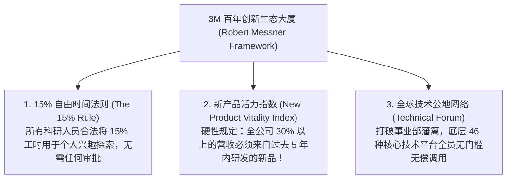

# Lec 04 管理内部创业者：上级督导的心智模型与 3M 创新机制 (Managing the Entrepreneur Inside: 3M Case)

> 授课教师：Prof. Aleksandra J. Kacperczyk & Prof. Charles Kiefer · MIT Sloan School of Management

## TL;DR

- 3M 高级实验室总监罗伯特·梅斯纳深度解构世界最强创新机器的底层制度。
- 著名的 15% 自由时间法则与“技术公地（Technical Commons）”知识流通网络。
- 上级督导在面对高度不确定性时，必须从发号施令的裁判转变为保护伞与资源协调者。
- 建立耐心资本与宽容失败机制：如何体面终结走入死胡同的项目而不挫伤骨干士气。

## 督导者的认知危机：当管理者无法预知未来时该怎么办？

在传统的管理培训与工商管理学课程中，中高层主管的角色被明确定义为“制定清晰计划、设定量化目标、分解任务并监督下属按时按质交付”。在确定性极高的成熟运营业务中，这种管理模式是极其高效的。

然而，当一位主管被委派去管理一支从事全新前沿探索的内部创业团队时，传统的心智模型会瞬间崩塌。面对前所未见的新技术与变幻莫测的新市场，下属不知道下周会发生什么，**作为上级的主管更不可能知道正确的答案是什么！**

如果此时主管依然强行要求下属每周提交一份确定性的 Gantt 排期表，并对每一次实验失败进行严厉批评，其结果就是逼迫下属彻底放弃高风险的突破性探索，退回安全平庸的温室。

麻省理工学院本讲特邀享誉全球的创新圣殿——**3M 公司高级实验室总监罗伯特·梅斯纳（Dr. Robert P. Messner）**，深度解构 3M 百年不衰的创新机制，探讨在充满极端不确定性的环境下，高级管理者应当如何重构自身的心智模式与督导行为。

::: definition 探险型督导心智模型 (Exploratory Supervisory Model)
管理者深刻承认在探索初期自身的无知与环境的不可控性，彻底放弃微观干预与命令控制，转而致力于为下属**构建高心理安全感空间、扫清跨部门行政官僚阻碍、匹配组织资源并建立基于假设验证的动态复盘机制**的领导形态。
:::

## 3M 创新大厦的三大制度支柱

梅斯纳总监指出，3M 能够在一个多世纪的时间里持续孵化出超过 60,000 种创新产品（从报事贴 Post-it、透明胶带到航天级复合材料），靠的绝不是运气，而是一套深植于组织骨髓的精密制度：

### 1. 15% 自由时间法则的神圣性
在 3M，任何一名工程师无需向任何主任或经理请示报批，有权合法动用每周 15% 的工作时间，去实验室捣鼓任何自己感兴趣但目前尚未被公司立项的古怪点子。
- 著名的“报事贴（Post-it Note）”正是诞生于此：阿瑟·弗莱（Art Fry）利用同事斯宾塞·西尔弗（Spencer Silver）发明的“一种由于粘性过弱而被传统部门视作残次品的胶水”，在 15% 自由时间里折腾出了贴在乐谱上不伤纸张的便签，最终成长为年销数十亿美元的超级现金牛！

### 2. 新产品活力指数（NPVI）的刚性倒逼
许多大公司的成熟事业部总监极度排斥创新，因为吃老本的利润率最高。3M 通过一项极其凶猛的全局考核指标粉碎了这种惰性——**新产品活力指数（NPVI）**：
- 每一个事业部每年被严格考核：**过去五年内上市的新产品所贡献的销售额，必须占到该事业部总营收的 30% 以上！**
- 如果一个总监今年业绩极其出色，但全靠十年前的老产品支撑，其 NPVI 考核立即亮起红灯，年终奖大幅削减并取消晋升资格。这一指标从根本上倒逼管理层必须持续在新业务上押注。

## 督导者的角色蜕变：从监工到“政治保护伞”

梅斯纳博士系统梳理了传统经理人与卓越创新督导者在微观管理行为上的鲜明反差：

| 管理行为维度 | 传统科层制监工 (Control-Oriented Manager) | 3M 式创新督导者 (Innovation-Oriented Sponsor) |
| :--- | :--- | :--- |
| **对待失败与延误** | 启动严厉调查问责，追究责任人过失，扣除绩效分 | 召开客观复盘会：“我们通过这次失败排除了哪种错误假设？学到了什么？” |
| **项目立项门槛** | 必须出具详尽的市场调研报告与五年财务测算模型 | 只要底层技术逻辑自洽且能做出粗糙物理原型，立即批准微型种子基金 |
| **对待跨部门越界** | 严厉斥责：“这不是你部门管的事，不要多管闲事！” | 极力鼓励跨部门技术借用，主动充当破冰船引荐其他事业部顶尖专家 |
| **对待项目的终止** | 视项目下马为耻辱与管理失败，往往引发团队恐慌 | **举行体面的“项目葬礼”**，公开表彰团队的英勇探索，将人才无损安置 |

::: insight
“如何体面地杀死一个项目，比如何立项更能考验领导者的水平”。梅斯纳指出：如果一家公司在项目宣告失败时，把项目负责人降职甚至解雇，全公司的人就会得出结论：“千万不要去搞创新，搞死一个项目自己的职业生涯就完蛋了。” 3M 的做法截然相反：**当一个勇敢探索但被证明在商业上不可行的项目被叫停时，管理层会为团队开香槟庆祝，感谢他们为公司排除了一条死胡同，并立即把这帮经受过炮火洗礼的精锐骨干调往另一个战略要地担任主管**。
:::

## 卓越管理者赋能内部创新者的行动准则

1. **充当组织的“政治减震器（Shock Absorber）”**：作为中高层主管，你的首要天职是阻断来自总部的形式主义噪音。当下属在实验室攻关时，主动替他们应付总部的例行表格与无休止的汇报，保护团队宝贵的心流带宽。
2. **制度化推行“双轨晋升制（Dual-Ladder System）”**：在组织内部确立：顶尖的技术专家可以享受与事业部副总裁完全平级的薪酬、股票与办公室待遇，无需为了追求待遇而被迫转行去做平庸的行政管理者。
3. **建立跨领域的“技术相亲会（Technical Mashups）”**：每月组织不同事业部（如医用材料与汽车内饰）的科学家在轻松的啤酒吧台站立交流。禁止宣讲 PPT，只允许展示手头最棘手的技术难题，让跨界的隐喻灵感在非正式碰撞中自发涌现。

::: pitfall
绝不要在探索初期强行给内部创业者指定“唯一的正确技术路线”！许多自负的高管总觉得自己吃过的盐比下属吃过的米多，喜欢指手画脚命令团队“必须用 A 方案，B 方案绝对行不通”。在极端前沿领域，管理者的陈旧经验往往是最致命的偏见。放手让团队去快速试错，是管理者最需要克制的权力欲望。
:::
