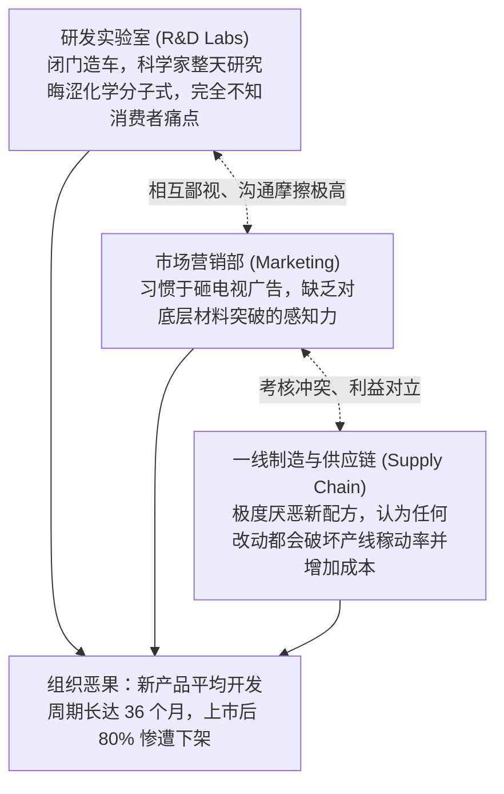
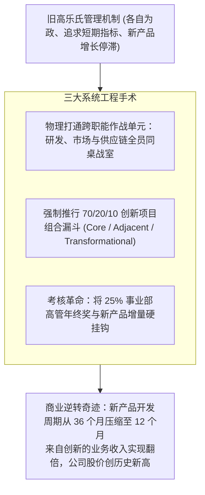

# Lec 05 大型企业组织再造与首席创新官职责：高乐氏公司逆转案例 (Enterprise Redesign & Chief Innovation Officers: Clorox)

> 授课教师：Prof. Aleksandra J. Kacperczyk & Prof. Charles Kiefer · MIT Sloan School of Management

## TL;DR

- 百年快消巨头高乐氏（The Clorox Company）通过组织深度重构打破增长停滞困局。
- 前高级副总裁兼首席创新官韦恩·德尔克博士系统拆解全企业级创新引擎再造。
- 设立专职首席创新官（CIO）并非搭建空中楼阁，而是重塑全员资源分配权力中枢。
- 将创新产出与事业部总经理薪酬强绑定，成功实现来自创新的业绩增长翻倍奇迹。

## 巨人的觉醒：传统消费品帝国的增长失速

在许多人的传统观念中，高科技企业需要创新，而生产漂白水、垃圾袋与猫砂等日用快消品（CPG）的传统消费品企业，只需要死守既有配方与大规模铺设沃尔玛货架即可安稳盈利。然而，在竞争极其激烈的现代零售红海中，缺乏创新能力的企业会迅速遭遇残酷的双重挤压：一端是宝洁、联合利华等行业巨头狂轰滥炸式的升级换代，另一端是大型连锁零售商（如沃尔玛、Costco）自有廉价贴牌白牌商品的残酷低价绞杀。

拥有百年历史的美国消费品领军企业**高乐氏公司（The Clorox Company）**，在 2000 年代初便撞上了这堵冰冷的业绩铁墙：全公司年销售额停滞在 40 亿美元上下，新产品研发周期长达数年，货架份额不断被竞品侵蚀。

麻省理工学院本讲特邀高乐氏公司前执行副总裁兼**首席创新官（Chief Innovation Officer, CIO）韦恩·德尔克博士（Dr. Wayne Delker）**亲临现场，系统拆解其如何在短短数年内彻底推倒老旧研发体系，主导全企业级组织重塑，**实现来自创新的业务增长翻倍（Doubling Growth from Innovation）**的经典商业逆转。

::: definition 企业级首席创新官机制 (Chief Innovation Officer, CIO)
不同于传统的首席技术官（CTO，主要负责具体技术栈与工程交付）或研发副总裁（R&D VP，负责实验室日常运营），首席创新官是直接向 CEO 与董事会汇报的最高战略决策核心成员。其核心天职是统筹全公司的长期创新投资组合、打通研发-市场-供应链壁垒、重塑考核激励机制并主导跨部门的颠覆性商业化进程。
:::

## 诊断痛点：为什么传统大企业的研发中心会蜕变为“技术孤岛”？

德尔克博士在走马上任之初，对高乐氏遍布全球的实验室进行了彻底的微观解剖，发现了一系列令人震惊的组织溃烂：

- **各自为政的部门深井（Silos）**：研发部抱怨市场部目光短浅、只会搞降价促销；市场部嘲笑研发部是一帮脱离商业现实的书呆子；制造工厂则本能地抵制一切新配方，因为重新清洗混合罐和调整包装机流水线会拖累工厂的当月产能考核。
- **缺乏端到端的所有权（No End-to-End Ownership）**：一个新产品概念在公司内部像皮球一样被踢来踢去，经过了十几个不同部门的审批盖章，最终上市失败时，没有任何一个人承担真正的责任。

## 德尔克的高乐氏组织再造三大重磅重组

为了彻底扭转乾坤，德尔克博士以雷霆手腕推行了三大组织结构性手术：

### 1. 设立跨职能“创新业务单元（Innovation Business Units）”
彻底砸碎过去“研发是一栋楼、市场是一栋楼”的物理与行政隔离：
- 围绕具体的核心消费场景（如家居清洁、绿色环保、水质净化），组建全功能的独立作战单元；
- 将化学科学家、工业设计师、消费者洞察专家、品牌营销总监与高级财务分析师物理编排在同一个开放战室（War Room）办公，实行统一的端到端业绩绑定。

### 2. 重塑全公司研发项目组合的“黄金配比法则”
德尔克坚决叫停了过去各事业部盲目跟风立项的混乱局面，在全公司强制推行清晰的创新项目组合漏斗：
- **70% 资源投向核心业务防御（Core）**：针对现有畅销大单品（如经典漂白水）进行包装改进与配方微调，保证短期现金流；
- **20% 资源投向相邻赛道扩张（Adjacent）**：将现有技术迁移至全新人群或新渠道（如开发针对宠物除臭的专业衍生品）；
- **10% 资源坚决投向突破性颠覆创新（Transformational）**：布局具有五年技术壁垒的绿色全天然植物基清洁品牌（如随后震撼全美的 Green Works 系列，在短短一年内拿下该细分赛道 40% 以上市场份额）。

### 3. 创新指标与事业部总经理薪酬硬挂钩
过去，事业部总经理只对当季度的营业利润负责，因此本能地压制高风险创新。德尔克联合薪酬委员会修改了全公司高管的考核公式：
- **每一位事业部负责人的年度奖金与长期期权中，有整整 25% 直接取决于其事业部“新产品贡献率与创新管道健康度”！**
- 这项举措在一夜之间改变了高管层的屁股坐向，过去拒绝创新的保守派总经理，开始主动跑到研发中心敲门求索突破性方案。

## 高乐氏变革演进与商业成效架构

通过这种利益绑定的顶层设计，高乐氏成功将创新从自下而上的孤立抗争，转变为自上而下的考核驱动与全员共识。在德尔克推行新机制之前，跨部门沟通充满内耗，各职能部门彼此推诿，新产品往往由于部门墙和排产冲突而无疾而终。

通过物理打通作战单元、强制落实项目组合配比、以及革命性地重组高管考核体系，高乐氏建立起一套闭环的创新推进飞轮。整个转型不仅从体制上扫清了创新阻碍，更直接转化为惊人的商业价值：新产品从研发到上架的周期被大幅压缩三分之二，全公司新产品销售额占比翻倍，真正验证了大企业内部再造的可行性：

## 首席创新官（CIO）成败的组织学洞察

在很多企业中，“首席创新官”往往沦落为一个只有虚名、没有实权的吉祥物。德尔克博士总结了首席创新官能够在高乐氏取得成功的制度前提：

| 组织维度 | 形式主义的失败 CIO | 拥有实权的高乐氏德尔克模式 |
| :--- | :--- | :--- |
| **汇报线与政治地位** | 向市场副总裁或人力资源汇报，属于边缘幕僚部门 | **直通 CEO 与董事会，与各核心事业部总经理平起平坐** |
| **资本预算控制权** | 手中没有任何独立预算，做任何项目都要向老业务伸手化缘 | **拥有全公司专属创新投资池的独立最终裁决与下拨权** |
| **考核杠杆有效性** | 只能提建议与办全员创新讲座，对高管薪酬无发言权 | **参与全公司高管年度考核评定，拥有创新指标一票否决权** |
| **组织赋能范围** | 局限于研发实验室的专利挖掘 | 贯穿从消费者洞察、研发配方、供应链开模到全球货架分销全链路 |

::: insight
“没有预算调配权的高管只是小丑”。德尔克直言不讳地指出：如果一家企业的 CEO 宣布设立了首席创新官或创新实验室，但没有从全公司的总预算中切出至少 10% 的独立资金归其直接支配，那么这项任命就是纯粹的公关表演。创新从来不是靠空洞的说教推动的，资源流向哪里，人才和注意力才会真正涌向哪里。
:::

## 现代大型企业推进全面组织重塑的行动心法

1. **先抓“能够速赢的低垂果实（Quick Wins）”**：在新管理团队上任的前 100 天内，挑选一两个过去被体制耽误、但技术极其成熟的边缘项目，集中火力在 6 个月内将其推向市场并取得亮眼销量。用切实的商业胜仗在全公司树立变革信心，粉碎怀疑论者的窃窃私语。
2. **建立“研发与消费者洞察的零时差通道”**：取消由市场部撰写二手调研报告转交研发的陈旧流程。强制要求配方科学家每周必须坐在单向玻璃后亲眼观察消费者使用清洁剂擦洗厨房油污的全过程，让真实的市场痛点直接刺激科学家的视网膜。
3. **敬畏供应链的“可制造性（Design for Manufacturability）”**：在项目立项的第一天，就必须把包装机械厂长拉入核心评审团队。坚决杜绝在实验室里调出完美配方、却在规模化量产灌装时导致流水线频频卡死的灾难。

::: pitfall
绝不要试图在全公司全面铺开长达数十页的繁琐创新流程手册！很多咨询顾问进入大企业后，热衷于设计充满上百个审批门径（Stage-Gate）的超重型流程，结果反而让创新的决策周期变得更加漫长。真正的组织再造是做减法：砍掉多余的审批层级，建立直接对结果负责的敏捷战室。
:::
