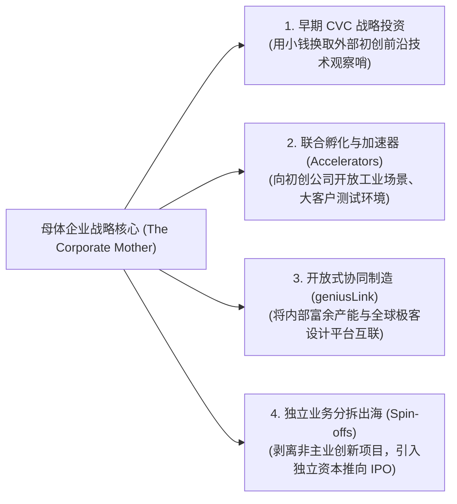

# Lec 06 业务加速成长：企业风投 CVC、分拆上市与开放式创新 (Accelerating Growth: CVC & Open Innovation)

> 授课教师：Prof. Aleksandra J. Kacperczyk & Prof. Charles Kiefer · MIT Sloan School of Management

## TL;DR

- 通用电气风险投资（GE Ventures）高管系统拆解大型企业利用外部工具加速创新的机制。
- 企业风险投资（CVC）的双重底线：在战略协同（Strategic Alignment）与财务回报间平衡。
- 分拆上市（Spin-off）与合资企业是释放非核心业务高成长潜力的解脱之路。",
- 开放式制造与平台化资源共享（GE geniusLink）大幅缩短了重工业创新周期。

## 打破围墙：企业创新的外部加速引擎

在传统封闭式研发范式下，企业坚信“所有伟大的构想都必须在自己的实验室里诞生、所有核心技术都必须由自己的全职员工开发”。然而，随着全球技术演进速率的呈指数级暴增，即使是像通用电气（GE）、西门子或英特尔这样的万亿美元工业与技术巨擘，也无法单凭内部研发跟上所有前沿领域的突破步伐。

麻省理工学院本讲联合通用电气风险投资部（GE Ventures）高级总监**史蒂夫·陶布（Steve Taub）**与 GE 开放式创新与先进制造平台负责人**迪安·芬克豪森（Dyan Finkhousen）**，深入剖析全球工业霸主如何通过**企业风险投资（CVC）、外部孵化加速器、业务独立分拆（Spin-offs）以及众包设计制造网络（geniusLink）**等外部工具箱，构建生生不息的开放式商业生态。

::: definition 企业风险投资 (Corporate Venture Capital, CVC)
成熟大型企业利用自有资产负债表上的资金，以少数股权投资的形式，直接注资并扶持外部高成长初创企业的战略金融活动。其核心诉求通常兼顾“前沿技术雷达与战略协同接入”与“资本财务增值收益”。
:::

## 外部创新工具箱全谱系架构

陶布与芬克豪森指出，成熟企业在寻求外部创新加速时，拥有一整套梯度鲜明的工具组合，切忌盲目单打一：

### 1. 战略协同 vs 财务回报：CVC 的走钢丝艺术
传统独立风险投资（IVC，如红杉或经纬）唯一的考核指标就是基金的净内部收益率（IRR）与现金回报倍数（DPI）。而企业风险投资（CVC）面临着极其复杂的**“双重底线（Dual Mandate）”**：
- **战略价值**：该初创企业的技术是否能补齐母体现有工业物联网（如 GE Predix）的技术断层？是否能为母体核心业务带来新的大单？
- **财务独立性**：如果只看战略而容忍巨额亏损，CVC 就会沦为大企业的洗钱福利部门；只有同时在财务上保持严苛的投资回报标准，才能证明被投企业在残酷市场上的真正竞争力。

### 2. 传统收购整合的“拥抱致死（The Kiss of Death）”
许多大企业看到一家极具前途的初创公司，本能的反应是“立即全资收购（100% M&A）”。然而，历史惨案反复证明：一旦将一家充满活力、崇尚极速敏捷的初创团队彻底塞进大企业的官僚体制内，强迫其使用母体的采购报销系统、参与母体漫长的早会并接受老高管的指手画脚，不出 18 个月，初创公司的创始人就会全部离职，核心代码陷入停滞，昂贵的收购最终以巨额商誉减值草草收场。

## 外部加速工具对比决策矩阵

根据外部创新的成熟度与母体核心主业的协同紧密程度，管理层应当采用不同的治理架构：

| 外部创新模式 | 股权控制度与治理结构 | 核心战略价值 | 典型适用场景 |
| :--- | :--- | :--- | :--- |
| **少数股权 CVC 投资** | 持股 5% 至 15%，通常不谋求控股，保留董事会观察员席位 | 建立前沿技术雷达，以极低试错成本观察下一代技术路线演化 | 底层技术尚处于早期概念验证阶段（如早期量子计算、固态电池） |
| **战略联盟与联合研发** | 不涉及股权或仅有极少期权绑定，签署严密的 IP 共享协议 | 优势互补：初创公司出算法与灵性，大企业出海量数据与工业机床 | 双方技术互补性极强、且都需要借力对方打破僵局的攻坚战 |
| **独立分拆上市 (Spin-off)** | 母体放弃多数绝对控制权，引入外部独立 VC 领投，团队全员全职创业 | 彻底打破母体薪酬与体制枷锁，直接对接公开资本市场高估值倍数 | 极具爆发潜力的前沿项目，但与母体传统主业存在严重战略偏离 |
| **开放式众包制造网络** | 依托数字化平台（如 GE geniusLink），按需调用全球自由专家与产能 | 极端压缩研发周期，在几周内完成原本需要两年的工业级复杂零部件打样 | 传统重工业装备的极限轻量化设计、紧急供应链断供重组 |

::: insight
“不要试图拥有所有东西”。史蒂夫·陶布在课堂上告诫所有管理者：在数字科技时代，**‘连接权（Access）’往往比‘所有权（Ownership）’更加重要**。通过持有 10% 的少数股权，你不仅与世界上最聪明的年轻创业团队结成了利益共同体，更保留了对方在车库里通宵拼命的狼性斗志；如果你强行花大钱把它买下变成一个内部事业部，你买到的只是一群领死工资、准点下班的职业打工人。
:::

## 避免 CVC 与开放创新变味走样的三大铁律

1. **坚持“快速过会与不设立排他霸王条款”**：许多初创公司极其害怕大企业的 CVC，因为大企业法务总喜欢在投资协议中加入霸道条款（如“禁止将技术卖给母体的任何潜在竞品”、“母体拥有未来绝对优先收购权”）。这种苛刻的条款会直接扼杀初创公司后续融资的能力。优秀的 CVC 必须展现出像独立 VC 一样纯粹的专业度，绝不在条款中给创业者戴上手铐脚镣。
2. **设立专职的“业务对接桥梁团队（Catalysts）”**：CVC 的成败，不在于把钱打给初创公司那一瞬间，而在于投后能否真正促成初创公司与母体核心事业部之间的真实业务协同。设立专门负责跨部门破冰的催化团队，专职解决初创公司在与大企业合作时遭遇的采购资质壁垒与回款账期拖延。
3. **保持投资决策委员会的专业独立性**：坚决杜绝让传统业务部门的总监们在 CVC 投委会中拥有一票否决权！传统业务高管由于本能的利益冲突，往往会一票否决所有可能颠覆自己部门的新兴项目。投委会必须由具备专业风投背景的合伙人、CTO 与 CEO 直接组建。

::: pitfall
绝不要把开放式创新当成“大企业的遮羞布”！很多管理层在内部创新推不动时，就热衷于花钱办几场热闹非凡的“黑客松大赛”或赞助几个大学孵化器，拍照发公关通稿宣称“我们非常开放”。如果这种外部连接无法沉淀为真实的零部件采购订单、具体的商业落地合同与实质性的资本收益，所有的狂欢都只是资本市场上的浮华肥皂泡。
:::
