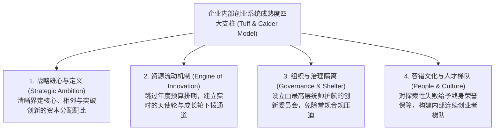
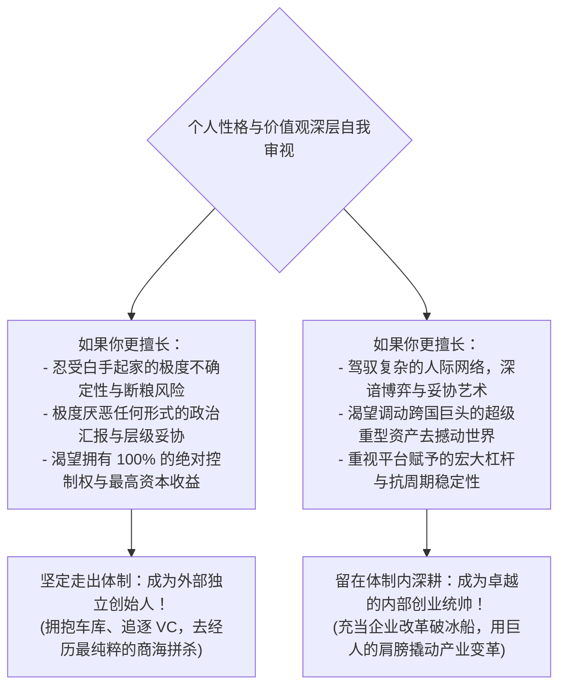

# Lec 07 构建创业友好型企业架构与个人职业规划 (Designing Entrepreneur-Friendly Architecture)

> 授课教师：Prof. Aleksandra J. Kacperczyk & Prof. Charles Kiefer · MIT Sloan School of Management

## TL;DR

- 德勤 Monitor Doblin 与 Innosight 咨询领袖系统提炼跨国巨头内部创业方法论。
- 构建“创业友好型组织架构”必须在战略意图、人才池、资源流向与文化容错上形成合力。
- 个人职业路径抉择：如何在大企业内部创业者（Intrapreneur）与外部创始人之间权衡。
- 全课程系统收敛：为技术管理者打通从战略突围到落地生根的组织创新终极心法。

## 终局之问：系统化打造“创业友好型组织”究竟是可行还是幻想？

在整门课程的探索中，我们见证了无数大企业在面对颠覆性创新时的挣扎、内耗与悲壮突围。无论是宝洁、通用电气、高乐氏还是 3M，所有企业都在试图回答同一个根本性命题：**我们能否人为地在成熟官僚母体内部，系统化、制度化地开辟出一片包容异见、鼓励冒险、并且能够持续孵化高成长新业务的‘创业友好型组织（Entrepreneur-Friendly Organization）’？**还是说，这本身就是一个反人性的乌托邦幻想？

麻省理工学院 15.369 课程的压轴讲次，特邀全球两大顶尖创新咨询机构的掌门人——**德勤 Monitor Doblin 创新咨询业务主管杰夫·塔夫（Geoff Tuff）**与**克里斯坦森创办的 Innosight 咨询合伙人奈德·考尔德（Ned Calder）**共同登台，将数十年服务全球数百家财富 500 强企业的咨询架构进行终极提炼，并为每一位面临职业选择的麻省理工学子提供深度的个人领导力发展指南。

::: definition 创业友好型组织架构 (Entrepreneur-Friendly Architecture)
成熟企业在保持主流成熟业务高效率运营的同时，在组织边界内部设计出专门为应对极高不确定性而生的子系统。该系统拥有独立的资本配置通道、自适应的里程碑评估标准、独特的非对称激励机制与崇尚敏捷试错的亚文化，能够持续吸收并孵化内部与外部的突破性创新。
:::

## 德勤 Doblin 与 Innosight 的创新成熟度诊断模型

塔夫与考尔德指出，一家企业声称自己“重视创新”毫无意义。真正的创业友好度，取决于企业在以下四大维度的底层能力建设：

### 1. 战略意图的清醒量化（Ambition Mapping）
塔夫指出，绝大多数大企业之所以搞不好内部创业，是因为缺乏“雄心地图（Ambition Map）”。管理层口头上喊着要搞颠覆，但在实际预算分配中，99% 的资金依然流向了成熟产品的微小降本。一家真正的创业友好型企业，必须在董事会层面用白纸黑字锁定：**至少 15% 至 20% 的资本支出必须直接投向可能颠覆自身现有商业模式的非共识新赛道！**

### 2. 构建免受官僚毒害的“生态绿洲（Sheltered Enclaves）”
考尔德强调，创新业务在早期必须与传统业务在物理和考核上实现绝对的“双轨制隔离”。老业务讲究零缺陷、降成本、保交付；新业务讲究极速试错、高频见客户与快速迭代。企图用同一套 KPI 手册去同时考核这两个群体，不仅会杀死新业务，还会扰乱老业务的军心。

## 15.369 全课程核心逻辑与战略框架大盘点

在全课程收敛之际，教授将七讲核心内容系统总结为一张企业内部创业实战导航图：

| 课程阶段与核心讲次 | 核心理论模型与关键概念 | 内部创业领袖的实操心法与行动法则 |
| :--- | :--- | :--- |
| **病因诊断与生存穿行** (Lec 01 - 02) | - 核心能力演变为核心刚性 - 财务折现模型 (DCF) 暴政 - 隐形探索模式与政治资本积累 | 深刻理解大企业的恐惧；用隐形探索打磨出稳定原型；将功劳主动让渡给关键中层化解阻力 |
| **严谨流程与督导机制** (Lec 03 - 04) | - 比尔·奥莱特严谨创业 24 步 - 3M 15% 自由时间法则与 NPVI - 探险型督导与体面的项目葬礼 | 绝不靠拍脑袋自嗨，必须在外部市场独立验证付费闭环；以宽容和免责充当下属的政治减震器 |
| **组织再造与外部借力** (Lec 05 - 06) | - 高乐氏 CIO 领导跨职能战室 - CVC 少数股权前沿技术观察哨 - 拥抱致死陷阱与开放式制造网络 | 设立拥有独立财务裁决权的 CIO；连接权大于所有权，用少数股权绑定天才极客的狼性 |
| **制度成熟度与职业规划** (Lec 07) | - Doblin 创新成熟度四大支柱 - 雄心地图 (Ambition Mapping) - 内部创业者 vs 外部创始人抉择 | 建立制度化保护绿洲；清醒评估自身性格特质，选择最适合自己的创新商业战场 |

::: insight
“大企业内部创业不是一场单纯的技术攻关，它是一场极高维度的社会系统工程”。塔夫与考尔德总结道：一位平庸的研发经理只懂得死扣技术参数，而一位卓越的企业内部创业领袖，能够精准洞察组织深层的权力天平、利益诉求与集体无意识恐惧。你必须既懂得如何造出不可思议的机器，又懂得如何在错综复杂的政治丛林中为这台机器开辟出一条生路。
:::

## 个人职业路线抉择指南：我该走向何方？

在课程的终点，每一位有志于投身商业创新的技术管理者，都必须严肃直面关于个人职业生涯的灵魂拷问：**我究竟适合做一名大企业内部创业者（Intrapreneur），还是去外部创办一家属于自己的独立初创公司（Entrepreneur）？**

无论你最终选择哪一条道路，麻省理工学院 15.369 课程所赋予你的严谨创新工程思维、对复杂组织系统的敬畏心以及在泥泞中坚韧不拔的推进行动力，都将成为伴随你一生的核心战略资产。去打破平庸的现状，去创造真正具备深远价值的未来！

::: pitfall
绝不要盲目把“外部创业”浪漫化，也不要盲目把“体制内创新”污名化！商业历史上没有哪一条道路比另一条更容易。外部创业者每天都在与死亡和破产赛跑，承受着非人的孤独与煎熬；而内部创业者在面对体制羁绊时所需要的耐力与政治情商，丝毫不亚于外部征战。认清自己的天性，一旦做出了选择，就全力以赴去赢得胜利。
:::
