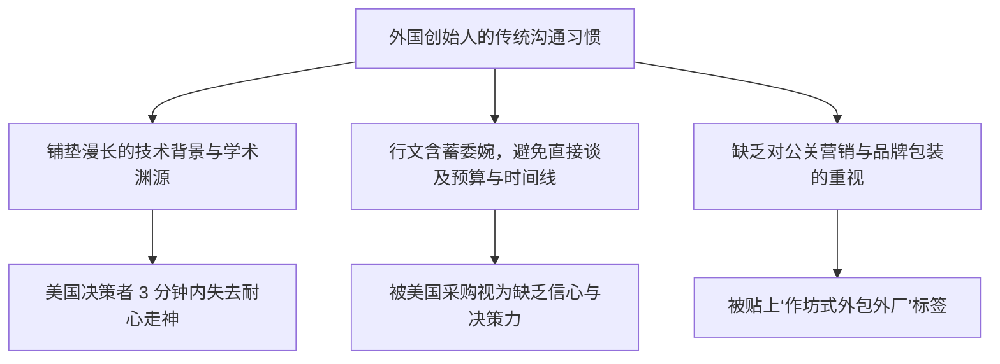

# Lec 12 跨国企业拓展美国本土市场策略 (Expanding into the U.S. Market: Tactics and Pitfalls)

> MIT 15.387 · Entrepreneurial Sales · 模块三：国际扩张与高级渠道谈判

## TL;DR

- 美国是全球规模最大、付费意愿最高但也最具毁灭性竞争烈度的 B2B 软件大市场。
- 外国初创团队进军美国的最致命误区是低估了美国一线销售代表极其高昂的人力成本。
- 必须在美国本土设立特拉华州公司，并在波士顿、纽约或硅谷建立具备决策权的前线司令部。
- 跨文化商务沟通中，必须彻底适应美国高管直接、快节奏、高度关注量化 ROI 的对话风格。

## 进军美国市场的战略重力与残酷现实

对于欧洲、以色列、亚太等地区的科技创新企业而言，美国市场是无法回避的终极修罗场。美国企业软件市场容量占全球 50% 以上，但也是全球巨头最集中的战场：

```text
[进军美国市场的双刃剑特征]
核心吸引力 (The Lure):
- 市场容量极大：单一语言、统一的商业法规大市场，天花板极高
- 付费意识极其成熟：只要能提升效率或合规，大企业愿意支付百万级年费
- 资本退出生态完善：成熟的纳斯达克 IPO 与科技巨头并购退出通道

残酷冰山 (The Hidden Perils):
- 销售人力成本极度高昂：优秀企业级销售 OTE 达 $250,000 - $400,000/年
- 诉讼与合规风险极高：专利流氓、合同纠纷与无休止的法务尽职调查
- 竞争白热化：任何细分赛道都有至少 5 家获得了上千万美元风投的硅谷竞品
```

::: definition 登陆美国市场的“双总督战术” (The Two-Pronged Command)
外国科技公司进军美国的最成功范式是：
- **总部后方（原产国）**：保留高效、成本相对受控的硬核技术研发中心与基础架构运维团队；
- **美国前线（前线实体）**：CEO 或联合创始人将全家搬迁至美国，成立独立子公司，负责市场营销、融资、战略伙伴开拓与一线客户签单。
:::

## 跨国销售沟通中的文化摩擦

外国团队在美国开展销售时常遭遇的致命水土不服：



### 美国大企业决策者的沟通潜规则
1. **开门见山（Bottom Line First）**：第一分钟必须讲清楚“你们能帮我省多少钱或解决什么问题”，技术细节留到后面谈；
2. **极速节奏与无摩擦日历对齐**：使用 Calendly 等自动化工具直接插入日程，严禁在邮件里来回推拉确认时间；
3. **客户引荐与同行推荐至上**：美国企业极其看重“你们目前正在为哪些知名美企服务”，哪怕只有一家知名美企试点，其说服力也远超数十家外国老牌客户。

::: insight
很多海外创始人认为“我们只要在美国雇几个当地猎头推荐的销售员就行了，我自己留在国内管研发”。这种模式的**失败率高达 95%**。在产品尚未完全适配美国市场前，雇佣兵销售根本无法替你完成产品迭代；创始人必须亲自坐在波士顿或旧金山的办公室里，每天亲自听美国客户的痛骂与挑剔。
:::

::: pitfall
以“外国母公司主体”直接与美国 500 强签合同。美国法务部门对跨国诉讼管辖权极其排斥，未设立美国本地主体和本地商业保险（如 E&O 职业责任险）会导致采购审批在法务部无限期搁置。
:::
