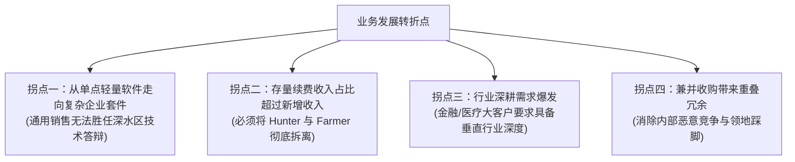

# Lec 13 销售队伍组织架构重组 (Sales Force Reorganization: Adapting to Market Shifts)

> MIT 15.387 · Entrepreneurial Sales · 模块三：国际扩张与高级渠道谈判

## TL;DR

- 当企业跨越产品生命周期、拓展新业务线或遭遇增长失速时，销售组织重组是必然选择。
- 架构调整涵盖从地理区域向垂直行业矩阵转型，以及拆分新客开拓（Hunter）与老客耕作（Farmer）。
- 销售架构调整的核心阻力在于既得利益客户的重新分配，必须设立平滑的过渡佣金补偿机制。
- 成功的变革管理要求领导层在 48 小时内完成新老领地切割，避免长期不确定性瓦解团队。

## 驱动销售组织重组的四大典型拐点

企业在不同发展阶段对销售体系的要求截然不同。Howard Anderson 指出，高科技初创企业通常会在以下四个业务转折点被迫启动销售架构重组：



::: definition 猎手 (Hunter) 与 农夫 (Farmer) 职能彻底剥离
- **猎手 (Hunter / Account Executive)**：天生渴望征服未知，专注于从零开发全新客户，拿下第一笔合同。缺点是对合同签订后的繁琐交付支持缺乏耐心。
- **农夫 (Farmer / Account Manager / CSM)**：擅长精耕细作、客户关怀与深度服务，专注于在现有客户内部挖掘二期增购、增添席位与防止流失。
:::

## 领地切割与过渡补偿（Transition Economics）的设计艺术

重组中最血腥的环节是**从老销售代表手中收回成熟客户**。如果处理不当，会引发骨干员工集体罢工抗议：

```text
[领地重新划分过渡补偿阶梯 (Commission Shadow Period)]
场景：销售代表 Alice 深耕某大区 3 年，现因架构拆分，需将其培育成熟的 5 家大客户划归垂直行业大客户组。
为化解抵触情绪，设计为期 12 个月的“影子佣金衰减过渡”：
- 前 3 个月：该 5 家客户产生的所有续约增购，Alice 依然享有 100% 原始佣金提成；
- 4 至 6 个月：Alice 享有 50% 佣金提成，新接管的行业销售享有 50%；
- 7 至 12 个月：Alice 享有 25% 提成，新接管销售享有 75%；
- 满 1 年后：客户提成 100% 彻底移交给新团队，Alice 全身心投入新拓展战区。
```

::: insight
销售重组必须像做外科手术一样**快、准、狠**。在全体销售大会上宣布重组方案后，必须在 48 小时内将所有 CRM 权限、客户名录分配与新 Quota 条款一次性调整完毕。拖延谈判一周，团队就会浪费一个月的时间沉迷于私下串联与抱怨。
:::

::: pitfall
在重组方案中实行“双向模糊核算”，让两个不同部门的销售代表共同享有同一单提成且责任边界不清。这不仅会导致佣金成本失控翻倍，更会在项目出现交付事故时导致互相推诿。
:::
