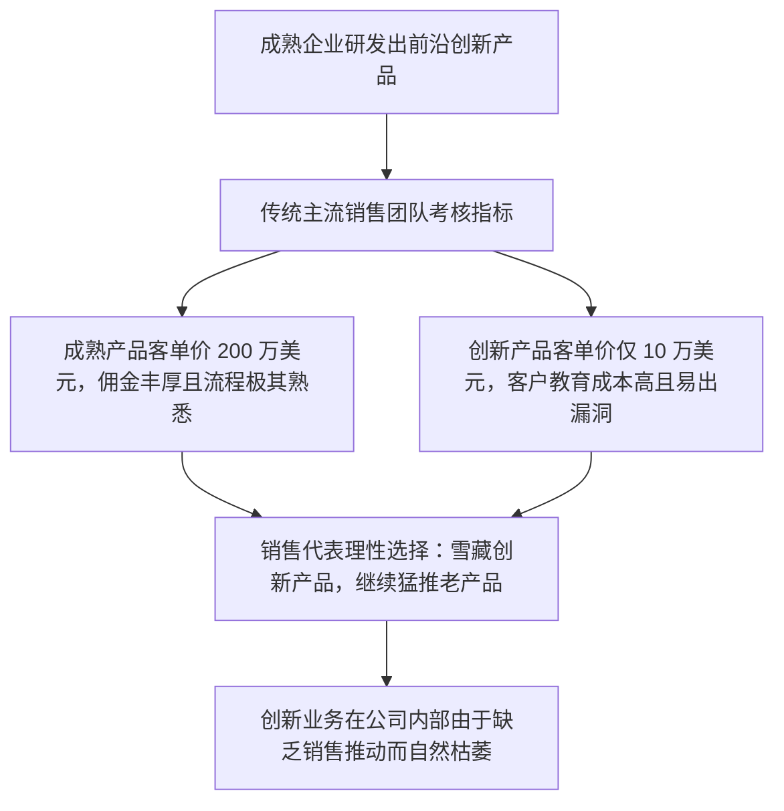

# Lec 15 大型企业内部销售人员管理 (Managing Sales Teams in Large Established Corporations)

> MIT 15.387 · Entrepreneurial Sales · 模块三：国际扩张与高级渠道谈判

## TL;DR

- 大企业内部的销售管理不仅是对外开拓市场，更是一场高度复杂的跨部门政治资本运作。
- 在成熟公司内部推进创新产品销售，必须面对主流产品线既得利益部门的隐性抵制。
- 设立独立的“特种部队孵化销售组”，使新产品销售脱离传统大盘考评指标的束缚。
- 掌握跨越法务、合规、财务与交付部门的横向影响力，是企业级销售高管的核心功力。

## 大企业内部销售的特殊挑战：官僚阻力与内部竞争

与初创企业“一人说了算”的敏捷不同，成熟巨头（如 IBM, Cisco, Oracle）内部推行新产品销售时，最大的敌人往往不是外部竞品，而是**企业内部的官僚系统**：

::: definition 组织内部的“销售资源黑洞”
当一家公司有 90% 的现金流来自传统老旧产品时，即使 CEO 在年会上高喊转型，一线销售代表依然会把 99% 的拜访时间留给老产品。因为销售人员是依靠每季度的佣金支票还房贷的，没有人愿意拿自己的家庭收入冒险去当创新实验的牺牲品。
:::

## 成功激活内部创新销售的制度解药

成熟企业若要成功推进新产品销售，必须在组织架构与激励体系上设立防火墙：

1. **组建垂直孵化销售特种兵（Specialized Overlay Team）**：
   - 选拔一批富有探索精神的资深销售代表，其 KPI **100% 仅挂钩创新产品的成单量**，与传统老产品彻底脱钩；
   - 给予特种销售直接向高级副总裁或 CEO 汇报的绿色通道，免除繁琐的多层级审批。
2. **推行“双重计提激励（Double Commission Credits）”**：
   - 当区域老销售把存量客户介绍给创新特种组并促成签约时，老销售和创新销售均可获得 100% 全额业绩计提；
   - 用超额激励消除传统销售对新产品“蚕食自身存量额度”的敌意。
3. **设立法务与合规豁免试验区**：
   - 为前 20 家创新产品客户设立轻量版标准合同模板，缩短法务部门长达半年的常规合规审查流程。

::: insight
在成熟企业内部推销新产品，本质上是一场**对内说服的政治攻坚战**。优秀的销售管理者必须在公司内部积累充裕的政治资本，懂得何时向财务申请特殊折扣审批、何时拉拢交付主管提供 VIP 保障，为一线团队扫除内部羁绊。
:::

::: pitfall
用考核老产品的利润率标准去硬套新产品的早期销售。在创新业务初期强求 40% 的营业净利润率，会直接扼杀销售代表通过降价促销建立早期市场占有率的所有战略空间。
:::
