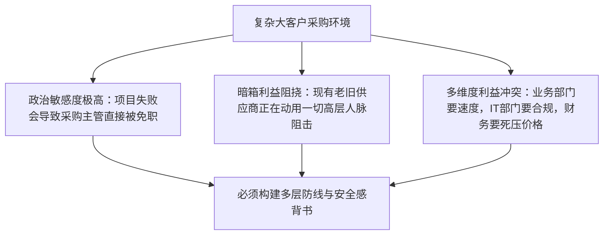

# Lec 16 复杂高风险销售情境破局 (Complex Sales Situations: Multi-Stakeholder Navigation)

> MIT 15.387 · Entrepreneurial Sales · 模块四：现代工具、模式演进与全景复盘

## TL;DR

- 高风险复杂销售的特征是客单价极高、影响业务命脉且伴随激烈的组织政治站位。
- 在面对竞争对手恶意造谣恐吓（FUD 策略）时，必须通过第三方公证测试与铁证标杆予以还击。
- 掌握客户内部权力结构图（Power Map），识别拥有非正式隐形影响力的“影子决策者”。
- 设立阶梯式让步策略（Concession Strategy），绝不在没有换取对等商业利益的情况下单方面降价。

## 复杂高风险交易（High-Stakes Deals）的三大深层特征

当一笔订单金额突破百万美元时，采购决策已经脱离了单纯的“好不好用”的技术范畴，而转变为一场涉及各部门高管政治前途的博弈：

::: definition 恐惧、不确定性与怀疑策略 (FUD Strategy)
行业在位巨头面对初创挑战者时最惯用的防守阴招：
- **Fear (恐惧)**：“他们是一家账面资金只剩几个月的小创业公司，万一明年破产倒闭，谁来给你们维护核心系统？”
- **Uncertainty (不确定性)**：“他们的方案还没通过全行业最严苛的百万级并发测试，你们敢拿公司的业务核心做实验吗？”
- **Doubt (怀疑)**：“买 IBM/甲骨文没人会被解雇（Nobody ever got fired for buying IBM）；但买了初创软件出了事，责任全在你们！”
:::

## 破局 FUD 进攻的反制武器库

初创企业在面对巨头的 FUD 攻击时，切忌陷入无谓的口水战，必须拿出以下三张王牌：

1. **出资设立第三方托管与代管信托（Source Code Escrow）**：在合同中承诺，若初创企业倒闭，客户可无偿接管全套源代码并由第三方机构继续维保。
2. **点对点客户参访（Reference Calls with Peer CXOs）**：安排客户高管与已经稳定使用一年的同行业头部标杆客户 CTO 闭门共进午餐，用同行的真实口碑打消恐惧。
3. **分阶段试点与无风险退出条款（Phased Rollout with Kill-Switch）**：设计三期实施路径，首期仅在非核心部门试运行 30 天，若达不到预设指标允许全额退还软件款，将决策者的个人政治风险降至零。

::: insight
在复杂谈判中，**让步必须是有条件的交易**。如果客户要求降价 15%，你千万不能立刻满口答应（这证明你之前的报价充满水分）；你必须严肃回应：“如果您愿意将付款账期从 90 天缩短到 15 天，或者允许我们发布联合新闻稿并充当行业灯塔案例，我们可以向董事会申请这一特殊折扣。”
:::

::: pitfall
把全部希望押注在单一的内部支持者身上。如果在漫长的销售周期中，你唯一的内部联系人突然被调岗或离职，整笔推进了半年的百万级大单将瞬间化为泡影。
:::
