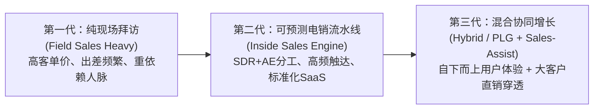

# Lec 17 现代销售模型的演进：从现场到协同 (Evolution of a Sales Model: From Field to Hybrid)

> MIT 15.387 · Entrepreneurial Sales · 模块四：现代工具、模式演进与全景复盘

## TL;DR

- 现代企业级销售模型经历了从传统纯现场拜访、纯内部电销到混合协同销售（Hybrid Model）的范式演进。
- 边缘分析（Edge Analytics）实战案例展现了硬件、边缘算法与云端多层架构下的销售模式跃迁。
- 销售模型必须与产品复杂度、客单价及客户采纳阻力实现严格的动态匹配。
- 结合产品驱动增长（PLG）与销售辅助（Sales-Assist）能够以最低获客成本引爆大企业内部自下而上的裂变。

## 销售模型演进的历史光谱

随着企业数字化基础设施的成熟，B2B 销售模型在过去三十年间完成了三次重大跨越：

| 维度对比 | 第一代：传统大客户直销 | 第二代：标准内部电销 | 第三代：混合协同驱动 (Hybrid) |
| :--- | :--- | :--- | :--- |
| **主要触达方式** | 频繁出差跨国现场拜访、高尔夫与豪华晚宴 | 全天候电话、群发邮件与标准化 Web 演示 | 线上自测试用 + 关键决策节点高管现场会晤 |
| **销售转化动力** | 强关系型推销与高层关系运作 | 结构化外呼节奏与高频话术推进 | 终端用户口碑自发蔓延 + 销售进场促成企业级签约 |
| **获客成本 (COCA)** | 极高 ($30,000 - $100,000) | 中等 ($3,000 - $10,000) | 极低至中等 (自下而上漏斗大幅稀释获客成本) |

## 经典实战追踪：边缘分析公司（Edge Analytics）的渠道破局

课堂深入追踪了工业智能初创企业 **Edge Analytics** 的销售演进历程：
- **初期的困境**：作为一家提供边缘工业振动分析的高科技团队，早期试图让销售代表向工厂厂长兜售昂贵的整套分析软件，遭遇了漫长的 9 个月采购周期与冷淡拒绝；
- **销售模型的进化**：团队转而提供即插即用的低成本无线振动传感器盒子，允许车间设备维修主管免费试用 2 周；
- **协同收网**：当传感器成功预警了一起价值百万的轴承过热事故后，维修工主动向厂长极力推荐。此时内部大客户销售（AE）立刻切入，直接向上游工厂高层签署全厂 500 台设备的年度企业级监控大单。

::: insight
现代 B2B 销售的最高境界是**让客户觉得是他们自己发现了宝藏，而不是被销售员推销了产品**。通过极简的终端试用体验打动一线操作人员（底端包围），再由专业销售切入顶层经济决策人促成集团采购（顶端收网），这是颠覆在位巨头的最强组合拳。
:::

::: pitfall
在极低客单价（如年费几百美元）的产品上配置昂贵的现场直销人员。这种单位经济学倒挂会导致公司每新增一个客户都在扩大净亏损，迅速走向破产。
:::
