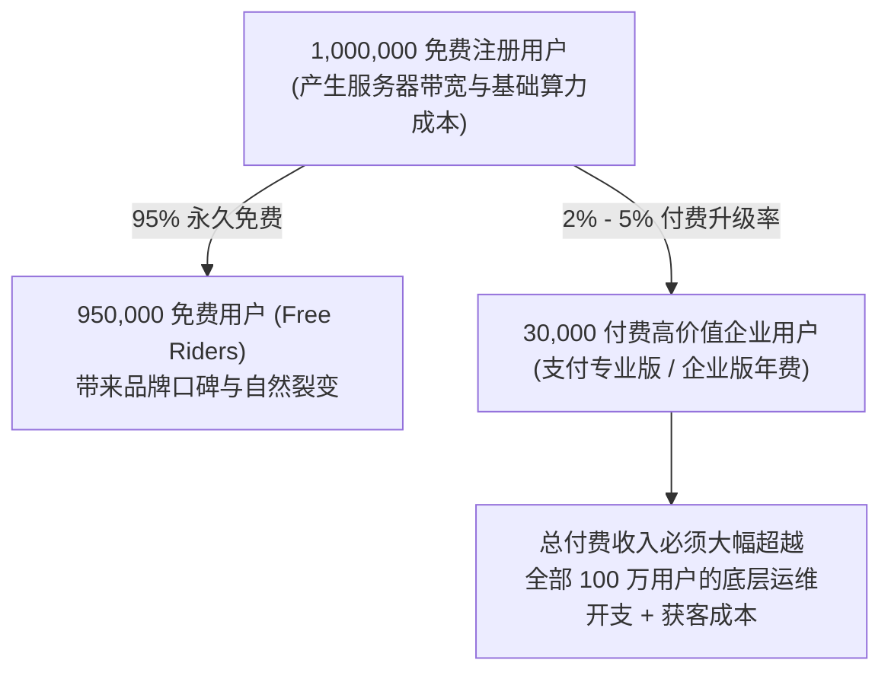

# Lec 18 免费增值（Freemium）商业模式与转化 (Freemium Business Models: Funnel and Monetization)

> MIT 15.387 · Entrepreneurial Sales · 模块四：现代工具、模式演进与全景复盘

## TL;DR

- 免费增值（Freemium）通过永久免费的基础功能极速做大漏斗顶端，以低边际成本完成市场教育。
- 典型的 Freemium 转化率通常仅在 2% 至 5% 之间，因此底层必须拥有极其庞大的活跃用户池。
- 免费与付费功能之间的“功能切割线（Paywall Trigger）”设计是决定变现效率的生死线。
- 防范“免费寄生虫（Free Riders）”过度侵蚀服务器算力与客服支持资源。

## 免费增值（Freemium）的经济学生存公式

Freemium 模式（Free + Premium）打破了传统企业软件必须先签单后使用的门槛。然而其背后的数学逻辑极为苛刻：

::: definition 免费增值模式的核心指标体系
- **免费转付费率 (Conversion Rate)**：
  $$	ext{Conversion Rate} = rac{	ext{付费订阅客户数}}{	ext{总注册活跃用户数}} 	imes 100\% \quad (	ext{行业健康区间: } 2\% - 5\%)$$
- **单免费用户月度服务成本 (Cost to Serve a Free User)**：必须严格控制在极微小的金额（如每月低于 $0.05），否则庞大的免费用户群将拖垮初创公司现金流。
:::

## 收费切割线（The Paywall / Feature Gate）的四大切分逻辑

如何让免费用户心甘情愿掏钱升级为付费客户？功能边界切分策略：

1. **容量与使用额度门槛（Usage Limits）**：
   - 免费版提供 5GB 存储空间或每月 1000 次 API 调用；超出后必须购买商业版（如 Dropbox, GitHub）。
2. **企业级协作与安全合规（Enterprise Features）**：
   - 个人使用完全免费，但若需要“单点登录（SSO）”、“审计日志跟踪”、“角色权限精细控制（RBAC）”，必须升级至企业版（如 Slack, Notion）。
3. **团队协作规模限制（Team Size Cap）**：
   - 1 至 5 人小团队免费使用；一旦第 6 位成员加入协作，全员启动按人头收费。
4. **高级分析与自动化报表（Advanced Analytics）**：
   - 基础数据查看免费，高级自定义分析、导出多维报表与第三方 ERP 集成收取高昂费用。

::: insight
设计免费增值功能时最容易犯的错误是**把免费版做得太好太完整**。如果免费功能已经能够满足 98% 用户的所有日常需求，用户没有任何经济动力掏钱包。免费版必须让用户“爱不释手，但在业务规模扩大时感到隐隐作痛”。
:::

::: pitfall
为免费用户提供人工客服支持。如果初创公司的技术支持人员每天都在为不花一分钱的免费用户排查琐碎问题，付费客户的满意度将大幅跳水，公司将迅速陷入恶性亏损。
:::
