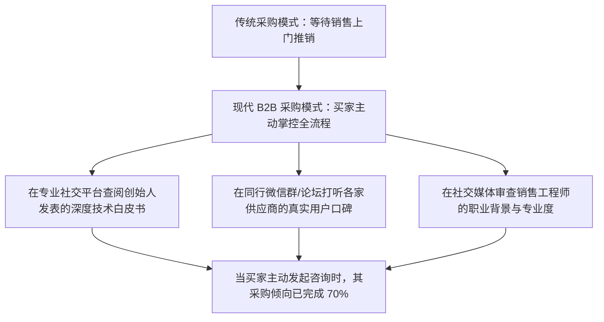

# Lec 19 社交媒体时代的 B2B 社交销售 (Selling in the Age of Social Media: Social Selling)

> MIT 15.387 · Entrepreneurial Sales · 模块四：现代工具、模式演进与全景复盘

## TL;DR

- 现代 B2B 买家在接听销售电话前，平均已通过社交网络和行业社群完成了 60% 的自主调研。
- 社交销售（Social Selling）的核心是通过行业专业洞见（Thought Leadership）树立专家人设与信任背书。
- LinkedIn（领英）等职业社交网络是穿透大企业多层级采购决策链的超精准制导武器。
- 社交销售的精髓在于“先贡献价值与见解，再展开商务接洽”，严禁群发冷冰冰的推销垃圾私信。

## 数字化采购决策时代的客户行为范式转移

传统电话陌生推销（Cold Calling）的接通率在过去十年间已骤降至不足 2%。大企业决策者不再愿意接听陌生推销电话，而是通过社交网络与同行社群主动搜寻解决方案：



::: definition 社交销售指数 (Social Selling Index, SSI)
衡量销售专业人员在数字化社交网络中建立商业影响力、寻找对口决策人、输出高价值内容并维系信任关系的量化评估体系。
:::

## 打造个人思想领袖（Thought Leadership）的实战路径

在社交媒体上，销售代表不能充当无聊的企业通稿复读机，而必须化身为**垂直行业领域的咨询专家**：

```text
[B2B 社交销售高转化内容配比黄金法则 (4-1-1 Rule)]
每周在职业社交网络发布 6 条动态，配比结构如下：
- 4 条行业前沿深度干货 (Industry Insights):
  分享行业最新白皮书解读、生产线故障排查技巧、技术避坑指南，零广告痕迹
- 1 条标杆客户落地复盘 (Case Study):
  以客观中立口吻拆解某行业龙头如何化解停机风险，突出客户主角形象
- 1 条软性商业互动引流 (Soft Pitch):
  邀请参加线上闭门研讨会或领取最新设备健康度自测模板
```

### 穿透企业高管的私信沟通准则
1. **深度个性化调研（Hyper-Personalization）**：在私信前必须研读目标决策人最近发表的演讲、点赞动态或公司新闻，寻找自然的对话切入点；
2. **引发同行共鸣，不推销产品**：“王总，拜读了您最近关于智能制造换模瓶颈的采访，我们在与长城汽车合作时也遇到了类似问题，这是我们总结的实测对比报告，或许对您有参考价值”；
3. **低压力互动**：不强求对方立刻安排会议，先建立专业信任连接。

::: insight
社交销售不是在社交平台上群发推销垃圾邮件。最高级的社交销售是**吸引客户主动向你提问**。当你在行业圈子里持续输出极高水准的专业分析时，面临痛点的客户高管会主动私信你：“请教一下，你们针对这个问题有什么成熟方案吗？”
:::

::: pitfall
让销售代表在社交平台上疯狂使用自动化机器人脚本批量添加好友并秒发群发推销广告。这种粗暴行径会瞬间摧毁个人与企业的专业声誉，并极易导致社交账号被官方封禁。
:::
