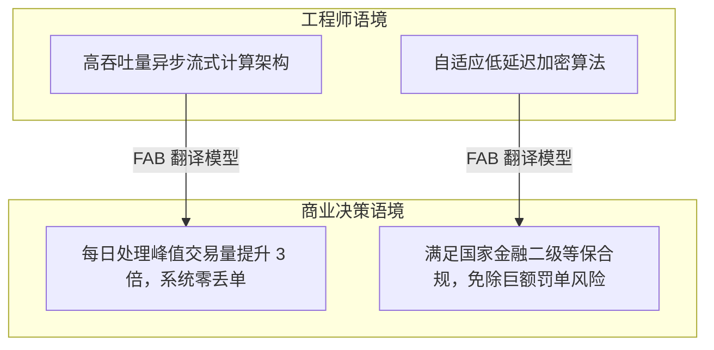

# Lec 2 复杂销售全流程与产品知识转化 (The Sale and Product Knowledge Transformation)

> MIT 15.387 · Entrepreneurial Sales · 模块一：销售基石与客户接洽

## TL;DR

- B2B 复杂销售的核心是从“讲解产品技术参数”彻底转向“翻译商业财务价值”。
- 复杂销售流程分为接触、痛点诊断、方案演示、商务谈判、合规审查与履约六大阶段。
- 特征-优势-利益（FAB）框架是连接工程师思维与企业高管决策的关键工具。
- 绝不在客户没有明确承认存在痛点并表达解决紧迫性前过早展开产品 Demo。

## 从“工程师自嗨”到“商业价值翻译”

技术出身的创业者在见客户时最常犯的错误，是一坐下来就打开 50 页 PPT 讲解架构图、微服务组件和算法收敛速度。大企业业务主管只关心三个核心问题：
1. **这能帮我增加多少营业收入？**
2. **这能帮我削减多少运营成本与人头开支？**
3. **这能帮我规避何种灾难性的监管合规处罚？**

::: definition FAB 价值转换模型 (Feature-Advantage-Benefit)
- **Feature (产品特性)**：客观存在的技术参数（如“系统采用 AES-256 硬件加密芯片”）。
- **Advantage (产品优势)**：相比竞品的功能差异（如“数据加密处理延迟低于 5 微秒”）。
- **Benefit (客户利益)**：对客户财务与业务的终极价值（如“确保产线高频交易零等待，每年直接挽回 200 万元超时扣款”）。
:::

## 复杂企业级销售的六大阶段推进模型

复杂销售的周期通常在 3 到 12 个月之间，涉及多部门协同：

| 阶段序号 | 阶段名称 | 核心里程碑 | 客户方参与角色 |
| :---: | :--- | :--- | :--- |
| **Stage 1** | **初次接触与资格审查 (Qualification)** | 确认客户属于理想客户画像（ICP），存在明确痛点 | 业务主管、一线操作员 |
| **Stage 2** | **深度痛点诊断 (Discovery & Diagnosis)** | 量化现有流程损失，摸清客户内部年度预算与采购时间点 | 业务经理、倡导者 (Champion) |
| **Stage 3** | **量身定制方案演示 (Solution Presentation)** | 仅展示解决其痛点的核心模块，敲定概念验证（PoC）标准 | 部门总监、技术专家 |
| **Stage 4** | **概念验证与价值确认 (PoC & Validation)** | 在客户测试环境实测通过，达成预设量化指标 | IT 安全主管、一线工程团队 |
| **Stage 5** | **商务与合同谈判 (Proposal & Negotiation)** | 敲定付款周期、折扣阶梯、SLA 运维与知识产权归属 | 采购部、法务合规部、CFO |
| **Stage 6** | **签约打款与客户成功 (Closing & Onboarding)** | 签署首期合同，启动实施培训，跟进首付款到账 | 项目交付经理、最终用户 |

::: insight
优秀的销售代表在初次拜访中 80% 的时间是在倾听与提问，只有 20% 的时间在说话。通过层层追问（“这个问题如果下季度依然无法解决，对您部门的年终考评会有什么直接影响？”），让客户自己亲口把痛点的严重性与财务损失算清楚。
:::

::: pitfall
在客户还没承认自身有痛点时就强行展示 Demo。过早的产品展示会过早暴露系统当前界面的不成熟，并过早将对话拉入琐碎的按钮细节争论中，失去对宏观商业价值的把握。
:::
