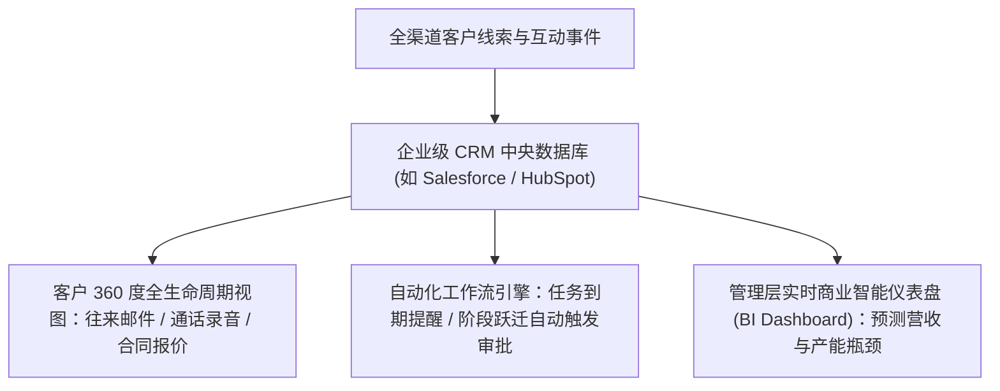

# Lec 20 客户关系管理（CRM）系统与销售赋能 (Using Customer Relationship Management Software)

> MIT 15.387 · Entrepreneurial Sales · 模块四：现代工具、模式演进与全景复盘

## TL;DR

- 客户关系管理（CRM）系统是现代销售组织的中央数据库与神经中枢系统。
- CRM 不是用来监视销售员行踪的考勤机，而是用来梳理客户资产、沉淀销售知识的赋能平台。
- 保持“管道数据卫生（Pipeline Hygiene）”是确保管理层做出正确业务决策与资源配置的前提。
- 未录入 CRM 系统的客户互动在商业管理视角下等同于从未发生。

## CRM 系统的本质：从个人手记到组织资产

在初创企业早期，销售员往往把客户名片、电话记录与谈判备忘保存在个人笔记本或微信聊天记录中。这种作坊式做法存在巨大隐患：一旦销售代表离职，公司的全部客户历史与商务线索将瞬间蒸发。



::: definition 销售管道卫生度 (Pipeline Hygiene)
CRM 中所记录的所有商机阶段、预计关单金额、关闭日期与决策进展的真实性、及时性与准确度。
- **僵尸商机 (Stale Deals)**：超过 30 天无任何实质进展却依然停留在系统中的商机，必须坚决予以关停归档（Closed Lost），严防虚假繁荣。
:::

## 成功推行 CRM 系统的三大管理铁律

销售员天生讨厌填写繁琐的表单。Howard Anderson 强调，必须通过制度设计确保系统落地：

```text
[CRM 落地三大核心法则]
1. 黄金法则：没进 CRM 就等于没发生 (If it isn't in CRM, it didn't happen)
   - 任何未在系统报备的合同，公司坚决不予结算提成佣金；
   - 任何跨部门资源调配（如申请架构师出差支持），必须以 CRM 商机记录为依据。
2. 极简原则：精简必填字段，降低一线录入摩擦
   - 砍掉所有官僚主义的无用字段，早期阶段每个商机阶段只需填报 3-5 个核心硬事实；
   - 整合手机端移动应用与语音输入，让销售员在出租车上 1 分钟完成跟进备忘。
3. 赋能原则：让系统真正帮销售员多赚钱
   - 自动化生成精美标准化报价单（CPQ），自动追踪客户是否打开了邮件附件；
   - 提醒销售员哪些久未联系的老客户即将迎来年度续约续订窗口。
```

::: insight
CRM 系统的真正所有者是**企业法人而非销售个人**。建立起强大的 CRM 数据沉淀后，即使销售代表发生流动，新接手人员可以在 10 分钟内完整调阅过去 2 年该客户与本公司的每一次技术沟通、异议争议与合同折扣历史，实现无缝接力。
:::

::: pitfall
管理层把 CRM 变成了冷冰冰的微观监控工具，要求销售员每半小时打卡一次。这会激起一线团队的强烈抵触，导致销售员开始用虚假的模板数据应付系统，彻底污染整个数据库。
:::
