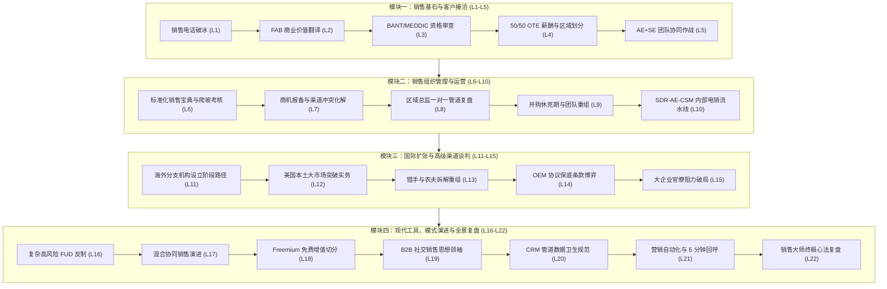

# Lec 22 课程复盘与销售战略全景 (Course Wrap Up: Entrepreneurial Sales Synthesis)

> MIT 15.387 · Entrepreneurial Sales · 模块四：现代工具、模式演进与全景复盘

## TL;DR

- 创业销售是一门高度理性、由数字与流程驱动的工程学科，是贯穿企业生死的绝对底层能力。
- 完整贯通从 Cold Call 破冰、痛点诊断、DMU 利益对齐、薪酬激励到国际化扩张的 22 讲知识网络。
- 伟大创始人的本质是具备卓越同理心、深谙商业现实并拥有不可动摇决心的首席销售员。
- 带着科学的销售流水线纪律与崇高的客户价值信仰，去前线夺取属于你的胜利。

## 15.387 课程四大核心模块知识网络全景

在 15.387 的最后一讲，Howard Anderson 带领全班同学串联复盘了贯穿整学期的企业级战略销售体系：

在本课程的教学设计中，四大模块构成了环环相扣的闭环链条。第一模块帮助技术创业者跨越心理恐惧，掌握商业价值翻译与双向协同战术；第二模块帮助管理者搭建标准化打法手册、设计合理的薪酬激励并防范渠道冲突；第三模块带领企业走向跨国扩张，直面海外实体设立与 OEM 谈判深水区；第四模块则将销售带入智能化与自动化时代，借助现代 CRM 与营销技术飞轮实现可规模化的收入增长。

通过这种循序渐进的系统训练，创业者能够建立起端到端的销售战略全局视野，从而在复杂残酷的市场竞争中始终掌握主动权。

从最初面对冷冰冰的电话号码本勇敢拨出第一通破冰致电，到学会运用 FAB 模型将复杂的底层技术翻译为客户 C-Level 高管能够听懂的财务回报；从在内部建立严密的 50/50 OTE 薪酬与区域划分体系，到协同售前架构师攻克跨国 500 强客户的政治防线；再到驾驭国际化子公司设立、规避 OEM 谈判陷阱以及用 CRM 与营销自动化赋能全员，这套课程构筑起了一套完整的现代化企业级销售科学。

值得注意的是，这四大模块并非孤立存在的静态知识点，而是在企业日常运营中每日发生高频互动的动态系统。例如，前线 SDR 在电话破冰中收集到的最新客户异议，会即时反馈至销售宝典进行更新；而 CRM 系统中沉淀的成单周期数据，又会反哺区域总监的季度业绩预测与佣金政策调整。这种数据与认知的双向循环，才是现代销售铁军生生不息的动力源泉。

贯穿整门课程的四大核心模块逻辑演进脉络如下图所示：

这一全景架构表明，优秀的销售体系从来不是偶发的灵感闪现，而是一台精密咬合的工业齿轮组。每一个环节的输入输出都有明确的量化标准，每一个阶段的跃迁都有严谨的事实支撑。正是这种工程化的严密性，让初创企业能够在极端残酷的市场竞争中杀出重围。

## 顶尖销售大师的三大终极心法

走出课堂踏上真实商业征程时，每一位创业者应当牢记的底层心法：

销售体系的系统化建设是企业跨越早期死亡之谷的决定性工程。在许多科技初创企业中，技术团队往往误以为只要代码足够优秀，客户就会自发涌入并主动刷卡。然而，15.387 课程反复证明：在企业级复杂交易的深水区中，没有经过严格训练的销售铁军与清晰的渠道战略，再精妙的技术也会被阻挡在客户漫长的采购审批、安全审查与既得利益防线之外。

从销售代表个人技能的淬炼，到区域组织与薪酬体系的设计，再到全球化子公司设立与现代数字化工具赋能，销售能力构成了初创企业将技术专利转化为真实商业现金流的不可或缺的变压器。

### 1. 销售是最高级别的“利他主义”
- 平庸的销售试图从客户口袋里掏钱；卓越的销售致力于帮客户创造巨大价值并解决其切身痛苦。当你真正帮一家企业挽回了数百万元损失或帮助某位部门总监获得了晋升，成交只是水到渠成的自然回报。

### 2. 拥抱“拒绝”作为统计学规律
- 在企业级销售中，90% 的客户最终会因为各种预算或内部原因说“不”。顶尖销售代表从来不会把拒绝视为个人耻辱，而把每一次拒绝视为排除了一个错误选项并逼近下一个“好”字的必经统计样本。

### 3. 创始人永远是首席销售官（CSO）
- 即使未来公司估值达到数十亿美元、拥有数百人规模的专业销售团队，创始人依然必须定期深入销售前线拜访客户。只有泡在客户一线的创始人，才能保持对市场风向的最敏锐嗅觉，带领企业永远走在时代的最前沿。

::: insight
世间最强大的力量，是将**天才的工程师头脑**与**坚韧不拔的销售铁军纪律**融合于一身。当你既能写出改变世界的底层代码，又能敲开财富 500 强大楼的大门将价值讲得清清楚楚时，你将在这个世界上所向披靡。
:::
