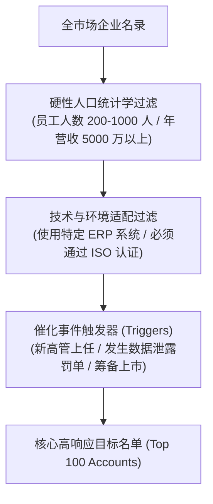

# Lec 3 潜在客户勘探与线索挖掘 (Sales Prospecting and Lead Qualification)

> MIT 15.387 · Entrepreneurial Sales · 模块一：销售基石与客户接洽

## TL;DR

- 线索勘探（Prospecting）是决定整个销售漏斗吞吐量与健康度的源头活水。
- 理想客户画像（ICP）必须包含企业规模、技术栈契合度、行业痛点与关键事件触发器。
- 运用 BANT 与 MEDDIC 资格审查模型，迅速甄别出虚假意向与无法成单的垃圾线索。
- 自动化工具与精准人脉网络的有机结合能够将外向拓客效率提升 3 倍以上。

## 理想客户画像（ICP）的精密圈定

面对全市场上万家潜在企业，初创企业若漫无目的地扫楼式拓客，不仅成本极高，而且会迅速耗尽团队士气。必须制定明确的 **理想客户画像（Ideal Customer Profile, ICP）**：

::: definition 触发事件 (Trigger Events)
大企业做出采购变革往往不是由常规需求引发，而是由外部**催化事件**强力驱动：
1. **新高管履新**：新上任的 VP 或总监急于在百日内证明业绩改革，最具采购新系统的冲动；
2. **监管罚单或合规新规颁布**：强制性的法规整改使得采购变得不可推卸；
3. **重大竞品发布或公关危机**：迫使管理层必须在短期内拿出应对方案。
:::

## 经典线索资格审查框架：BANT vs. MEDDIC

在线索初步进入销售漏斗后，销售员必须在第一轮电话中进行严格的资格审查，避免将资源浪费在无预算、无权力的非客户身上：

| 评估维度 | BANT 框架 (传统通用销售) | MEDDIC 框架 (高阶企业级复杂销售) |
| :--- | :--- | :--- |
| **核心要素 1** | **Budget (预算)**：是否有明确的资金额度？ | **Metrics (可量化指标)**：客户希望达成的具体 ROI 数字是多少？ |
| **核心要素 2** | **Authority (权力)**：接洽人是否具有拍板权？ | **Economic Buyer (经济决策人)**：控制预算资金并最终签字的人是谁？ |
| **核心要素 3** | **Need (需求)**：业务痛点是否真实且迫切？ | **Decision Criteria (决策标准)**：客户从哪些技术与商业维度评估方案？ |
| **核心要素 4** | **Timeline (时间线)**：是否有明确的采购上线倒计时？ | **Decision Process (决策流程)**：内部法务、安全与招投标流程怎么走？ |
| **核心要素 5** | - | **Identify Pain (识别深层痛点)**：该问题导致的具体组织与财务伤害 |
| **核心要素 6** | - | **Champion (内部倡导者)**：谁在内部极力推进并替你扫清障碍？ |

::: insight
线索挖掘中最宝贵的素质是**果断淘汰线索（Disqualifying Leads）**的勇气。初级销售员常常沉迷于与态度极好、每次都会热情接待的年轻工程师长谈数月，却迟迟不敢问对方是否有预算审批权，最终陷入时间黑洞。
:::

::: pitfall
混淆“兴趣”与“意向”。很多大企业研发人员喜欢约初创公司做技术交流以“开阔眼界”，但若对方没有面临具体的业务考核压力与明确的采购时间节点，这种交流对创业公司毫无商业价值。
:::
