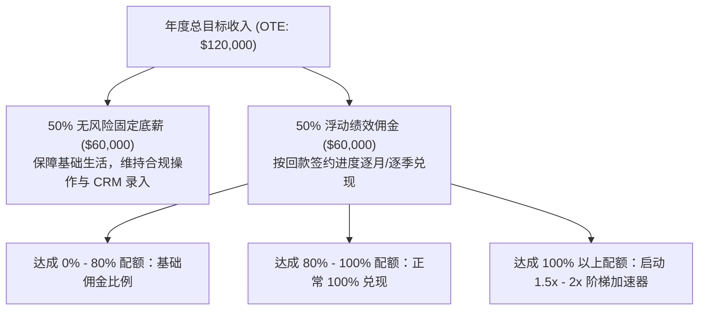

# Lec 4 销售区域划分、定额与激励薪酬 (Setting Sales Quotas, Territories, and Compensation)

> MIT 15.387 · Entrepreneurial Sales · 模块一：销售基石与客户接洽

## TL;DR

- 销售人员的薪酬结构决定了其日常行为偏好；错误的薪酬设计会直接毁掉初创战略。
- 行业标准销售薪酬结构为 50/50 OTE（底薪与浮动佣金各半），年度业绩配额为 OTE 的 4 至 5 倍。
- 销售区域划分必须平衡客户密度、行业属性与历史潜力，避免“旱涝不均”挫伤团队士气。
- 引入阶梯超额提成（Accelerators）以激发顶级销售代表冲刺天花板的爆发力。

## 销售薪酬方案（Sales Compensation Plan）的机制设计

销售员是商业组织中最具有经济理性计算意识的群体。销售人员的精力分配永远严格对齐薪酬制度中的佣金计算法则。

::: definition 目标全额收入 (On-Target Earnings, OTE) 与 阶梯加速器 (Accelerators)
- **OTE (On-Target Earnings)**：销售代表若 100% 完成年度销售指标（Quota）所能获得的全部年收入（底薪 + 佣金）。
- **阶梯加速器 (Accelerators)**：当销售员完成 100% 配额后，超出部分的签约提成比例跳增（如原本提成 10%，超额部分跳增至 15% 或 20%），用以防止销售员在第四季度提前达标后“压单到明年”。
:::

## 销售区域划分（Territory Planning）的平衡艺术

区域划分失衡会导致销售团队内部产生剧烈的怨气。区域划分的三大维度：

1. **地理维度划分（Geographic Territories）**：
   - 最传统的划分方式（如美东、美西、大中华区），差旅成本最低；
   - 弱点是某些区域天然富庶（如加州硅谷），某些区域工业稀疏，容易造成起点不公。
2. **行业垂直维度划分（Vertical/Industry Territories）**：
   - 按照金融、医疗、智能制造等行业纵向划分；
   - 优势是销售代表能深耕垂直领域的专业术语与人脉圈；
   - 弱点是跨区域出差交通成本较高。
3. **客户规模分层（Account Size Tiering）**：
   - 划分为战略大客户（Strategic Enterprise）、中型商业客户（Commercial/Mid-Market）与中小微客户（SMB）；
   - 能够让具备不同成熟度的销售代表匹配相应难度的决策链路。

| 指标维度 | 战略大客户销售 (Enterprise) | 中型商业销售 (Mid-Market) | 中小微销售 (SMB / Inside) |
| :--- | :--- | :--- | :--- |
| **客单价 (ACV)** | > $100,000 | $20,000 - $100,000 | < $20,000 |
| **平均销售周期** | 6 - 12 个月 | 2 - 4 个月 | 2 - 4 周 |
| **销售人员 OTE** | $200,000 - $350,000 | $120,000 - $180,000 | $70,000 - $100,000 |
| **年度业绩配额** | $1,000,000 - $1,800,000 | $600,000 - $900,000 | $350,000 - $500,000 |

::: insight
初创公司切忌向早期销售员支付过高比例的固定底薪。如果一个销售代表无论是否开单每月都能稳拿高额底薪，你雇佣的不是狼性拓客的创业销售，而是一个悠闲的行业观光客。
:::

::: pitfall
在合同资金尚未实际到账时提前发放全额佣金。如果客户在付款后 60 天内因产品重大漏洞申请退款，销售代表往往无力退还已花掉的佣金，从而引发严重的劳资纠纷与坏账风险。
:::
