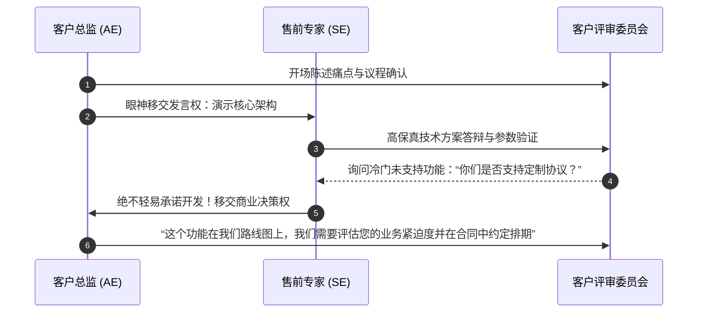

# Lec 5 团队协同销售与大客户战术 (Team Selling and Key Account Tactics)

> MIT 15.387 · Entrepreneurial Sales · 模块一：销售基石与客户接洽

## TL;DR

- 百万美元级大型标杆客户必须依赖“多兵种合成作战”的团队协同销售（Team Selling）。
- 销售代表（AE）、售前工程师（SE）与创始人/高管三位一体各司其职。
- 绘制大客户内部的政治利益地图，识别暗中的利益冲突与潜伏的“地雷”。
- 设立高管赞助机制（Executive Sponsorship），实现跨层级的高管对等对话。

## 为什么单打独斗在大客户销售中注定失败？

在面对世界 500 强或大型金融机构时，采购决策涉及 IT 架构师、业务副总裁、信息安全官、采购总监与法务专家等数十人。一个普通的业务销售员根本无法独自应对如此多维度的拷问：

```text
[大客户团队协同销售作战编组]
  [客户方层级]                      [初创销售军团]
  客户 CEO / CIO  <===============>  初创公司创始人 / CEO (战略背书与愿景承诺)
        ^                                   ^
        |                                   |
  业务副总裁 (经济决策人) <=======>  大客户销售代表 (AE: 掌控流程与商业条款)
        ^                                   ^
        |                                   |
  IT 架构师 / 工程师 <============>  资深售前解决方案专家 (SE: 攻克技术难题)
```

::: definition 团队销售角色分工与职责边界
- **客户总监 (Account Executive, AE)**：统筹整个战局的指挥官。负责商务谈判、人脉穿透、跟进日程并对签约结果承担唯一终极责任。
- **销售工程师 / 解决方案架构师 (Sales Engineer, SE)**：拥有深厚的技术底座，现场解答 API 规范、安全加密机制并亲自操盘技术 PoC。
- **高管赞助人 (Executive Sponsor)**：由初创公司创始人或 VP 担任，在关键签约节点与客户方 C 级别高管共进晚餐，提供最高战略承诺。
:::

## 售前工程师（SE）与销售（AE）的协同默契法则

技术人员与商务人员天生存在文化差异，协同作战时必须恪守以下纪律：



::: insight
售前工程师（SE）最忌讳犯的错误是“讨好型技术承诺”。很多工程师在现场面对客户技术员的挑衅时，为了证明自己技术过硬脱口而出：“这个功能我们两周就能给你们做出来！”这会瞬间毁掉公司的产品研发规划并给后续交付埋下无尽的雷区。
:::

::: pitfall
在会议现场发生内部争论。如果销售员在客户面前反驳售前工程师，或者工程师当场纠正销售员的口误，会瞬间破坏客户对团队专业性的所有信任。
:::
