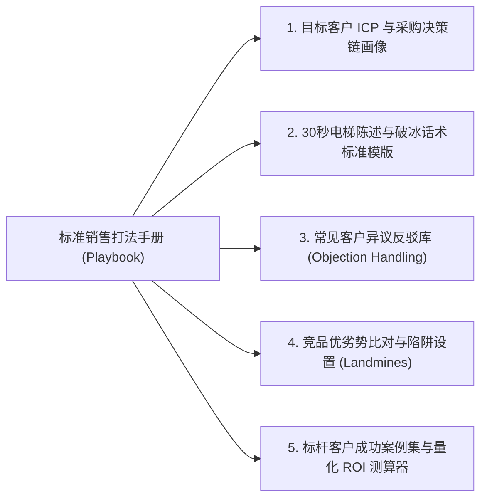

# Lec 6 销售团队培训与业绩预测 (Sales Training, Onboarding, and Revenue Forecasting)

> MIT 15.387 · Entrepreneurial Sales · 模块二：销售组织管理与运营

## TL;DR

- 打造可复制的销售宝典（Sales Playbook）是将个体销售英雄主义转化为规模化组织的基石。
- 新销售代表的入职爬坡期（Ramp-Up Time）通常需经历 3 至 6 个月，必须分阶段设定爬坡配额考核。
- 业绩预测（Forecasting）绝非基于主观感觉的猜谜，而是基于管道各阶段加权概率的数理统计模型。
- 区分预测中的承诺单（Commit）、最佳情况（Best Case）与管道储备（Pipeline）。

## 销售宝典（Sales Playbook）的标准化结构

如果每位销售代表见客户时都按照自己的方式随性发挥，初创企业将永远无法实现规模化。必须编写标准化的 **销售打法手册（Sales Playbook）**：

::: definition 爬坡配额阶梯 (Ramped Quota Schedule)
新员工入职初期无法立即扛起 100% 配额，合理的爬坡配额设计应为：
- **第 1 个月**：0% 配额（全天候学习产品、考核考卷、观摩优秀老销售通话）；
- **第 2 个月**：25% 配额（开始独立外呼，接管少量初级中小线索）；
- **第 3 个月**：50% 配额（独立进行线上演示，建立个人有效管道）；
- **第 4 个月**：75% 配额（推进首批商机进入商务阶段）；
- **第 5 个月及以后**：100% 满额配额考核。
:::

## 科学业绩预测（Sales Forecasting）的三维模型

管理层向董事会汇报收入时，最忌讳“差不多能签”的定性汇报。成熟销售管理采用加权预测模型：

| 管道阶段 (Stage) | 达标标准与客观事实标志 | 历史平均成单概率 | 示例商机金额 | 加权预测金额 |
| :--- | :--- | :---: | :---: | :---: |
| **Stage 1: 发现立项** | 客户承认存在预算且痛点迫切 | 10% | $100,000 | $10,000 |
| **Stage 2: 方案确认** | 客户技术负责人确认方案满足核心需求 | 30% | $100,000 | $30,000 |
| **Stage 3: 概念验证通过** | 客户签字验收 PoC 测试合格报告 | 50% | $100,000 | $50,000 |
| **Stage 4: 商务与合同审核** | 合同已进入客户法务和采购部审批流程 | 75% | $100,000 | $75,000 |
| **Stage 5: 承诺签单 (Commit)** | 获客户经济决策人正式采购确认书，仅待签字盖章 | 90% | $100,000 | $90,000 |

::: insight
业绩预测的终极准则是**依据客户的客观行动打分，而非依据销售员的主观感觉**。销售员说“我跟客户聊得很开心”毫无意义；只有当“客户主动发来保密协议”或“客户正式拉入采购主管入会”，商机才能在系统里前进一步。
:::

::: pitfall
把“承诺单（Commit）”建立在未经验证的口头许诺上。如果销售总监向 CEO 承诺本季度必签的一笔大单，却在最后一刻发现客户需要过董事会且董事会下半年才开会，这种预测黑天鹅会直接引发公司的现金流断裂危机。
:::
