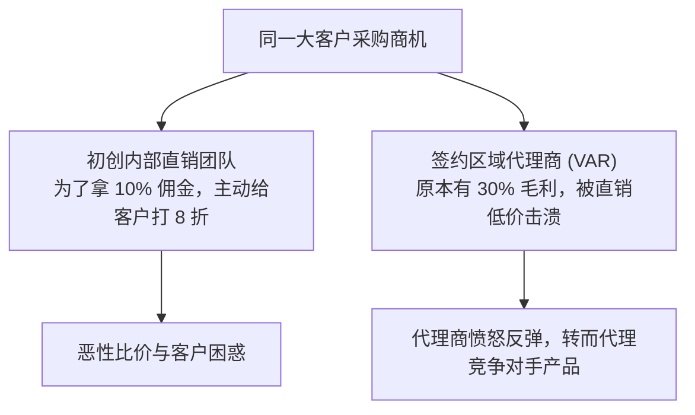

# Lec 7 渠道冲突化解与电梯路演竞争 (Channel Conflict and Elevator Pitch Competition)

> MIT 15.387 · Entrepreneurial Sales · 模块二：销售组织管理与运营

## TL;DR

- 当自建直销团队与外部代理商同时争抢同一区域客户时，必然爆发毁灭性的渠道冲突。
- 化解渠道冲突的核心准则是设立清晰的商机报备机制（Deal Registration）与分层准入界限。
- 电梯路演（Elevator Pitch）必须在 60 秒内完成从“痛点共鸣”、“方案解药”到“呼吁行动”的完整闭环。
- 合作伙伴渠道只有在能够获得高额增值实施服务收益时，才会死心塌地推销你的底层软件。

## 渠道冲突（Channel Conflict）的爆发根源与治理

初创公司在规模扩张时，常试图双轮驱动：一边让内部直销团队攻城拔寨，另一边签约全国代理商。然而若规则模糊，极易引发内战：



::: definition 商机报备保护机制 (Deal Registration)
代理商若首先发现了某一新客户线索，可在初创公司的伙伴门户网站上提交正式报备。
- 经审核通过后，该商机享有 **90 天排他性独家保护期**；
- 在保护期内，初创公司自建直销团队严禁私下接洽该客户，且代理商享有额外的 10%-15% 专属价格折扣保护。
:::

## 渠道分层治理的三大防火墙
1. **按客户规模分流**：直销团队只准跟进全行业前 500 强战略客户；其余所有中小型商业客户 100% 划归区域代理商。
2. **按产品版本分流**：轻量标准化版本走线上与代理分销；高客单价、深定制的企业旗舰版走专属直销。
3. **给代理商让渡“服务溢价”**：现代高科技初创企业让渡的不是单纯的软件差价，而是配套的咨询实施、定制集成（SI）高毛利工程。

## 60 秒电梯路演（Elevator Pitch）实战竞技

课堂组织了高压电梯路演擂台赛，要求学生在电梯上升的 60 秒内说服陌生投资人或潜在客户：

```text
[电梯路演 60 秒极致结构]
- 00-15秒 (钩子与剧痛):
  "全美每年因医院院内超级细菌交叉感染，导致 7.5 万名患者丧生，
   给医疗系统带来超过 100 亿美元的惩罚性赔偿..."
- 15-35秒 (颠覆性解药与技术背书):
  "我们基于 MIT 材料实验室专利，开发了一种分子级自清洁抗菌光触媒涂层，
   喷涂一次即可在 2 年内持续灭杀 99.99% 的耐药病菌..."
- 35-50秒 (商业验证硬数据):
  "我们刚在麻省总医院完成了 6 个月的双盲临床测试，将重症病房感染率直接降低了 62%..."
- 50-60秒 (低门槛明确召唤):
  "这是我的名片。下周二我们有一场针对医院院长闭门成果发布会，
   我想为您预留一个贵宾席位，您看可以吗？"
```

::: insight
电梯路演不是把 30 分钟的 PPT 语速加快 30 倍念出来。它是一颗精准制导的子弹，只打一个点：**让对方的心脏跳漏一拍，并主动从口袋里掏出名片递给你**。
:::

::: pitfall
在路演中使用毫无辨识度的空话套话（如“我们是一家利用大数据与前沿 AI 赋能未来的颠覆性平台”）。这种辞藻会瞬间触发听众的大脑休眠机制。
:::
