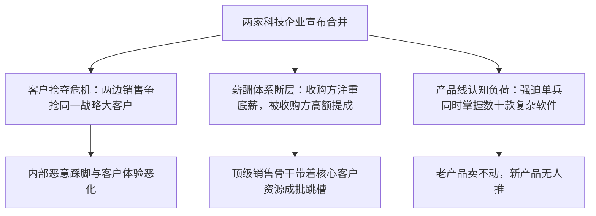

# Lec 9 并购重组中的销售团队整合 (Merger Problems: Combining and Rebuilding Sales Forces)

> MIT 15.387 · Entrepreneurial Sales · 模块二：销售组织管理与运营

## TL;DR

- 超过 70% 的高科技企业并购未能实现预期协同效应，其核心症结在于销售团队整合崩盘。
- 并购引发的客户所有权争夺、区域重叠与薪酬差异会导致顶级销售人员迅速离职。
- 必须在并购宣布后 30 天内敲定全新的领地划分与配额体系，防范竞争对手借机恶意挖角。
- 跨产品线交叉销售（Cross-Selling）需要重新培训产品知识，切忌预设销售员能自动掌握复杂新系统。

## 并购后销售体系的三大剧烈震荡

当两家科技公司宣布合并时，新闻通稿中往往大谈“产品线互补与庞大交叉销售协同”。然而在真实业务前线，销售人员面临的却是一场零和博弈的生存恐慌：

::: definition 并购整合中的“休克期” (The Post-Merger Shock Period)
并购宣布后的前 90 天被称为危险休克期。在此期间，销售员往往把 80% 的精力用于探听内部政治风声、算计个人职位与领地，用于拜访客户的时间骤降，给竞争对手提供了乘虚而入的黄金窗口。
:::

## 整合销售队伍的五大保底铁律

Howard Anderson 结合数十起跨国科技并购整合实战经验，提出了挽救销售崩盘的行动指南：

1. **建立“祖父条款（Grandfathering）”保护存量客户**：
   - 规定在并购前已在各自系统内合法签约并服务的既有客户，原销售代表享有至少 12 个月的独家服务与续约提成权，严禁新团队强行割韭菜。
2. **设立高管留任金（Retention Bonuses）**：
   - 针对两家公司前 10% 的顶级销售王牌与技术架构师，设立捆绑 1-2 年服务期的丰厚留任奖金包，防范竞品猎头挖角。
3. **推行“搭档销售机制（Overlay Specialists）”**：
   - 绝不强迫老销售一夜之间学会卖被收购方的新型复杂软件；
   - 设立专业产品专家组（Overlay Reps），由专家陪同老销售拜访存量客户，成单后双方均计入业绩指标，激发交叉推销动力。
4. **迅速统一 CRM 数据库与线索规则**：
   - 在 60 天内强制将两套异构的 CRM 客户数据彻底清洗合并，消除重复客户与信息死角。

::: insight
在并购整合中，**沟通速度决定一切**。如果管理层在并购发生后两周内迟迟不定下新的区域划分与佣金政策，团队内部的谣言会像野火一样蔓延，顶级骨干在第一个月末就会把简历投遍全行业。
:::

::: pitfall
为了节省开支直接削减被收购团队的提成比例。优秀销售员对自己的收入极其敏感，单方面单向降低佣金提成无异于向全行业发出“欢迎挖走我们最核心骨干”的公开邀请函。
:::
