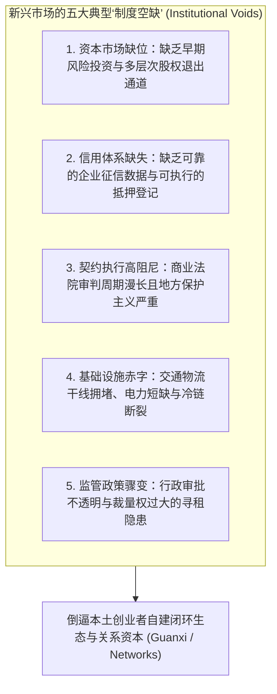

# Lec 01 全球新兴市场创业环境与制度空缺透视 (Stylized View of Entrepreneurship in Emerging Markets)

> MIT Sloan School of Management · 15.389 Global Entrepreneurship Lab (G-Lab) · Prof. Yasheng Huang & Prof. Simon Johnson

## TL;DR

- 新兴市场创业的核心特征并非缺乏商机，而是普遍面临法治、金融中介与合约执行的“制度空缺（Institutional Voids）”。
- 黄亚生教授三大经济增长机制：要素积累、部门重配与要素配置效率；后者的突破必须依赖草根创新企业家。
- 发达市场复制品在发展中经济体的水土不服：跨国初创企业必须具备“情境智能（Contextual Intelligence）”。
- MIT G-Lab 行动学习理念：以微观企业战略咨询为杠杆，穿透宏观制度迷雾并交付可落地价值。

## 什么是真正优秀的创业环境？ / What Is a Good Entrepreneurial Environment?

当西方商学院谈论“创业生态”时，教科书通常会罗列出一套标准化的硅谷清单：健全的产权保护法律、透明的破产法院、成熟的风投资本网络、灵活的劳动雇佣合同以及受尊重的契约精神。然而，在占全球人口绝大多数的新兴市场（Emerging Markets），这套标准清单几乎全部处于缺失状态。

麻省理工学院斯隆管理学院著名经济学教授黄亚生（Prof. Yasheng Huang）与前国际货币基金组织（IMF）首席经济学家西蒙·约翰逊（Prof. Simon Johnson）在 15.389 全球创业实战实验室（G-Lab）第一讲中提出了经典的制度经济学框架：**新兴市场的高成长初创企业，从来不是在真空中生长的，它们必须在一张布满“制度空缺”的复杂地网上艰难破局**。

::: definition 制度空缺 (Institutional Voids)
哈佛商学院塔伦·卡纳（Tarun Khanna）与麻省理工学院黄亚生教授共同界定的经典概念：**在转型经济体与发展中国家，由于缺乏专业的中间服务机构（如信用评级机构、审计事务所、行业协会、高效司法清算体系），导致买卖双方交易搜寻成本与履约风险极其高昂的结构性制度缺陷**。
:::

## 经济增长的三大机制与企业家的不可替代性

黄亚生教授在课堂上深入剖析了宏观经济增长的三大源动力，并精辟指出了国家资本与民间创业者的能力边界：

| 经济增长机制 | 运作核心机理 | 政府干预的有效性与边界 | 创业型企业家的核心角色 |
| :--- | :--- | :--- | :--- |
| **1. 要素积累 (Factor Accumulation)** | 大规模追加固定资产投资、动员廉价劳动力进厂、铺设跨省铁路与工业园区 | **极高**（威权政府能凭借行政命令快速调动资源） | 主要是被动承接基础设施红利，充当标准件加工厂 |
| **2. 部门重配 (Sectoral Reallocation)** | 将劳动力从低生产率的传统农业，大规模迁移至高附加值的现代制造业与城市服务业 | **中等**（通过户籍改革与外资招商引资政策引导） | 创办早期劳动密集型民营企业，吸纳数以千万计的农民工 |
| **3. 要素配置效率 (Factor Allocation Efficiency)** | 将全社会有限的资本、技术与人才，精准下拨给全要素生产率（TFP）最高、最具创新活力的业务单元 | **极其低下**（政府产业基金往往陷入寻租腐败与僵尸企业扶持） | **绝对主力与唯一引擎**：凭借市场敏锐嗅觉淘汰低效产能，开辟前沿新范式 |

::: theorem 要素报酬递减与创新转型铁律 (Diminishing Returns to Factor Accumulation)
依靠政府主导的“要素积累”与“部门重配”能够在工业化初期创造惊人的 GDP 增长奇迹（如早期的苏联、新加坡及部分东亚经济体）。然而，**随着资本边际报酬递减（Diminishing Returns），单纯靠砸钱基建的增长红利必然在 15 至 20 年内耗尽**。国家要想跨越“中等收入陷阱”，唯一可行的出路是迅速向第三种机制跨越——彻底激活以草根创新企业家为核心的自由市场要素配置体系。
:::

## 为什么照搬西方商业模式在新兴市场必死无疑？

许多欧美跨国巨头或海归创业者常常陷入“制度盲区（Institutional Myopia）”：他们将在发达经济体中如鱼得水的商业逻辑（如轻资产软件平台、纯线上信用贷、依赖快递当日达的电商）直接复制到印尼、印度或中国内陆，结果遭遇惨痛失败。

西蒙·约翰逊教授强调，在新兴市场生存，必须具备**“情境智能（Contextual Intelligence）”**：
- **自建基础设施成为护城河**：当外部缺乏现成物流时，像中国京东（JD.com）自建仓配一体化物流，或印尼 Gojek 从摩托车打车切入自建外卖地推大军，看似违背了硅谷轻资产教条，却构筑了最坚不可摧的线下履约护城河；
- **非正式关系网络（Relational Capital）的资产化**：在法律合同缺乏执行力的环境下，企业家通过宗族、同乡会、商会以及高管校友网络建立的信任背书，往往比一份 100 页的商业合同更能确保货款的安全回笼。

## MIT G-Lab 行动学习：直插一线的微观手术

面对如此复杂的新兴市场环境，MIT Sloan 创立了名扬全球的行动学习旗舰项目——**G-Lab（Global Entrepreneurship Lab）**。

G-Lab 的核心理念是：**真正的商业智慧不在哈佛红砖楼的案例书本里，而在雅加达拥堵的街头、深圳充满松香烟雾的车间与班加罗尔的软件外包呼叫中心现场**。通过与当地企业最高管理层并肩作战，学员们不仅为企业化解了增长瓶颈，更在真实的商业战壕中淬炼出对全球新兴市场的深刻穿透力。

## 我的理解与实践洞察 / Personal Insight

在新兴市场做战略咨询或自主创业，最大的忌讳就是“优越感与水土不服”。

::: insight 尊重制度空缺背后的本土生存智慧
很多受过顶尖西方商学院训练的专业人士，在看到新兴市场充斥着现金交易、非标合同与人情往来时，往往居高临下地将其贬斥为“落后落后”。然而，**每一个看似扭曲的本土商业习惯，都是当地商人在极其残酷的制度荒漠中进化出的最优自适应生存抗体**。战略家的第一课是俯下身去倾听与理解，而不是盲目用硅谷教条去强行改造现实。
:::

## 思考题与实战研讨

1. 结合黄亚生教授关于经济增长的三大机制，审视你所关注的新兴市场国家（如当下的越南、印度或印尼），其当前的高速增长主要依赖于哪一种机制？这一机制预计在多少年内会遭遇边际收益递减的天花板？
2. 在很多缺乏第三方独立征信体系的发展中国家，像微型金融（Microfinance）格莱珉银行（Grameen Bank）或中国早期的阿里巴巴“诚信通/支付宝担保交易”，是如何通过独特的商业设计来填补“信用制度空缺”的？
3. 如果你的团队被派往一家位于东南亚的快速成长型物流初创企业担任 G-Lab 咨询顾问，在没有当地官方统计局可信行业数据的前提下，你会采用哪些非传统的田野调查方法来估算当地市场的真实规模？
