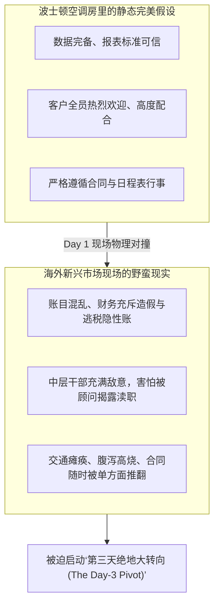
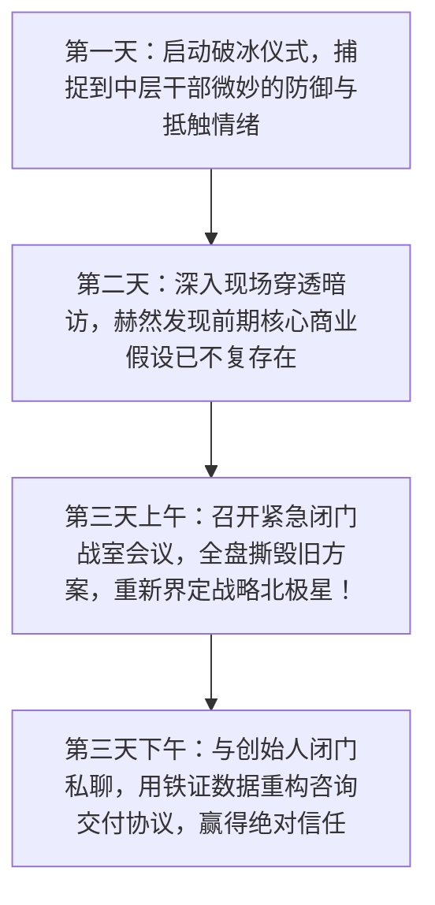

# Lec 10 跨文化情境智能与现场混沌穿行 (Cross-Cultural Contextual Intelligence & Onsite Adaptation)

> MIT Sloan School of Management · 15.389 Global Entrepreneurship Lab (G-Lab) · Michellana Jester & Prof. Yasheng Huang

## TL;DR

- “情境智能（Contextual Intelligence）”：将抽象商业理论与特定异国文化、非正式潜规则深度融合的能力。
- 霍夫斯泰德与爱琳·迈耶文化地图：解析新兴市场在高权力距离、高语境沟通与关系主导谈判上的隐形密码。
- G-Lab 经典的“第三天大转向（The Day-3 Pivot）”：当现场田野事实彻底推翻前期所有假设时的危机重构方法论。
- 穿透现场混沌的实战艺术：如何在缺乏可信数据、遭遇语言障碍与中层官僚防御中提炼真实商业洞见。

## 走出波士顿机场的文化休克 / Culture Shock Beyond the Airport Gate

在 MIT G-Lab 的历史传统中，有一句几乎所有返校学长都会反复叮嘱新学员的经典名言：
**“The G-Lab team was in for a surprise when it arrived…”（当团队抵达现场的那一刻，意想不到的意外便如期而至……）**

在波士顿斯隆大楼里，学员们度过了三个月的精密推演：建立了包含数十个嵌套公式的宏观财务贴现模型，查阅了世界银行和高盛的几十份研究研报，排出了严密到分钟级的现场调研日程表。然而，当四名身穿笔挺西装的 MBA 走下雅加达、班加罗尔或河内机场的那一瞬间，真实世界的热浪与混乱会迎面给每一个人狠狠一记耳光：
- 原定来接机的客户司机在暴雨和拥堵中迟到了两个小时；
- 原本在邮件中满口答应配合调研的公司 CTO 昨天刚刚辞职带走了全部源代码；
- 财务总监拿出的所谓“官方账目”，竟然是三本记录在破旧笔记本上的手写糊涂账，而且真实亏损是此前财报的整整五倍！

米歇拉娜·杰斯特主任在 15.389 课堂上指出：**这一刻，考试才真正开始！衡量一个顶尖商业领袖成色的，绝不是他在平稳环境下的推演能力，而是他在面对未知、混乱与失控时的‘情境智能（Contextual Intelligence）’**。

## 跨文化沟通的隐形暗礁：爱琳·迈耶文化地图解密

为什么很多高智商的西方顾问在亚洲和拉美做咨询时，往往把关系搞得极其僵硬？欧洲工商管理学院（INSEAD）学者爱琳·迈耶（Erin Meyer）在《文化地图》（*The Culture Map*）中的经典框架，为 G-Lab 学员提供了极其锋利的透镜：

| 文化维度对比 | 欧美低语境低权力距离文化 (Low Context / Low Power Distance) | 亚洲/拉美高语境高权力距离文化 (High Context / High Power Distance) |
| :--- | :--- | :--- |
| **沟通表达模式** | **直截了当、黑白分明**：“你的方案在逻辑上存在严重错误” | **微言大义、顾全颜面**：“这个构想很有新意，但我们或许可以从另一个角度再推敲一下” |
| **对待层级权威** | 平等直呼其名，鼓励初级员工在会议上公开挑战 CEO | **极度森严的辈分与权威**：老板没开口前，下属绝对保持沉默；严禁当众让上级难堪 |
| **商业信任基础** | **基于合同与实证（Task-based Trust）**：“只要你把模型算准了，我就相信你” | **基于情感与私交（Relationship-based Trust）**：“如果我跟你没喝过酒、没见过你的家人，我绝不会对你吐露真话” |
| **负面反馈传递** | 公开做批评复盘，追求客观公正 | **私下一对一婉转沟通**，公开批评等同于对人格的终极侮辱与结仇 |

::: definition 高语境沟通与“读空气” (High-Context Communication)
在包括中国、日本、印尼和越南在内的高语境文化中，**言语的字面意思往往只承担了不到 30% 的信息量，真正核心的决策信号深埋于未说出口的弦外之音、眼神流转、座次排位以及长时间的沉默之中**。低语境顾问如果只听字面上的“好的、没问题”，就会完全误判客户的真实态度。
:::

## 经典危机应对：“第三天大转向”实操法则 / The Day-3 Pivot

在 G-Lab 的实战兵法中，所有顾问团队都必须在心理上准备好迎接**“第三天大转向（The Day-3 Pivot）”**：

### 第三天绝地转向的三大纪律

1. **坚决杀死“沉没成本谬误”**：不要因为自己在波士顿花了两个月搭建了一套漂亮的供应链规划模型，就舍不得扔掉。如果现场调研表明客户的核心瓶颈根本不是供应链而是渠道恶性窜货，必须在 10 分钟内果断将旧模型归档废弃；
2. **主动拆解中层干部的“防御工事”**：客户的中层副总们往往把 MIT 顾问视为“董事长派来裁员抓把柄的钦差大臣”，因此会本能地封锁数据。聪明的团队会在第一晚邀请中层干部一起去街头大排档喝啤酒，开诚布公地声明：“我们是来帮你们向董事会申请更多资源和奖金预算的，我们是在为你们抬轿子！”打消防备后，真实的数据才会像泉水一样喷涌而出；
3. **与创始人建立“深夜走廊共谋”**：在亚洲商业文化中，很多至关重要的真相绝不会发生在正式会议室里，而是发生在深夜加完班后与董事长一起去便利店买咖啡的 15 分钟漫步中。在这短短的一刻钟里，创始人往往会卸下防备，向你吐露那些从未写进任何财报的公司生死秘密。

## 我的理解与实践洞察 / Personal Insight

“真正的战略家，在风暴来临时，脚下要有根，眼里要有光。”

::: insight 情境智能是最高级的跨文化共情
很多人以为情境智能就是八面玲珑、世故圆滑的做人技巧，这是一种彻底的庸俗化。**情境智能在本质上是一种极其深沉的智力同理心（Cognitive Empathy）——它要求你完全剥离自身原生的特权偏见与文化傲慢，在极短的时间内，精准揣摩出对方在特定历史、政治与家族约束下的恐惧、贪婪与悲悯**。当你能看懂对方的痛苦时，你的战略方案才能化作一把温润的手术刀，切除病灶而不伤及机体。

## 思考题与实战研讨

1. 在亚洲新兴市场的商业会议上，当你向客户高管阐述完一个极其激进的改革方案后，全场陷入了长达两分钟的绝对沉默，随后客户董事长微笑着说了一句：“这个想法非常有远见，我们会非常认真地组织闭门研讨。”结合本讲关于“高语境沟通”的理论，这句回复的真实潜台词究竟是什么？作为顾问你接下来应该怎么做？
2. 很多西方留学生在海外调研时，对当地不讲卫生的街头小吃与混乱的公共交通表现出极度的嫌弃，甚至天天躲在五星级酒店房间里吃西餐、要求客户把资料送过来。这种行为给客户团队释放了怎样的心理信号？会对咨询的信任基础造成怎样不可逆的摧毁？
3. 如果你在现场调研期间，偶然发现了客户公司内部某位功勋元老级副总裁存在严重的吃回扣腐败证据，而这位副总裁恰恰是创始人的亲表兄，面对这种足以引爆家族内乱的深水炸弹，你的顾问团队应该如何向最高董事长汇报这一敏感事实？
