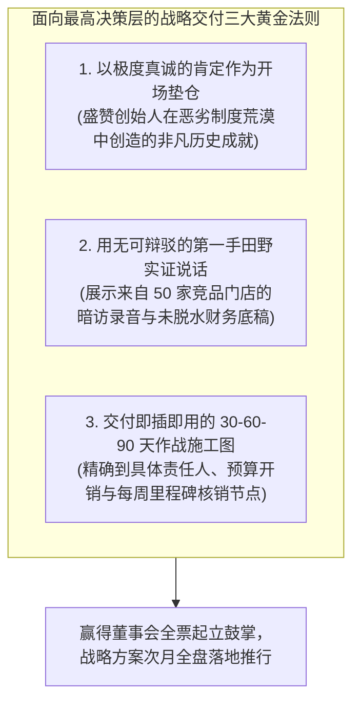
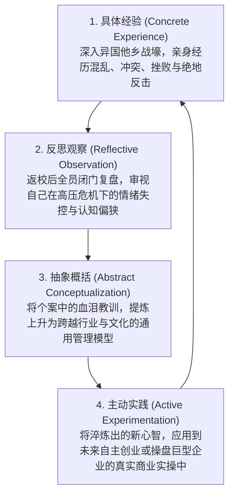
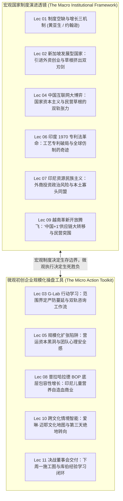

# Lec 11 G-Lab 咨询交付与行动反思全景大闭环 (Consulting Delivery & Action Learning Synthesis)

> MIT Sloan School of Management · 15.389 Global Entrepreneurship Lab (G-Lab) · Prof. Yasheng Huang & Prof. Simon Johnson

## TL;DR

- 向董事会与创始人进行终极商业路演（C-Suite Presentation）：残酷真理与建设性路径的高超平衡。
- 交付物必须具备“下周一即可落地的微观颗粒度”：坚决摒弃云端空洞口号，交付 Excel 敏感度模型与 30-60-90 天作战甘特图。
- 大卫·库伯（David Kolb）经验学习圈：从具体经验、反思观察、抽象概括到主动实践的领导力认知升华。
- 15.389 全课宏观大闭环：将国家宏观制度透镜（新加坡、中国、印度、印尼、越南）与微观初创企业规模化操盘深度熔铸。

## 决战董事会：如何向创始人交付“刺耳的真理”？ / The C-Suite Moment of Truth

在为期三周的海外高强度驻场调研的最后一个星期五下午，每一支 G-Lab 顾问团队都将迎来其行动学习生涯的最严酷考验——**向客户企业全体董事会、创始人及核心高管团队做终极战略路演（Final Board Presentation）**。

米歇拉娜·杰斯特主任强调，名校商学院学生在这一关键时刻最常犯的严重错误，是将交付做成了一场炫耀学术名词的“论文答辩”：
- 堆砌了 100 页满是微积分公式和宏观经济图表的幻灯片；
- 当着所有投资人和下属的面，极其傲慢地痛陈创始人过去三年的战略是多么愚蠢；
- 最终结果是彻底激怒了创始人，双方在董事会现场不欢而散，所有宝贵的调研成果被直接扔进垃圾桶。

黄亚生教授与项目导师传授了顶级管理咨询合伙人严格恪守的**“高情商战略交付黄金法则”**：

### 交付物的微观颗粒度标准

G-Lab 的战略交付物绝不是一叠空洞的废纸 PPT，而必须是一套**具备硬核工具属性的生产力武器库**：
1. **动态敏感性财务预测沙箱（Parametric Financial Sandbox）**：一套用 Excel 严谨搭建的动态模型。创始人只需拖动一个参数滑块（例如将经销商返点从 15% 调至 12%），模型在毫秒级内自动联动更新未来三年的月度现金流缺口、盈亏平衡点与破产安全垫；
2. **免除政治摩擦的“缓冲组织架构设计”**：如果方案建议削减某个低效功勋副总的权力，绝不能建议直接开除，而是为其量身定制一个拥有高声望虚衔、专注战略前沿探索的“首席顾问”职位，在保全老臣颜面的同时，将实权平稳移交给年轻少壮派；
3. **“下周一即可执行的行动清单（Monday Morning Checklist）”**：明确列出在下周一早上 9 点，CEO 应该召集哪三个人开会、签发哪两份管理规范、第一笔止血资金应该在下周五前从哪个账户划拨到位。

## 库伯经验学习圈：从项目结束走向领导力觉醒 / Kolb's Experiential Learning Cycle

当飞往波士顿的航班冲上云霄、海外征程落下帷幕时，真正的行动学习才刚刚迈入最深沉的阶段。

组织行为学泰斗大卫·库伯（David Kolb）著名的**“经验学习圈（Experiential Learning Cycle）”**，构成了 G-Lab 课程终结反思的灵魂框架：

::: insight 行动学习的终极产品是“进化后的人”
MIT Sloan 设立 G-Lab 的终极目的，从来不仅是为海外几十家初创企业撰写几份商业方案，**行动学习的终极产品，恰恰是每一位经过了商业烈火淬炼的学员本身！**当你亲眼见证过印尼乡村母亲的坚韧眼眸、亲手拆解过中国车间流水线的轰鸣节拍、亲自在董事会上顶住过跨国创始人的愤怒质询，你内心深处的软弱、傲慢与虚荣便在实战中被彻底焚毁，取而代之的是一颗波澜不惊、敢于在一切未知风暴中掌舵前行的强大统帅心智。

## 15.389 全球创业实战实验室：全课宏观微观大闭环 / Course Synthesis

历经 11 讲的激荡征程，MIT 15.389 G-Lab 为我们构建起了一幅跨越宏观国家制度演进与微观企业规模化操盘的**全景商业智慧全景图**。它打破了传统商学院教育中宏观经济与微观战略各自为政的壁垒，建立起一套贯通国家政治经济学与现场执行行动学的完整闭环。

在宏观维度上，黄亚生与西蒙·约翰逊教授的制度透镜，向我们揭示了新兴市场商业生态的底层基因：新加坡的发展型国家模式展现了要素动员的极致但伴生草根挤出，中国的双轨力场展现了国家资本与民营草根的博弈张力，印度的工艺专利革命揭示了制度非对称套利对产业逆袭的决定性催化，印尼的资源民族主义展示了跨国资本与主权博弈的长周期拉锯，而越南的革新开放则展现了全球供应链大重组下的新生代突围契机。

而在微观行动维度上，G-Lab 交付了一整套经历过实弹射击检验的战术武器库：从最初严防死守范围蔓延的项目立项任务书，到规模化扩张中的现金转换周期与团队心理安全感建设；从普拉哈拉德底层的包容性商业模式自造血重构，到面对海外现场混沌时的第三天绝地转向法，直至最终决战董事会时的下周一施工图交付。宏观透镜决定了企业的生存边界与天花板，而微观战术则决定了团队能否在恶劣的战壕中活到明天。

下面的全景闭环图系统展示了宏观制度演进与微观行动工具之间的动态传导关系：

在这个风云变幻的世纪大变局时代，全球化的单极叙事正在退潮，多元新兴市场的异构崛起正在重绘世界地图。唯有同时掌握了**宏观制度经济学的宏大透镜**与**微观商业战壕拼刺刀硬功夫**的卓越领袖，方能在人类文明壮丽的商业航海史诗中，破浪前行，直济沧海！

## 我的理解与实践洞察 / Personal Insight

从麻省理工学院斯隆大楼出发，我们的脚步踏遍了东南亚的海岛、南亚的平原与东亚的工厂。

::: insight 商业的本质是点燃希望
在所有的商学院词汇中，我们常常谈论 EBITDA、IRR、市盈率与退出估值。然而，在 G-Lab 的漫长旅途中，真正震撼心灵的，是当那些深陷绝境的本土创业者握住你的手、眼中泛着泪光说“谢谢你们帮我们看清了前路”的那一刻；是当印尼贫困海岛上的母亲用你设计的微型营养包喂饱怀里嗷嗷待哺的婴儿的那一刻。**商业文明最崇高的荣光，从来不是资本家锦上添花的数字游戏，而是在全球那些最艰苦、最荒芜的制度缝隙中，用理性的工具为底层人民劈开一条通往尊严与希望的生路**。

## 思考题与实战研讨

1. 总结整门 15.389 G-Lab 课程，比较新加坡模式、中国模式、印度模式与印尼模式在处理“政府干预、法制健全度与民间草根创业活力”上的本质差异。哪一种模式对当今处于现代化起飞阶段的发展中国家最具备复制参考价值？
2. 在向企业创始人做结项战略汇报时，如果你的量化财务模型得出的客观结论是“建议公司在三个月内坚决砍掉创始人倾注了五年心血、由其亲弟弟负责但连年巨亏的主力老业务”，你会如何设计你的幻灯片结构与路演叙事逻辑，才能在不引发剧烈家庭矛盾的前提下达成战略目标？
3. 结合大卫·库伯的经验学习圈，回顾你个人过去三年经历的最痛苦、最挫败的一次项目或职业经历，尝试运用“反思观察”与“抽象概括”，将其提炼为你未来人生决策的三条不可逾越的底层元规则。
