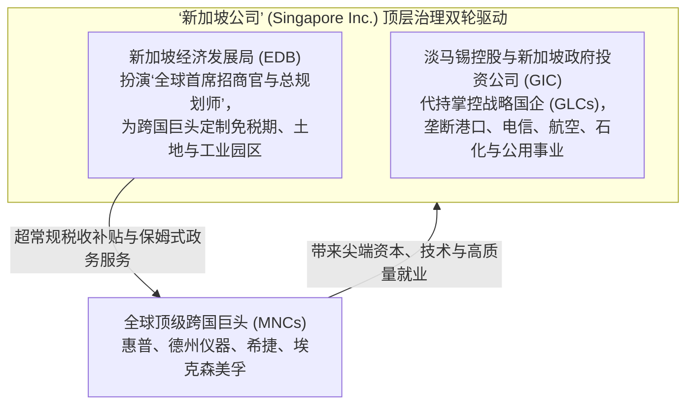

# Lec 02 国家角色与政府干预：新加坡政府主导型发展主义与双刃剑 (The Role of Government: Singapore)

> MIT Sloan School of Management · 15.389 Global Entrepreneurship Lab (G-Lab) · Prof. Yasheng Huang & Prof. Simon Johnson

## TL;DR

- 新加坡发展型国家模型（Developmental State）：通过经济发展局（EDB）与淡马锡控股实现极其精密的国家顶层资本运作。
- “引进外资创业（Importing Entrepreneurship）”战略的辉煌成果：通过超级跨国巨头（MNC）带动工业化与就业。
- 新加坡模式的深层代价：强势国有企业与外资巨头挤压了本土草根创业生态，导致民间自发创新基因相对匮乏。
- 从制造组装向知识经济转型之痛：启奥生物医药园（Biopolis）展示了政府重金“购买创新”的巨大挑战与反思。

## 逆境中的国家资本主义：新加坡发展模式起源 / The Singapore Miracle

1965 年，当新加坡被逐出马来西亚联邦宣布独立时，摆在开国总理李光耀面前的是一块毫无淡水、缺乏腹地资源、失业率高达 14% 的贫瘠小岛。然而，在随后的四十年里，新加坡创造了全球经济史上最不可思议的跃迁，人均 GDP 迅速超越其前殖民宗主国英国。

麻省理工学院黄亚生教授在 G-Lab 课堂上，系统剖析了这一被全球无数发展中国家奉为神明、但也引发巨大争议的经典政经模式——**新加坡发展型国家（Developmental State）与政府主导型增长**。

### 新加坡模式的三大制度支柱

1. **经济发展局（EDB）的“保姆式”超前产业规划**：不同于西方政府的消极监管，EDB 深度介入全球产业价值链的推演。在 1970 年代精准押注半导体封装，在 1980 年代超前建设裕廊岛炼化一体化基地，在 1990 年代强行布局精密机械与硬盘制造；
2. **“引进外部创业家精神（Importing Foreign Entrepreneurship）”**：新加坡政府清醒地认识到，在短期内培育本土技术企业家需要数十年时间。因此，新加坡选择了一条终极捷径——**用世界上最廉洁高效的政府服务、最严密的知识产权保护与最优惠的税收政策，直接把全球最顶级的跨国科技巨头‘买’到新加坡来！**
3. **中央公积金（CPF）与强制高储蓄率**：政府通过强制性公积金制度，将国民收入的近 40% 转化为长期国家发展资本，用于填海造陆、建设樟宜机场与裕廊工业区，以极致的要素积累驱动早期腾飞。

## 辉煌背后的阴影：被挤压的本土草根创新 / The Dark Side of Success

然而，世上没有任何一种制度只有收益而没有代价。黄亚生教授向 G-Lab 学员们揭示了新加坡模式在中后期所遭遇的深刻制度困境：

| 制度特征对比 | 新加坡外资与国企主导模式 | 硅谷/台湾/浙江的民间草根创业模式 |
| :--- | :--- | :--- |
| **经济控制主体** | 外资跨国巨头（MNCs）与政联国企（GLCs）占 GDP 超过 75% | 由成千上万家富有攻击性的中小型民营初创企业主导 |
| **社会精英职业流向** | 最聪明的高考状元全部考取政府奖学金，争相进入公务员系统与淡马锡 | 顶尖技术极客与商界奇才在车库创业，追求颠覆行业 |
| **社会容错与风险偏好** | **零失误文化（Kiasu 怕输心理）**，失败被视为无法洗刷的污点 | **崇尚冒险文化**，将失败视为探索未知的宝贵勋章 |
| **自主核心技术掌控度** | 核心芯片与底层专利全部归属于海外跨国母公司，本地以制造为主 | 本土企业牢牢掌控自主架构与自有品牌（如台积电、联发科） |

::: definition 挤出效应与创新钝化 (Crowding-out of Entrepreneurship)
黄亚生教授实证指出：新加坡极其成功的国家资本主义，在无形中对民间草根创新造成了严重的**“三重挤出”**：
1. **资本挤出**：垄断性政联国企在资本市场上享受主权信用担保，吸纳了全社会绝大多数信贷资本，挤压了民间初创企业的融资空间；
2. **人才挤出**：政府公务员与外资五百强提供了极其丰厚稳定的薪酬与尊崇的社会地位，使得最优秀的本土年轻人彻底丧失了冒险下海创业的动力；
3. **文化挤出**：高度秩序化、惩罚严苛的社会治理塑造了规矩听话的职业经理人阶层，却无形中扼杀了离经叛道、敢于打破常规的颠覆性极客精神。
:::

## 启奥生物医药园（Biopolis）：政府能否“规划”出下一个硅谷？

进入 21 世纪，随着中国和印度的崛起，跨国制造流水线开始大规模迁出新加坡。为了破局，新加坡政府启动了史上最雄心勃勃的科学豪赌——**耗资数十亿美元打造全球生物医药之都“启奥生物医药园（Biopolis）”**。

::: example 新加坡“造峰计划”的狂热与反思
- **国家意志的顶层设计**：新加坡科技研究局（A*STAR）在裕廊工业区旁平地建起了一座科幻级的生命科学城，为顶尖科学家配备了全球最昂贵的质谱仪、电子显微镜和最先进的洁净室；
- **重金全球挖角科学巨星**：政府开出数倍于哈佛、牛津的高薪与数千万美元的独立研发经费，将包括人类基因组计划领袖爱迪生·刘（Edison Liu）、癌症基因权威大卫·莱恩（David Lane）在内的全球数十位泰斗级学术巨星整编包机迁往新加坡；
- **十年后的制度反思**：
  在论文发表数量上，Biopolis 取得了耀眼的成绩；然而，在商业化转化与孵化具备全球竞争力的本土重组蛋白药物独角兽上，成效却远逊于预期：
  - 许多外国学术明星将新加坡视为“科研度假天堂”，在合约期满拿走丰厚报酬后又回到了欧美母校；
  - 缺乏像波士顿肯德尔广场（Kendall Square）那样由数以百计的小型生化车库、天使投资人与激进初创公司构成的自发混乱生态，政府规划的产业园区最终展现出某种“精心浇灌的人工塑料盆景”特征。
:::

## 我的理解与实践洞察 / Personal Insight

“政府可以铺设世界上最好的高速公路，但政府绝对无法用红头文件命令谁跑在第一名。”

::: insight 规划型经济学在复杂创新面前的黄昏
在工业化初期的“追赶阶段（Catch-up Phase）”，由于目标极其明确（造港口、炼石油、组装收音机），政府主导的高效动员模式能够发挥惊天地泣鬼神的效率。然而，当经济体攀登至科技最前沿的“探索阶段（Exploration Phase）”时，创新的本质变成了非共识的试错与对未知的摸索。此时，**任何自上而下的五年规划都会在混沌复杂面前彻底失灵，唯有充分放权、宽容异端、包容失败的草根自由市场，才能孕育出不可预测的科技奇迹**。
:::

## 思考题与实战研讨

1. 很多发展中国家的政府官员在考察新加坡后，纷纷回国宣布要打造“国家级高新技术产业园区”，试图完全复刻 EDB 模式。结合黄亚生教授的理论，分析为什么绝大多数模仿者最终只建成了烂尾的房地产项目，而没有培育出真正的科技创新？
2. 新加坡的“怕输文化（Kiasu Culture）”在保障金融安全、航空准点率与司法廉洁上立下了汗马功劳，但它为什么会成为孵化类似苹果、特斯拉这样颠覆性企业的致命毒素？
3. 如果你的 G-Lab 项目客户是一家试图将总部迁往新加坡的东南亚初创科技公司，你会如何向其董事会客观分析新加坡的“政策红利”与“本土市场狭小、研发用工成本高昂”的双重现实？
