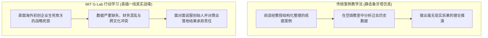
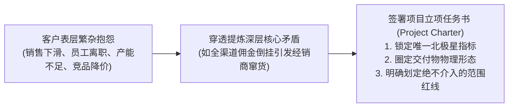

# Lec 03 G-Lab 行动学习机制与咨询项目界定：从远程协作到现场驻场 (Action Learning Framework)

> MIT Sloan School of Management · 15.389 Global Entrepreneurship Lab (G-Lab) · Michellana Jester & Prof. Yasheng Huang

## TL;DR

- MIT 斯隆管理学院行动学习（Action Learning）教学法：将未结构化商业混沌转化为高价值决策交付。
- 项目范围界定（Project Scoping）实战法则：坚决抵制“范围蔓延（Scope Creep）”，锁定唯一的北极星指标。
- G-Lab 双轨咨询工作流：为期三个月的跨洋远程背景调研与为期三周的高强度海外现场驻点调研。
- 客户期望管理与团队心理安全感：在缺乏充分数据与文化冲突环境下构建高绩效敏捷咨询战室。

## 行动学习的教育哲学：走出象牙塔的真实战壕 / Action Learning Pedagogy

在全世界顶级商学院的传统课堂中，案例教学法（Case Method）长期占据统治地位：学生们坐在装有空调的阶梯教室里，阅读一份由教授精心编写、事实被高度结构化归纳的 15 页哈佛案例，然后用两个小时推演“如果我是 CEO 我会怎么做”。

然而，MIT Sloan 全球创业实战实验室（G-Lab）项目主任米歇拉娜·杰斯特（Michellana Jester）在 15.389 课堂上指出：**真实商业世界中的决策，从来不会以整洁排版的商业案例形式出现在你面前！**

::: definition 行动学习 (Action Learning)
行动学习是指：**将多学科背景的高级管理团队，直接置身于现实世界中真实企业所面临的充满不确定性、数据严重匮乏且未经结构化的重大经营危机之中。团队必须在有限的时间与资源约束下，通过深度现场调研、跨文化协同与敏捷假设验证，向企业最高管理层交付具备直接可执行性的战略成果，并在这一残酷实战中完成个体领导力的反思与进化**。
:::

## 咨询项目的生命线：范围界定与防范“范围蔓延” / Project Scoping

G-Lab 顾问团队在接手海外初创企业咨询项目时，最常遭遇的第一大致命陷阱就是**“范围蔓延（Scope Creep）”**：
- 充满焦虑的创始人会恨不得让 MIT 的天才团队在三周内帮他重写商业计划书、重构分销渠道、优化供应链算法，顺便做完新一轮 1000 万美元融资的路演 PPT；
- 经验不足的咨询新手往往出于讨好客户的心理盲目答应，最终导致项目散焦、调研浮于表面，交付出一份充斥着空洞咨询套话的平庸报告，引发客户的极度愤怒。

杰斯特主任向学员们传授了顶级管理咨询公司严格恪守的**“项目界定协议（Project Charter）”**规范：

| 界定步骤与法则 | 核心操作规范与审查标准 | 违背该准则的典型灾难后果 |
| :--- | :--- | :--- |
| **1. 痛点降维提炼 (Core Pain Point)** | 穿透创始人繁杂的表层抱怨，提炼出唯一一个决定生死的核心杠杆问题 | 试图同时解决 5 个问题，最终没有任何一个问题得到深度攻克 |
| **2. 明确划定“不做什么” (Out of Scope)** | 在双方签字的立项任务书中，黑纸白字明确排除不在本次咨询范围内的议题 | 客户在结项前夕突然要求增加复杂的财务模型审计，引发恶性撕逼 |
| **3. 数据交付前置承诺 (Data Prerequisites)** | 明确要求客户在项目启动前两周内，必须提供真实的历史销售流水与物料账目 | 顾问团队飞抵海外据点后，整整两周都在等客户慢吞吞地导出数据 |
| **4. 交付物形态精准定义 (Deliverable Artifacts)** | 明确最终交付物是一套可操作的 Excel 定价排产工具，而非 200 页空洞的废纸 PPT | 客户认为顾问在忽悠，顾问认为客户不懂战略审美，彻底双输 |

## G-Lab 双轨咨询工作流：远程铺垫与现场突击

为了确保短短数周的咨询能产生真正的商业裂变，G-Lab 建立了一套严密的**双轨时间轴工程模型**：

1. **秋季远程铺垫期（10 月至 12 月）**：
   - 每周与海外客户高管召开一次跨洋视频对齐会；
   - 梳理目标国家的宏观经商环境、监管政策变动与关键竞争对手图谱；
   - 建立初步的财务假设模型与消费者访谈问卷初稿；
2. **现场高强度驻点期（1 月独立活动期 IAP，为期 3 周）**：
   - **四人专班全员到场**：必须全部飞抵客户企业所在地，深入一线办公室与员工同吃同住；
   - **第一天召开“启动破冰仪式（Kick-off Meeting）”**：向全公司各部门主管重申本次咨询的目标与边界，打消中层干部的防备猜忌心理；
   - **穿透式现场田野调研**：不仅访谈公司高管，更要跟随销售跑一线门店、坐在电话客服身旁听用户投诉、在仓库盘点积压滞销库存；
   - **最后一天向董事会做“终极成果决战路演（Final Board Presentation）”**：现场回答股东与高管的尖锐质询，并当面移交全部模型与代码。

## 我的理解与实践洞察 / Personal Insight

咨询的最高境界，从来不是展示自己的智商有多高，而是**帮助客户建立直面残酷现实的心理勇气**。

::: insight 顾问不是高高在上的法官，而是并肩作战的战友
很多初出茅庐的名校高材生在做企业咨询时，最容易犯的臭毛病就是“拿鼻孔看人”——动辄搬出麦肯锡七步法、波士顿矩阵等高大上词汇，将客户过去十年的心血批得一无是处。**在泥泞中摸爬滚打活下来的初创企业创始人，没有一个是傻子！他们之所以深陷死锁，往往是因为被短期现金流挤压、内部盘根错节的利益山头所捆绑。**卓越的咨询顾问必须怀揣巨大的谦卑与共情，站在创始人的鞋子里去感受痛苦，用坚实的实证数据充当打破政治死锁的外力借刀。
:::

## 思考题与实战研讨

1. 在 G-Lab 项目中，如果你的团队在抵达海外客户现场的第二天，发现客户公司内部实际账目的真实亏损程度远远超过了此前远程沟通时的数据，导致此前设定的咨询方案在物理上完全无法推行，作为项目组长，你在当天上午应该采取怎样的应急危机公关？
2. 为什么在为初创企业做战略咨询时，由 4 名背景高度互补（例如 1 名高科技软件工程师、1 名投行财务专家、1 名快消品营销总监与 1 名精益生产供应链专家）构成的紧密团队，其攻坚效率远远高于单一专业背景的团队？
3. 如何设计一份专业且不失礼貌的“项目工作范围任务书（Project Scope Charter）”，既能让防备心极强的客户创始人爽快签字，又能防止团队在后续现场调研中被沦为帮客户打印报销单和整理电子表格的免费苦力？
