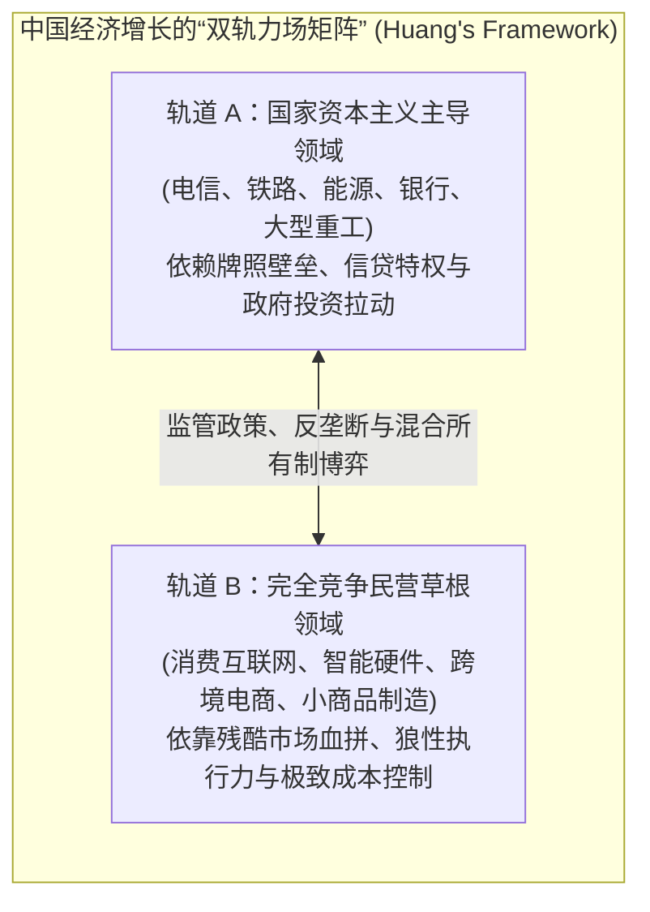

# Lec 04 国家治理与互联网跨国科技巨头博弈：中国市场深度解码 (National Government, Tech: China)

> MIT Sloan School of Management · 15.389 Global Entrepreneurship Lab (G-Lab) · Prof. Yasheng Huang

## TL;DR

- 黄亚生教授关于中国经济增长的双重动力分析：国家资本主义（State Capitalism）与草根民营创业（Private Sector）。
- 跨国科技巨头在新兴市场折戟的根源：谷歌在华博弈案例解构数字主权、监管合规与本土化断层。
- 搜狐、腾讯与百度的本土商业适应：在制度边界与快速变化的用户心智之间构建极度敏捷的防御工事。
- 跨国初创企业进入高强度监管市场的核心战略：合资架构、数据主权属地化与非政治化生态位选择。

## 中国经济的“双轨真实”：黄亚生教授的政经透镜 / Understanding the Chinese Paradox

对于绝大多数西方商学院学者和跨国投资者而言，中国经济一直是一个充满矛盾的巨大谜团：
- 一方面，中国拥有全球最庞大、由中央和地方政府牢牢掌控的国有企业（SOEs）、四大国有商业银行以及对土地与核心基础设施的绝对垄断；
- 另一方面，中国又爆发出了全球最富攻击性、最具创新活力、迭代速度快到令人窒息的民营互联网与智能硬件生态（从阿里巴巴、腾讯到大疆和字节跳动）。

麻省理工学院斯隆管理学院著名教授黄亚生在《具有中国特色的资本主义》（*Capitalism with Chinese Characteristics*）一书中，为 15.389 G-Lab 学员们提供了极具洞察力的剖析：**中国绝不是一个单一铁板一块的系统，理解中国创业环境的关键，在于看懂“国家资本主义”与“民间草根创业”之间的动态张力与边界博弈**。

### 两种资本主义模式的深刻分野

黄亚生教授指出，将中国经济笼统归为“国家主导”掩盖了民营经济创造的惊人历史财富：
- 在 1980 年代农村改革初期，正是千千万万个没有国家牌照、在体制缝隙中野蛮生长的乡镇企业（TVEs）与个体户，引爆了中国最早的生产力革命；
- 当民营企业被允许在没有政府过度干预的消费品与软件领域自由竞争时，其展现出的全要素生产率（TFP）增长速度令全球震惊；
- 然而，当行政干预过度延伸到微观商业竞争、向效率低下的国有实体倾斜信贷资源时，全社会的资本投资回报率便会面临不可逆的下行压力。

## 世纪世纪大博弈：谷歌（Google）在华进退的深层教训

在 G-Lab 课堂上，黄亚生教授带领学员们对 2000 年代全球最轰动的跨国商业冲突——**谷歌与中国互联网市场博弈**，展开了极为冷静、客观的制度与战略解剖。

::: example 谷歌在华商业博弈的全景复盘
- **傲慢入局与水土不服（2005 - 2008）**：
  谷歌进入中国市场时，试图将其在硅谷引以为傲的“不作恶（Don't be evil）”理想主义与全球统一的工程架构完整平移。然而，在实际商业竞争中，谷歌遭遇了来自百度（Baidu）的残酷降维打击：
  - **产品本土化的严重迟钝**：当时的中国网民以网吧年轻用户为主，渴望极速下载 MP3 音乐、泡论坛贴吧与搜索网络小说。百度推出了极度迎合下沉网民诉求的 MP3 搜索与贴吧社区；而谷歌加州总部的高管们坚决鄙视这种“非技术流”的做法，坚持纯粹的极简文本搜索，错失了中国互联网最狂野的人口红利期；
  - **跨洋汇报线的官僚死锁**：时任谷歌大中华区总裁李开复博士想要给服务器增加带宽或微调搜索算法，必须写长篇英文报告向加州山景城总部汇报，经历数个产品副总裁的漫长签字。而百度的李彦宏就在北京中关村，当晚喝完咖啡后凌晨即可上线新代码！
- **监管合规与价值观冲突的激化（2009 - 2010）**：
  随着中国对网络数字主权、信息安全合规要求的全面收紧，跨国巨头面临着不可调和的底层价值观冲突：加州工程师文化追求信息的绝对无限制自由流动，而主权国家政府坚持互联网必须遵守属地法律法规与意识形态底线；
- **黯然离场与历史余波**：2010 年初，谷歌宣布将搜索服务迁至香港，彻底退出了全球最大的互联网单一市场。
:::

| 战略评估维度 | 谷歌加州总部的全球化教条视角 | 百度/腾讯/搜狐的本土生存法则 |
| :--- | :--- | :--- |
| **战略决策重心** | 坚守全球产品代码架构的一致性与理想主义教条 | 100% 顺应本土消费习惯，在法律合规框架内穷尽一切变现可能 |
| **团队决策权** | 本地高管沦为执行层销售代表，缺乏底层产品定义权 | 创始人身处一线现场，以小时级速度响应用户需求变动 |
| **对监管的认知** | 将行政监管视为对其商业模式的无理干扰与挑衅 | 将政策红线视为不可动摇的刚性边界，并主动建立审核防线 |

## 本土巨头的丛林生存智慧：搜狐与腾讯的启示

与跨国公司的水土不服形成鲜明对照的，是中国本土第一代互联网拓荒者（搜狐张朝阳、腾讯马化腾、新浪王志东）所展现出的极高情境适应力：
- **可变利益实体（VIE 架构）的发明**：面对中国法律禁止外资进入电信增值业务的刚性空缺，中国早期创业者与华尔街律师联合发明了划时代的 VIE 协议控制架构，在完全合规的前提下，打通了引入海外美元风投并在纳斯达克敲钟上市的资本通道；
- **将“微创新”做到极致**：中国互联网企业很少从事最初始的原生科学发明，但他们将“应用层场景适配、高并发系统压测与人机交互便利性”做到了全球极致，最终在残酷的百团大战、打车大战中演化出拥有恐怖竞争力的超级应用（Super Apps）。

## 我的理解与实践洞察 / Personal Insight

进入任何一个由强力主权政府管辖的巨型新兴市场，跨国科技公司最大的死敌从来不是竞品，而是**自身的文化傲慢与制度无知**。

::: insight 商业理性必须尊重政治边界的刚性
商业逻辑讲求效率与利润，而国家治理讲求安全、稳定与主权秩序。很多跨国科技精英常常犯下的幼稚病，是用商业公司的价值观去教训主权国家的政治逻辑，这在政治经济学上注定是一场蚍蜉撼树的悲剧。**卓越的跨国企业家必须学会将“尊重当地监管与合规红线”作为企业生存的第一公理，在此绝对约束之下，将自身的技术能力深埋于造福当地民生、提升实体效率的无害化基础设施之中**。
:::

## 思考题与实战研讨

1. 很多硅谷独角兽在进军中国、印度或东南亚市场时，往往由加州总部指派一名不懂当地语言的外籍副总裁担任海外负责人。结合谷歌案例，分析这种组织架构为什么必然导致市场败局？
2. 比较 Uber 在中国的败北（最终被滴滴出行收购）与苹果公司（Apple）在中国的高额盈利：为什么同样作为美国顶尖科技巨头，两家公司在中国市场的命运与政府关系走向展现出了天壤之别？
3. 如果你的 G-Lab 咨询客户是一家计划进入中国或印度消费市场的拉美高科技初创企业，你会为他们设计怎样的本土合规与合作伙伴选择框架，来防止陷入跨文化诉讼陷阱？
