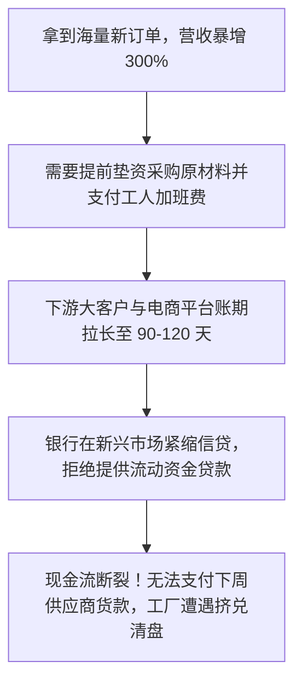
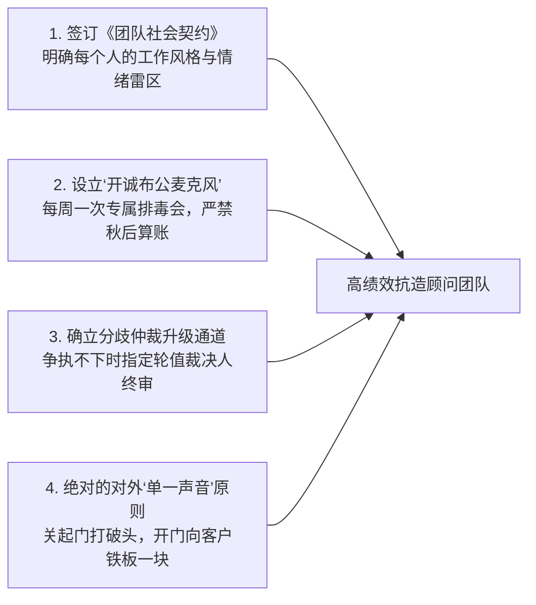

# Lec 05 新兴市场高成长扩张陷阱与跨文化团队动力学 (The Pressure to Expand & Team Dynamics: China Startup Scaling)

> MIT Sloan School of Management · 15.389 Global Entrepreneurship Lab (G-Lab) · Michellana Jester & Prof. Yasheng Huang

## TL;DR

- 新兴市场初创企业的“增长休克（Growth Shock）”：庞大的潜在市场需求与极度脆弱的营运资金链之间的尖锐矛盾。
- 营运资本陷阱（Working Capital Trap）：盲目追求营收翻倍导致应收账款与存货暴增，引发“盈利性破产”。
- G-Lab 警示案例“当好人组成糟糕团队”：剖析高智商顾问团队在海外高压环境下因缺乏心理安全感而崩盘的病理。
- 团队动能四步调试法：明确角色主权、建立情感沟通契约、设计升水升级流程与每日复盘反思。

## 巨大的诱惑与致命的深渊：高成长扩张陷阱 / The Scaling Paradox

在新兴市场（如中国、东南亚、拉美），创业者每天面对的最强烈刺激，莫过于“庞大到令人窒息的人口红利与市场空间”：
- 销售团队拿着翻倍的订单合同冲进创始人办公室：“只要我们扩建两条产线、多招 200 个地推人员，明年的销售额就能从 5000 万冲到 2 个亿！”
- 绝大多数创始人被这种狂热的增长前景冲昏了头脑，毅然签下扩张合约。然而，在 MIT G-Lab 追踪的数十个新兴市场初创企业破产清算案中，**超过 70% 的死亡不是因为没有业务，而恰恰是因为‘业务增长太快’！**

黄亚生教授与项目导师们在课堂上深度解剖了这一著名的**“营运资本陷阱（Working Capital Trap）与盈利性破产（Profitable Bankruptcy）”**。

::: definition 营运资本陷阱与现金转换周期 (Cash Conversion Cycle)
现金转换周期（CCC）是指：企业从向供应商支付原材料采购款开始，到最终从终端客户手中收回全部真金白银现金所经历的净天数：
$$	ext{CCC} = 	ext{存货周转天数 (DIO)} + 	ext{应收账款周转天数 (DSO)} - 	ext{应付账款周转天数 (DPO)}$$
在新兴市场，由于信用制度不健全，上游大宗供应商往往要求“见款发货（DPO 极低）”，而下游强势渠道商与大客户却频繁延期霸道拖欠（DSO 极高）。此时，**营收增长得越狂猛，企业账面上被死死吸干冻结的营运资金就越庞大**！一旦资金链断裂，账面上即使有上千万的“纸面净利润”，企业也会在瞬间猝死。
:::

### 规模化扩张的三大失控维度

除了致命的现金流黑洞，新兴市场初创企业在疯狂扩张时还会遭遇另外两重系统性打击：
1. **组织文化的稀释与熵增（Cultural Dilution）**：当员工规模在 6 个月内从 50 人膨胀到 300 人时，早期的兄弟义气与高频默契荡然无存。大量缺乏职业训练的新人涌入，部门墙迅速筑起，管理成本呈指数级失控；
2. **供应链良率的雪崩（Quality Decay）**：在小规模手工作坊阶段运行良好的工艺，在翻倍放量时遭遇瓶颈。外协小工厂偷工减料，导致次品率飙升，遭遇退货退款的毁灭性连锁反应。

## 团队动力学警示录：“当好人组成糟糕团队” / When Bad Teams Happen to Good People

在 G-Lab 历史上，最具震撼力的一节课是由米歇拉娜·杰斯特主持的闭门警示研讨：**《当好人组成糟糕团队》（When Bad Teams Happen to Good People）**。

::: example 一支豪华 MIT 顾问团队在海外的自我毁灭
- **梦幻阵容**：这是一支被全校寄予厚望的四人团队：组长是前麦肯锡全球资深商业分析师，组员包括一名高盛顶级投行并购专家、一名斯坦福毕业的硅谷资深全栈工程师、以及一名曾任联合国国际发展专员的跨文化专家。每个人单独拿出来都是无可挑剔的顶级精英；
- **潜伏的暗流（远程准备期）**：
  在秋季远程协作期间，组长习惯性地采用麦肯锡的高压强硬风格分配任务，在没有充分讨论的情况下擅自否定了其他成员的方案；其他成员为了保持“表面客气”，选择在会议上保持沉默，但在私下里开始拉小群互相抱怨发泄；
- **海外现场的灾难性大爆发**：
  当团队飞抵东南亚客户现场、面对客户极其混乱的数据和恶劣的酒店住宿条件时，长达数月积压的委屈与怒火彻底失控：
  - 在客户创始人当面，团队成员竟然因为幻灯片的一行排版和公式错误公开爆发激烈争吵，甚至拍桌离席；
  - 团队分裂为两个互不说话的对立阵营，各自向客户提交了一份自相矛盾的咨询方案；
  - 极度震惊的客户董事长直接向 MIT Sloan 院长发出了严厉的正式抗议信，该项目最终被全校通报批评并直接撤销。
:::

| 团队状态维度 | 表面客气但内耗濒死的“糟糕团队” | 具备高心理安全感的“敏捷战室团队” |
| :--- | :--- | :--- |
| **对待分歧的态度** | **害怕冲突**，会议上全员点头，会后私聊抱怨，冷暴力对抗 | **健康冲突**，就事论事激烈辩论，但绝不对他人做道德评判 |
| **沟通反馈频率** | 只有每周一次的正式例会，平时靠冷冰冰的邮件指责推诿 | 每天早晚 15 分钟站会同步，开诚布公分享情绪压力与困境 |
| **面对错误的心态** | 极度害怕暴露自己的技术盲区，试图通过粉饰数据来掩盖 | 坦然承认“这道公式我算不出来”，第一时间向队友求助 |

::: insight 艾米·埃德蒙森与团队心理安全感 (Psychological Safety)
哈佛商学院组织大师艾米·埃德蒙森（Amy Edmondson）的奠基研究证明：**决定一支高学历知识团队产出天花板的，从来不是成员个人的 IQ，而是团队内部的‘心理安全感（Psychological Safety）’**。心理安全感是指团队成员深信“在这个集体中，暴露无知、提出荒谬想法或犯下错误，绝对不会招致同伴的嘲笑、羞辱或政治报复”。缺乏心理安全感的团队，即使由诺贝尔奖得主组成，最终也逃不脱内耗瘫痪的宿命。
:::

## 护航海外征程的团队治理四步法

针对 G-Lab 团队即将面临的极端海外高压工况，杰斯特主任为学员们立下了四条强制执行的军规：

## 我的理解与实践洞察 / Personal Insight

“能成事的团队，不是不吵架的团队，而是懂得如何吵一场高质量架的团队。”

::: insight 商业高压是人性的照妖镜
在空调房和咖啡馆里，每个人都可以表现得文质彬彬、情商拉满。然而，当把几个人扔进异国他乡破旧的小旅馆，面对连续三天高烧腹泻、客户数据的彻底崩塌以及明早向董事会的生死路演时，一切伪装都会被撕得粉碎。**卓越的领导力不是祈祷没有危机发生，而是在危机降临之前，就与伙伴们建立起深不可测的互信底仓与制度护栏**。

## 思考题与实战研讨

1. 很多处于天使轮或 A 轮融资后的初创企业，投资机构在董事会上往往极力施压要求“不惜一切代价冲刺 GMV 翻倍”。结合本讲关于“营运资本陷阱”的理论，作为首席财务官（CFO），你该用怎样的量化财务模型向董事会展示盲目扩张可能引发的猝死风险？
2. 在 G-Lab 团队中，如果有一位组员由于严重的语言障碍或文化背景差异，在日常讨论中极度内向害羞、从不主动发表意见，导致其被其他外向强势的组员逐步边缘化甚至架空，作为项目队长，你应该如何设计工作流程来激活这位隐形专家的独特价值？
3. 在海外现场调研期间，如果客户中层干部出于自我保护，故意向顾问团队提供严重失真、被刻意美化过的生产排产报表，你和你的团队应该如何通过非正式访谈与田野暗访来交叉验证真实数据？
