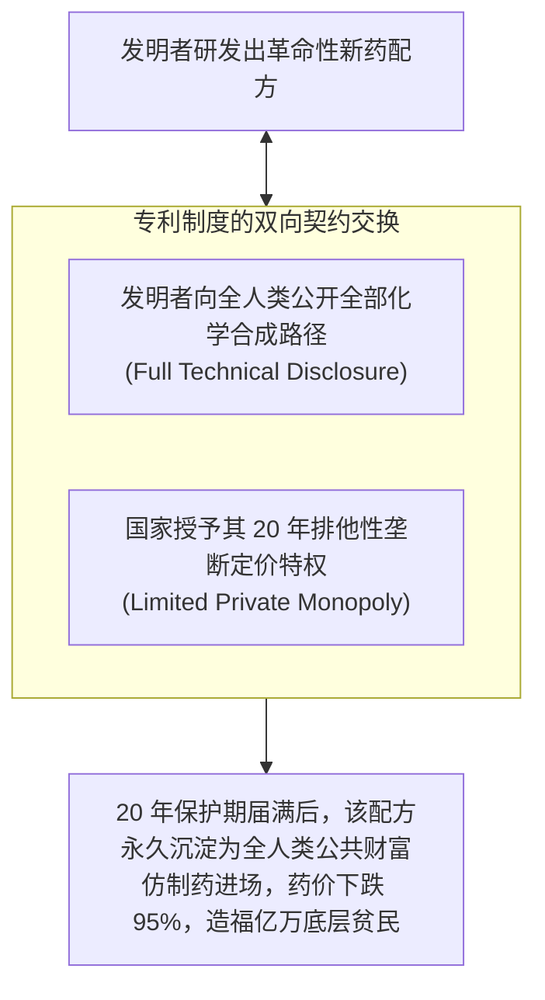
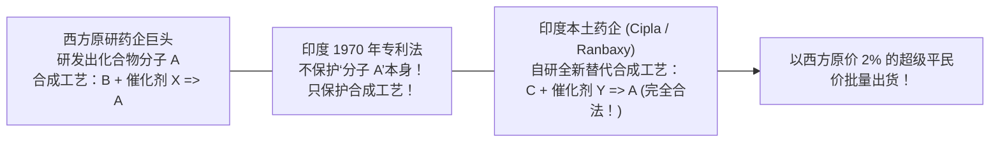

# Lec 06 知识产权制度演进与反向工程：印度制药业的崛起 (Intellectual Property Rights: India)

> MIT Sloan School of Management · 15.389 Global Entrepreneurship Lab (G-Lab) · Prof. Yasheng Huang & Prof. Simon Johnson

## TL;DR

- 专利制度的法理本质：以“彻底的技术充分公开（Full Disclosure）”换取法定有限期的私人垄断特权。
- 印度 1970 年专利法的划时代制度创新：废除药品“产品专利”，只承认“工艺专利”，引爆反向工程奇迹。
- 仿制药帝国的崛起：西普拉（Cipla）与雷迪博士等药企将救命抗艾滋药物价格打掉 98%，重塑全球公共卫生格局。
- 跨入 WTO 与 TRIPS 协议的制度再平衡：印度制药业从“低成本合法仿制”向“全球合规与自主创新研发”艰难跃迁。

## 专利的本质：一份神圣的社会契约 / The Intellectual Justification for Patents

在西方跨国制药巨头和主流知识产权法学家的叙事中，“侵犯专利权”往往被等同于最恶劣的偷盗犯罪。然而，麻省理工学院黄亚生教授在 15.389 课堂上直指法哲学的核心本质：**专利从来不是一项上帝赋予的绝对私人财产权，它在本质上是一份国家与发明人之间达成的“社会契约（Social Contract）”**！

::: definition 专利制度的社会契约逻辑 (The Social Contract Theory of Patents)
专利制度设立的终极初衷，**绝不是为了单纯保障发明人的私人暴利，而是为了‘引诱发明人彻底公开其绝密知识’，以促进全人类科学的永续扩散！**
- 如果没有专利制度，发明人会将配方作为商业机密带入坟墓（如同古代中药秘方或大马士革钢锻造法失传）；
- 国家向发明人承诺：“只要你愿意在专利申请书中**巨细靡遗、毫无保留地公开全部技术细节与实操工艺参数（Full and Complete Disclosure）**，国家就用暴力机器为你提供 20 年的排他性垄断销售特权”；
- **契约的核心终局在于‘期满公有化’**：一旦 20 年保护期届满，全人类的所有企业都可以零门槛、无偿地复制该技术，从而让全社会永久享受到科技进步的廉价福祉。
:::

## 制度设计的惊天妙手：印度 1970 年专利法革命

理解印度现代经济的最震撼切口，莫过于其战后在知识产权制度上做出的划时代法律重构。

1947 年印度独立后，国内医疗健康面临悲惨的死锁：全印度的药品市场被欧美跨国药企牢牢垄断，药价高居全球前列，数以亿计的底层平民只能在病痛中等死。为了彻底打破跨国资本的垄断枷锁，在英迪拉·甘地总理的主导下，印度国会于 1970 年通过了震撼全球的**《1970 年印度专利法》（Indian Patents Act 1970）**。

::: example 印度专利法的制度设计天才：区分“产品”与“工艺”
印度 1970 年专利法做出了一项惊天动地的法律条款修改：
- **坚决废除食品、药品与农用化学品的“产品专利（Product Patents）”**！
- **只承认化学合成的“工艺/方法专利（Process Patents）”，并将保护期从 14 年大幅削减至仅有 5 到 7 年！**

**这一制度微调带来了核爆级的法律后果**：
- 一家西方巨头花费数亿美元合成了一种全新的抗癌化合物分子 A，并在全球注册了专利；
- 按照印度 1970 年专利法，分子 A 这种化合物本身在印度**不享受任何法律垄断保护**！
- 西方巨头在专利中公开的合成路径是“通过 X 催化剂由原料 B 生成分子 A”；
- 聪明的印度化学家只要能找到一条全新的合成路径（例如“通过 Y 催化剂由原料 C 同样生成分子 A”），并在专利局申请新的工艺专利，**印度药企在印度法律下就可以完全合法合规、不受任何侵权指控地大规模量产分子 A 并在全球非专利覆盖国倾销！**
:::

## “世界药房”的崛起与反向工程奇迹

这项充满争议但极度契合国情的制度安排，在一夜之间彻底解放了印度优秀的化学家大军，引爆了长达三十年的**化学反向工程（Reverse Engineering）**黄金时代：

1. **全球最具攻击性的有机合成工业崛起**：西普拉（Cipla）、兰伯西（Ranbaxy）、雷迪博士（Dr. Reddy's）等本土药企迅速成长为跨国制药巨头。印度化学家精通分子逆向合成，往往在西方原研药上市后几个月内，就能研发出完全不同的高产率合成新路径；
2. **重塑全球公共卫生版图的“抗艾滋圣战”**：
   在 2000 年代初，非洲艾滋病大流行肆虐，数百万人濒临死亡。西方药企生产的三联“鸡尾酒疗法”抗艾滋药物，每位病人每年的费用高达 **10,400 美元**，非洲贫民根本无力承受；
   西普拉公司创始人优素福·哈米德博士（Dr. Yusuf Hamied）做出了震撼全人类的壮举：利用印度自研合成工艺，宣布将该鸡尾酒药物的年治疗费用**降至每人每年仅 350 美元（不到原价的 3%，平均每天不到 1 美元！）**，随后更是进一步降至不到 100 美元。这项义举在撒哈拉以南非洲直接拯救了上千万人的宝贵生命。

| 评估维度 | 西方跨国药企垄断阵营视角 | 印度仿制药企与全球公共卫生视角 |
| :--- | :--- | :--- |
| **对知识产权的定性** | 神圣不可侵犯的财产权，必须获取超额利润对冲 R&D 风险 | 专利不能凌驾于人类生存权与基础生命健康权之上 |
| **商业模式追求** | 高研发投入、超高定价、严格维持全球价格歧视 | 极致的化学工艺改良、规模化低成本制造、薄利多销 |
| **社会道德评价** | 指责印度为“合法的盗版海盗”，损害了前沿药物自研动力 | 盛赞印度为“发展中国家的普罗米修斯”与“第三世界药房” |

## 制度的再演进：入世 WTO 与 TRIPS 协议的阵痛与转型

天下没有免费的午餐。随着冷战结束与全球化深化，印度为了融入世界贸易组织（WTO），被迫在 1995 年签署了《与贸易有关的知识产权协定》（TRIPS 协议）。

经过十年的宽限过渡期，印度于 2005 年正式修改专利法，重新恢复了对药品的“产品专利”保护。这一历史性转折宣告了长达 35 年的“纯反向工程黄金时代”的终结：
- 印度制药业开始经历残酷的洗牌分化：缺乏自研能力的低端小作坊迅速被淘汰出局；
- 头部龙头药企（如雷迪博士与太阳制药）被迫启动第二次基因突变——**大举进军拥有严格 FDA 准入的美国仿制药市场（ANDA 通道），并逐步将利润投入到改良型新药（505(b)(2)）与原创生物类似药（Biosimilars）的自主研发之中**，完成了从草根逆袭到全球合规玩家的蜕变。

## 我的理解与实践洞察 / Personal Insight

印度制药业的发展史，是对“制度即核心竞争力”的最有力证明。

::: insight 制度设计必须匹配国家的真实要素禀赋
很多发展中国家的法学院教授往往不加批判地生搬硬套欧美最严苛的知识产权法条，以为这样就能“与国际接轨”。然而，黄亚生教授深刻指出：**如果一个国家的本土工业尚处于学徒期、缺乏原始创新能力，过早地实施超高标准的知识产权保护，无异于引狼入室，让本国市场彻底沦为外国跨国巨头的垄断殖民地**。唯有根据本国在不同发展阶段的要素禀赋，动态微调法律制度的松紧度，才能在保护创新与发展民生之间寻得精妙的平衡。
:::

## 思考题与实战研讨

1. 很多西方跨国巨头常常通过对即将过期的老药进行微小的晶型改变或剂型改良，重新申请长达 20 年的新专利，这种被称为“专利常青化（Patent Evergreening）”的策略被印度最高法院通过著名的《第 3(d) 条款》（诺华格列卫案 Novartis Glivec Case）严厉驳回。结合本讲理论，分析印度这一司法判决对全球创新与患者福祉产生了怎样的深远影响？
2. 比较印度在制药产业的“工艺专利突破”与中国在高铁产业的“引进消化吸收再创新”：两种模式在借力外部先验技术、重构国家竞争优势的路径上有哪些异曲同工之妙？
3. 如果你的 G-Lab 项目客户是一家在知识产权保护极其薄弱的国家开展业务的高科技初创企业，你会建议它如何通过“商业模式壁垒、超高速网络效应与自建闭环生态”，来防御竞争对手无孔不入的抄袭与反向工程？
