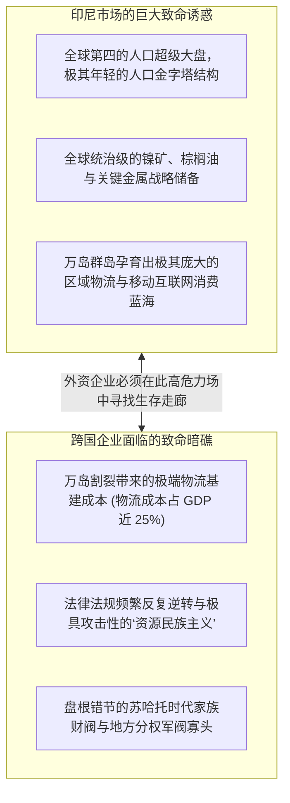

# Lec 07 外商直接投资与资源民族主义：印尼商业环境挑战 (FDI & Business Environment: Indonesia)

> MIT Sloan School of Management · 15.389 Global Entrepreneurship Lab (G-Lab) · Prof. Yasheng Huang & Prof. Simon Johnson

## TL;DR

- 东南亚最大经济体印尼的二元特征：诱人的巨大人口红利与丰富资源禀赋，伴随着基础设施赤字与政商寡头壁垒。
- 资源民族主义（Resource Nationalism）博弈：从禁止原矿直接出口到强推本土下游深加工的政策剧变。
- 外商直接投资（FDI）的政治风险对冲框架：如何化解外国资本与东道国主权利益的根本冲突。
- 本土财阀（Oligarchs）与裙带资本主义图谱：跨国企业在新兴岛国建立合规本地战略同盟的实操准则。

## 东南亚巨人的诱惑与陷阱 / Indonesia's Promise and Peril

印度尼西亚是东南亚无可争议的领头羊：拥有超过 2.7 亿人口（全球第四大人口国）、由 17,000 多个岛屿组成的庞大群岛国家，拥有世界上最丰富的红土镍矿（新能源汽车电池核心原料）、棕榈油、煤炭与铜金矿储量。

然而，在 MIT 斯隆管理学院 G-Lab 的历史档案中，印尼也是让跨国投资者和咨询顾问最容易折戟沉沙的高风险深水区。

西蒙·约翰逊教授与黄亚生教授在第 7 讲中，系统拆解了以印尼为代表的新兴资源大国所特有的商业环境图谱——**外商直接投资（FDI）、政治周期与“资源民族主义（Resource Nationalism）”的博弈拉锯**。

## 资源民族主义：从原料出口国到高附加值工业化的大豪赌

对于很多外资采矿和重工巨头而言，印尼政府在过去十年里推行的产业政策宛如一场噩梦：
- 长期以来，西方和亚洲跨国公司习惯于在印尼采掘廉价的原始镍矿石和铝土矿，直接装船运往本国冶炼厂，只给印尼留下微薄的开采税和满目疮痍的尾矿废墟；
- 2014 年起，印尼政府做出了震惊全球大宗商品市场的激进裁决——**彻底禁止任何未经加工的原始镍矿石直接出口！**
- 这一政策引发了跨国巨头的强烈抗议，欧盟甚至将印尼告上了世界贸易组织（WTO）法庭，指责其违反自由贸易协定。

::: definition 资源民族主义 (Resource Nationalism)
资源民族主义是指：**资源丰饶的发展中国家政府，出于提升国家主权经济独立性、增加财政税收与培育本土高端工业体系的诉求，通过提高出口关税、强制要求股权本土化、甚至实施绝对出口禁令等强制行政手段，逼迫跨国资本将产业链下游的高附加值冶炼、精细加工与制造环节强制迁移至东道国境内的战略政策**。
:::

### 印尼这场大豪赌成功了吗？

黄亚生教授指出，从国家战略转型的微观实证来看，印尼的激进博弈展现了惊人的成效：
- 面对矿石出口断供的生死危机，包括中国青山控股、宁德时代等在内的全球电池和不锈钢冶炼巨头，被迫在印尼中苏拉威西省莫罗瓦利（Morowali）和纬达贝（Weda Bay）等偏远海岛，砸下数百亿美元真金白银自建深海码头、巨型燃煤电厂与现代化高压酸浸（HPAL）冶炼工业园区；
- 印尼在短短数年内，从一个单纯出口红土泥巴的落后国家，一跃成为**全球无可撼动的精炼镍与不锈钢最大生产国，一举卡住了全球新能源汽车动力电池产业链的生死命脉**！

## 穿越政治雷区：跨国企业的 FDI 风险对冲模型

然而，对于中小初创企业和普通科技公司而言，印尼政策的剧烈波动往往意味着灭顶之灾。西蒙·约翰逊教授总结了外资在新兴市场管控政治风险的四大战略支柱：

| 政治风险维度 | 典型现实冲突场景 | 跨国初创企业的最优对冲策略 |
| :--- | :--- | :--- |
| **1. 股权所有权限制 (Ownership Caps)** | 法律突然规定特定行业外资持股比例不得超过 49% | 提前设计合规的同股不同权架构或寻找具备政治庇护力的合资方 |
| **2. 汇率剧烈波动与资本管制 (Capital Controls)** | 东南亚货币危机期间印尼盾暴跌，政府限制美元利润汇出 | 建立动态本币套期保值机制，并将多余利润再投资于属地固定资产 |
| **3. 地方分权与“双头敲诈” (Decentralization Tax)** | 雅加达中央各部委已经批准许可，但各省省长与县长依然扣留执照 | 坚决避免单纯依赖中央汇报线，必须将部分利益向地方社群与部落首领倾斜 |
| **4. 财阀寡头（Oligarchs）的恶意狙击** | 本地同类企业背后站着前总统家族或军方将领背景的巨型财团 | 避免与财阀正面硬刚，主动出让少数股权将其吸纳为“战略睡狮股东” |

::: insight 警惕“沉没成本俘虏”陷阱 (The Obsolescing Bargain)
国际政治经济学经典的“陈旧协议模型（Obsolescing Bargain）”指出：在项目投资初期，由于外国资本拥有资金和技术，东道国政府会给予极度谄媚的超常规免税与土地优惠；然而，**一旦外资的巨额厂房与设备彻底在当地水泥硬化施工完成（形成无法搬迁的沉没资产），双方的博弈天平就会瞬间倒转！**政府会开始翻脸，出台各种苛捐杂税和环保罚单。卓越的企业家在签署第一天起，就必须在合同中嵌入国际仲裁条款与分期投资杠杆。
:::

## 我的理解与实践洞察 / Personal Insight

在新兴市场投资，从来不是纯粹的算术题，而是一门走钢丝的高超政治艺术。

::: insight 利益的本地锚定是最好的安全气囊
很多跨国公司在出海印尼或东南亚时，恨不得把每一个零部件都从本国运过去，连工地的保安和食堂厨师都要从老家带去，完全不给当地社会留下一滴油水。这种自私的离岸飞地模式，必然会在下一次社会动荡中成为暴民首当其冲的洗劫目标。**真正的出海高手，懂得将自身的利益与当地的就业、学校建设、税收分成以及本土合伙人的家族荣誉深度交织在一起**。让当地人觉得“这家公司的存活关乎全村人的饭碗”，你的商业帝国才能在政治风暴中屹立不倒。
:::

## 思考题与实战研讨

1. 很多跨国企业在进入印尼市场时，为了图省事，往往直接与当地最有权势的政治家族企业组建合资公司。结合印尼频繁的民主选举与反腐更迭历史，分析这种“将身家性命完全绑定在单一政治派系身上”的策略存在着怎样毁灭性的长期隐患？
2. 面对印尼极度割裂的“万岛群岛”地理现实，为什么像极兔速递（J&T Express）这样植根于印尼本土的物流企业，能够凭借加盟制与极其凶悍的地推狼性击溃 DHL 等欧美老牌跨国物流巨头？
3. 如果你的 G-Lab 项目客户是一家在印尼开拓数字金融与微型借贷的金融科技初创企业，面对当地极高的坏账风险与缺乏全国统一身份证件的现状，你会如何设计风控与贷后催收策略？
