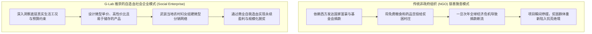
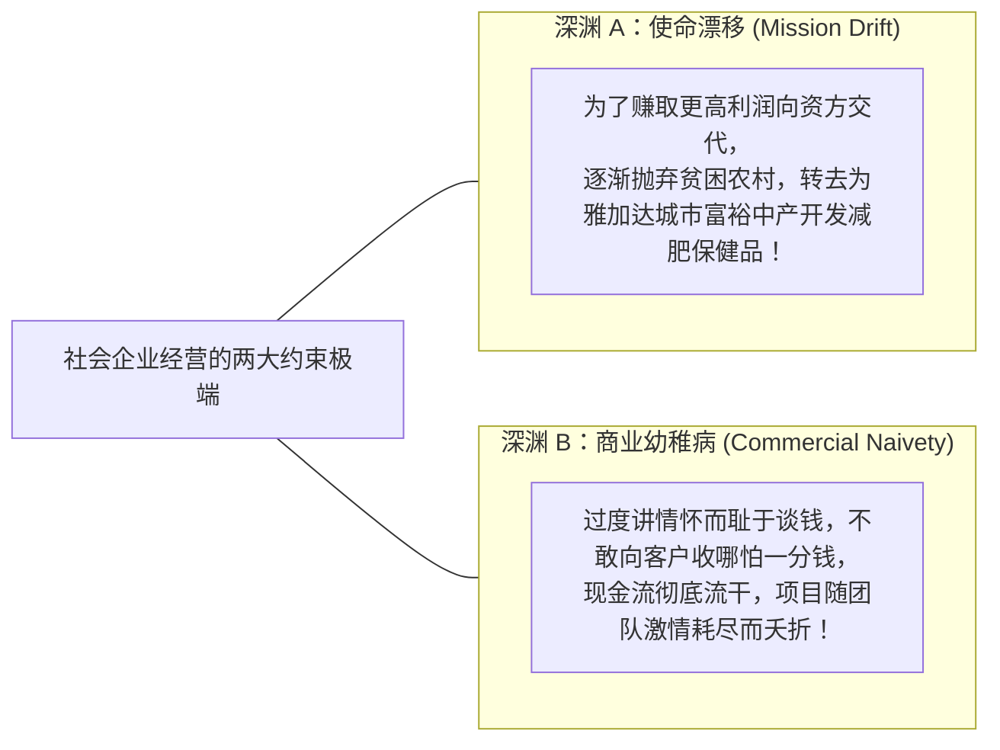

# Lec 08 底层包容性增长与社会创业实战：印尼营养不良改善项目 (Social Entrepreneurship: Indonesia)

> MIT Sloan School of Management · 15.389 Global Entrepreneurship Lab (G-Lab) · Michellana Jester & Prof. Yasheng Huang

## TL;DR

- C.K. 普拉哈拉德（C.K. Prahalad）“金字塔底层（BOP）”理论：全球 40 亿低收入群体不仅是慈善受捐者，更是极具潜力的庞大商业市场。
- 发展中国家农村最后一公里的断裂难题：高昂的冷链运输成本与极度匮乏的下沉分销渠道。
- G-Lab 明星获奖案例复盘：MIT 顾问团队为印尼社会企业量身打造解决儿童营养不良的自循环商业模型。
- 社会创业（Social Entrepreneurship）的核心平衡木：在坚守利他社会使命（Impact）与实现独立造血财务可持续性（Viability）之间求索最优解。

## 金字塔底层的财富：从慈善救济到商业自循环 / The Fortune at the Bottom of the Pyramid

在传统的全球商业叙事中，跨国公司的聚光灯永远打在全球最富裕的 10% 高端消费者身上：为纽约、伦敦和上海的中产阶层设计更昂贵的智能手机、抗衰老护肤品与新能源跑车。而对于生活在发展中国家、每天生活费不足 2 美元的全球近 40 亿底层人口，商业世界习惯性地将他们打上“没有购买力、毫无商业价值”的标签，将他们丢给联合国和非政府慈善组织（NGO）去施舍救济。

密歇根大学著名战略大师 C.K. 普拉哈拉德（C.K. Prahalad）在《金字塔底层的财富》（*The Fortune at the Bottom of the Pyramid*）中彻底粉碎了这一教条，并构成了 15.389 G-Lab 社会创业版块的核心思想基石：**金字塔底层的数十亿贫困人口，不是被动等待可怜的包袱，而是一个拥有巨大未满足刚需、一旦通过创新商业模式被激活便能爆发出惊人韧性的万亿美元蓝海！**

::: definition 社会企业 (Social Enterprise)
社会企业是指：**以解决重大社会、环境、贫困或公众健康危机为核心组织使命，但完全采用现代商业化管理机制、依靠销售产品或服务获取利润以实现自身财务独立造血可持续发展的创新企业形态**。它既不同于追求纯粹股东暴利的传统资本主义商业公司，也不同于依赖外部施舍度日的纯慈善机构。
:::

## G-Lab 经典获奖案例：攻克印尼农村儿童严重营养不良

在 2009-2010 年度的 G-Lab 项目中，一支由 4 名 MIT Sloan 学生组成的顾问团队，奔赴印尼西爪哇省与东努沙登加拉省的极其贫困偏远的农村地区，与当地一家名为“Nutri-Growth”的本土社会企业展开了生死攻坚。

::: example 印尼儿童营养补充剂商业化困局与破局
- **残酷的现实灾难**：在印尼偏远海岛农村，由于主食结构极度单一（仅靠大米和木薯淀粉填饱肚子），超过 35% 的五岁以下儿童患有严重的微量元素缺乏与长期慢性营养不良，导致大面积发育迟缓、智力受损以及免疫力低下导致的致命腹泻；
- **客户企业的死锁**：
  Nutri-Growth 创始人虽然研制出了一种富含微量元素、锌、铁和维生素的营养补充糊剂（微型小袋包装），但在商业化上濒临破产：
  - **传统药店渠道彻底失灵**：贫困村庄方圆 30 公里内根本没有正规药房，农村母亲极度自卑且缺乏营养知识，根本不会带孩子去城镇医院；
  - **冷链物流成本上天**：群岛交通颠簸，传统营养液在高温潮湿环境下极易变质腐败；
  - **定价与现金流断裂**：大包装（一个月剂量）售价 10 美元，贫困家庭即使想买，手头也根本掏不出整张大钞！
- **MIT G-Lab 团队的微观商业手术**：
  顾问团队深入印尼乡村田间地头，与数百名农村母亲同吃同住，量身定制了一套惊艳全校的战略重构方案：
  1. **产品物理形态极简重构**：将易变质的液体配方改良为微胶囊包裹的高稳定性干粉颗粒，常温保质期长达 18 个月，彻底摆脱了对冷链的依赖；
  2. **“微型单包装（Sachet Revolution）”策略**：坚决摒弃 10 美元的大罐包装，改为每天一袋的独立铝箔微包装，**零售价精准定在 1000 印尼盾（仅约合 0.1 美元，折合几美分！）**。农村家庭每天即使只靠打零工赚取微薄现金，也能用手头的一枚硬币随手给孩子买上一袋；
  3. **打造“印尼版雅芳小姐”微型创业网络（Ibu Network）**：
     顾问团队放弃了昂贵的传统超市与电视广告，与当地乡村妇女互助会合作。团队培训了数百名有威望的农村母亲（当地尊称为 Ibu），向她们提供小额微型进货贷款。母亲们背着印有卡通图案的帆布包，在走家串户闲聊喂奶时，向邻居展示营养粉拌进大米粥的神奇效果；
  4. **商业与社会双赢奇迹**：
     每一袋营养粉不仅改善了一个孩子的健康，更为推销它的农村母亲带来了 30% 的微型零售利润提成！千千万万名农村妇女第一次拥有了属于自己的独立经济收入，社会地位显著提高；而企业在短短 18 个月内实现了盈亏平衡并获得国际影响力投资机构的大规模注资，将营养网络覆盖了印尼全境超过 200 万名贫困儿童！
:::

| 运营维度 | 传统商业药企思路 | G-Lab 重塑后的印尼社会企业模式 |
| :--- | :--- | :--- |
| **包装与计量单位** | 针对中产家庭的整月大罐装（单价 10-20 美元） | 针对每日现金流零工家庭的单日铝箔微包装（单价 0.1 美元） |
| **分销履约路径** | 依赖省城连锁药店与大医院处方柜台 | 依靠走村串户的本土农村母亲直销微型创业大军 |
| **市场教育方式** | 昂贵的高大上医学学术会议与电视明星代言 | 在村头大树下组织熬粥品尝会，面对面传授母婴卫生知识 |

## 社会企业的终极平衡木：使命漂移与财务独立

社会企业之所以在管理学界被视为最具挑战性的组织形态，是因为它必须同时背负商业盈利与社会善意的双重受托责任。在传统资本市场眼中，任何不追求利润最大化的行为都是对股东的不忠；而在极端非营利组织眼中，任何向穷人收钱的举动都被扣上剥削资本家的道德帽子。

杰斯特主任在总结该案例时，向全体学员剖析了社会企业在做大做强过程中最容易失足跌落的两大深渊。这两大陷阱如同悬在创始人头顶的达摩克利斯之剑，稍有不慎就会导致整个组织走向瓦解或变质：

要规避这两大深渊，社会企业必须在顶层治理结构中建立双重考核机制：不仅考核 EBITDA 利润与资产回报率，更要将“受惠贫困儿童的营养改善率”硬性写入高管薪酬与董事会审计章程，用制度锁死使命的纯粹性。

真正顶尖的社会企业家，必须同时拥有一颗**“燃烧的菩萨心肠”**与一副**“极其冷酷严谨的投行 CFO 头脑”**。唯有用最严密的单位经济模型（Unit Economics）与极致的供应链纪律去捍卫崇高的社会使命，商业文明才能真正散发出普惠人间的温润光芒。

## 我的理解与实践洞察 / Personal Insight

“商业不仅能用来赚钱，商业更是人类有史以来最强大的脱贫机器。”

::: insight 尊严是最好的良药
在很多贫困地区，纯粹的白食施舍往往会摧毁受助者的心理自尊，滋生出怠惰与无休止的索取。而当一个企业将底层人民视为尊贵的“消费者”与合伙的“微型分销商”时，贫困母亲是用自己的劳动赚取了孩子的口粮。**商业交易赋予了底层人民最宝贵的东西——选择权与做人的神圣尊严**。用商业模式的严密逻辑去解决人类最顽固的社会溃疡，是 MIT Sloan 行动学习交付给世界的最美答卷。
:::

## 思考题与实战研讨

1. 很多大型快速消费品巨头（如联合利华在印度推行的 Shakti 妇女分销网络）也大规模采用了金字塔底层（BOP）策略。结合本讲理论，分析为什么在下沉到极端落后的农村地区时，“赋能当地微型创业者”往往是击穿最后一公里物流阻尼的唯一解？
2. 在印尼营养改善案例中，如果企业为了追求短期暴利，将微包装单价从 0.1 美元强行提高到 0.3 美元，会对当地贫困家庭的购买行为产生怎样的断崖式破坏？你该如何通过边际弹性测试来测定底层的最优心理价格红线？
3. 如果你今天要在非洲或拉美发起一个致力于解决清洁饮用水难题的社会企业，你会如何设计你的“自造血商业闭环”，来避免项目陷入依赖外部捐款的被动局面？
