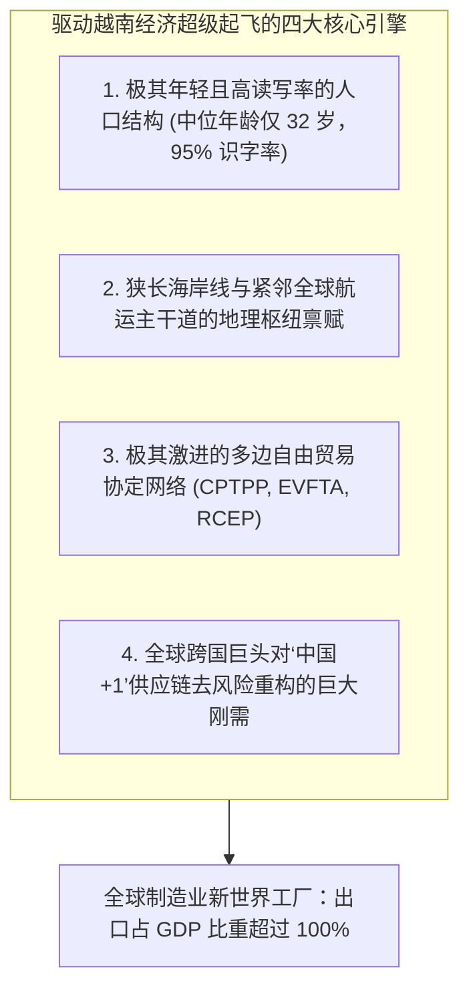
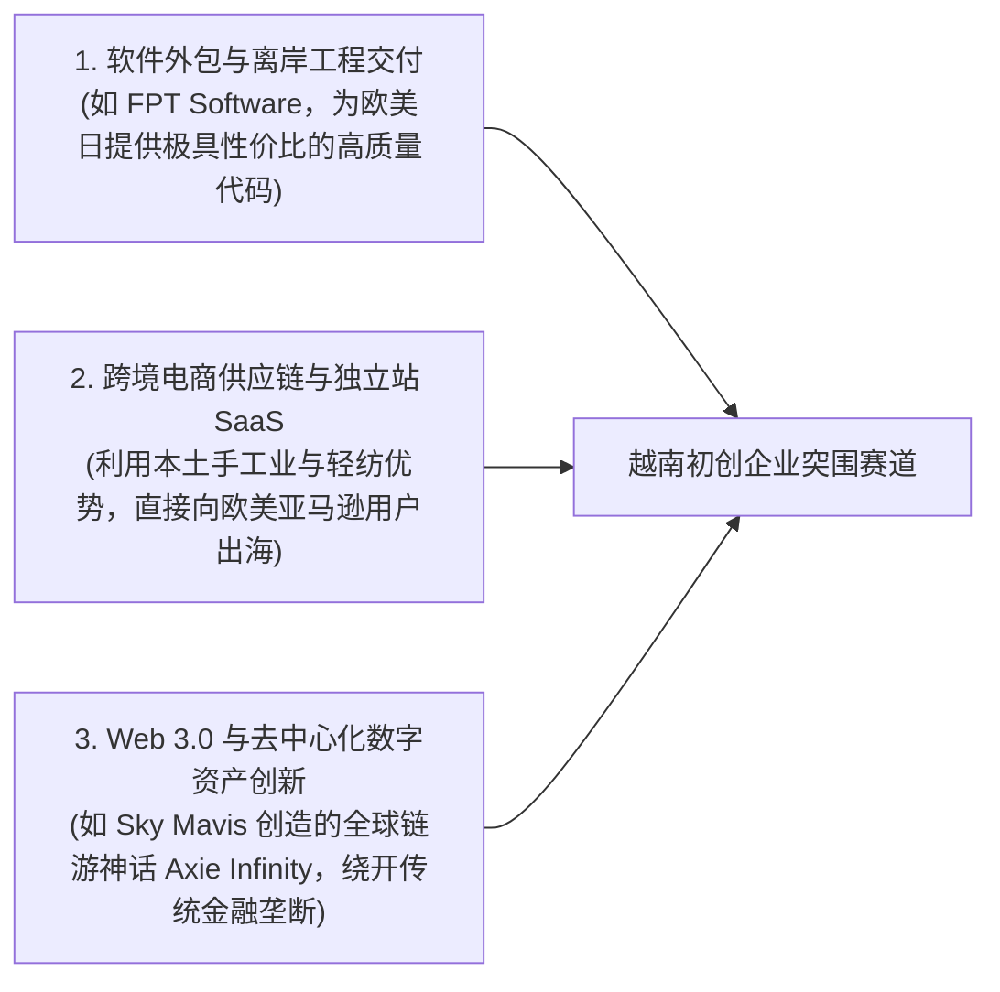

# Lec 09 转型经济体的新生代创业：越南革新开放与跨国承接 (Fledgling Companies in Fledgling Economy: Vietnam)

> MIT Sloan School of Management · 15.389 Global Entrepreneurship Lab (G-Lab) · Prof. Yasheng Huang & Prof. Simon Johnson

## TL;DR

- 越南“革新开放（Doi Moi）”的历史跃迁：从高度管制的计划经济向全球出口制造新高地的全面突围。
- 人口红利与“中国+1（China + 1）”供应链大转移：跨国电子巨头（三星、富士康、立讯）的大规模产能集聚。
- 越南经济的二元制度撕裂：垄断性国有企业（SOEs）掌握信贷特权，民间初创企业面临严峻的土地与融资壁垒。
- 本土初创企业的突围路径：避开重工业与基础金融正面战场，深耕跨境电商物流、软件外包与本地化移动服务。

## 战火余烬中的经济起飞：越南革新开放奇迹 / The Rise of the New Asian Tiger

在 1980 年代中期，饱受三十年战火摧残的越南，面临着严重的恶性通货膨胀（超过 700%）、粮食极度短缺与苏联经互会援助断流的崩溃边缘。1986 年，越共六大正式宣布推行划时代的**“革新开放（Doi Moi）”**政策：解散农业集体合作社、承认私人土地长期使用权、全面废除价格管制并积极吸引外国资本入驻。

在 MIT Sloan 15.389 G-Lab 课堂上，黄亚生教授与西蒙·约翰逊教授将目光投向了这片充满惊人活力的土地——**越南（Vietnam）：当今全球最具成长性、也是无数 G-Lab 团队深度介入的转型经济体标杆**。

### 三星效应与越南制造的跃迁

没有哪一个跨国公司能像韩国三星电子一样，如此深刻地重塑一个国家的微观经济面貌：
- 2008 年起，三星在越南北部北宁省和太原省投资了数百亿美元，建立了全球最大的智能手机制造基地；
- 如今，全球超过一半的三星 Galaxy 智能手机直接出产于越南车间；三星一家的出口额，在鼎盛时期占据了整个越南国家总出口总额的近 20%！
- 随后，富士康、立讯精密、歌尔股份、英特尔以及耐克、阿迪达斯等跨国巨头纷至沓来，使得河内-海防工业走廊迅速成为全球消费电子与轻工业组装的核心重镇。

## 二元体制的阵痛：国有巨头的特权与民营初创的逼仄

然而，黄亚生教授尖锐地指出，表面的宏观 GDP 繁荣掩盖了越南内部极其深刻的**“二元结构制度失衡”**：

| 经济主体类别 | 资源掌控力与制度特权 | 核心效率表现与创新产出 | G-Lab 顾问团队洞察到的微观现实 |
| :--- | :--- | :--- | :--- |
| **垄断性国有企业 (SOEs) (如越南石油、越南邮电、煤炭集团)** | **掌握绝对垄断特权**：占有全社会绝大多数工业用地配额、低息国有银行贷款与政府特许经营牌照 | **效率极低、负债累累**：资本回报率（ROIC）长期处于低位，大面积陷入寻租腐败与坏账泥潭 | 严重挤压了全社会有限的流动性，推高了民间商业土地的寻租黑市成本 |
| **外国跨国代工巨头 (FDI Firms) (如三星、鸿海、英特尔)** | 享受极度优厚的“三免四减半”税收优惠与量身定制的港口海关绿色通道 | **高度封闭的离岸飞地**：核心芯片与高端元器件 100% 依赖海外进口，本地采购仅限于低端纸箱与托盘 | 对本土民营企业的技术溢出效应远低于预期，存在严重的“产业脱节”风险 |
| **本土草根民营初创企业 (SMEs & Startups) (本土科技与消费互联网)** | **处于制度食物链最底层**：遭遇严苛的商业抵押审查，民间借贷利率高达 15%-20% 以上 | **极致的野蛮求生本能**：迭代速度极快、执行力极强、对本土年轻人心智理解极深 | 缺乏长期耐心资本，必须在成立第一天就追求正向现金流自造血 |

::: definition 制度性双重标准与所有权歧视 (Ownership Bias in Transitional Economies)
黄亚生教授在长期研究中国与越南转型经济时强调：许多转型国家虽然在口头上高喊“大力支持民营经济”，但其深层的金融与法律制度却深深植入了**“所有权歧视（Ownership Discrimination）”**。银行行长将贷款放给低效的国有企业哪怕产生坏账也无需承担个人政治责任；而一旦将资金贷给破产的民营初创企业，就会被扣上“流失国家资产”的审查罪名。这种制度性免责机制，构成了民营企业家头顶不可逾越的融资天花板。
:::

## 越南新生代初创企业的突围走廊

在如此逼仄的制度缝隙中，越南新一代年轻极客与海归企业家是如何杀出重围的？G-Lab 历史案例展现了三大经典赛道：

1. **软件外包与高性价比工程师红利**：以 FPT 为代表的越南本土科技巨头，将每年数十万名数学底子扎实、要价仅为硅谷五分之一的年轻程序员整编为庞大的软件交付大军，成为仅次于印度的全球离岸 IT 外包新圣地；
2. **利用全球互联网基础设施绕开本土官僚壁垒**：许多越南年轻创业者坚决不向本地银行借一分钱，他们利用 GitHub、亚马逊 AWS 与海外 Stripe 支付网关，直接面向全球市场销售软件与数字工具，在物理上生活在胡志明市，但在资产负债表上完全实现全球化自由漫游。

## 我的理解与实践洞察 / Personal Insight

“在水流最湍急的河段，鱼儿游得最快。”

::: insight 转型经济体的狂野生机
在瑞士或德国，一切都被法律、行会与标准严密规划好了，年轻人只能在百年老店里按部就班地当一颗螺丝钉；而在越南、印尼这样处于历史起飞期的转型国度，满街呼啸而过的摩托车、彻夜灯火通明的路边摊、年轻人眼中对财富与改变命运的狂热饥渴，散发着令人眩晕的原始生命力。**对于创业者而言，不完美与混乱从来不是缺点，混乱恰恰是超额阿尔法收益（Alpha）与阶层跃迁的唯一母体**。

## 思考题与实战研讨

1. 很多跨国企业在将供应链从中国迁往越南时，常常遭遇“越南港口拥堵、熟练高级技工匮乏、本地二级配套元器件极度短缺”的尴尬局面。结合本讲理论，分析为什么越南无法在短时间内完全替代中国完整的“全产业链重工集群”，而只能承担“最终组装车间”的角色？
2. 越南年轻人口占绝对优势的人口金字塔结构，对东南亚移动消费互联网（如社交电商、移动支付、即时送达与短视频娱乐）的渗透速度带来了怎样的推动作用？
3. 如果你的 G-Lab 咨询客户是一家位于河内的初创智能硬件设计公司，面对来自中国深圳极具成本杀伤力与极速开模能力的竞品冲击，你会建议它如何构筑属于本土的防御护城河？
