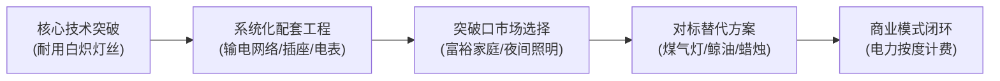

# Lec 1 课程导论与可行商业构想 (Course Introduction and Viable Business Ideas)

> MIT 15.390 · New Enterprises · 模块一：创业启航与创意初筛

## TL;DR

- 创业不仅是一门艺术，更是可教授、可学习且可重复验证的严谨工程科学。
- 爱迪生与特斯拉的历史对比揭示：发明（Invention）不等于创新（Innovation），没有商业化与客户价值捕获的发明无法自立。
- 启动创业的核心在于从真实未满足需求出发，在进攻者（Attacker）与防守者（Defender）的博弈中寻找不对称优势。
- 严谨创业法（Disciplined Entrepreneurship）提供 24 步结构化导航，避免盲目试错带来的资金与时间损耗。

## 创业的本质：科学还是直觉？

大众文化往往将创业者神话为具备超凡直觉的天才冒险家。然而在 MIT Sloan 的教学体系中，创业被重新定义为一项具有内在结构的方法论工程。

::: definition 创新公式 (Innovation Formula)
$$Innovation = Invention 	imes Commercialization$$
创新是发明与商业化两者的乘积。若一项发明的商业化能力为 0，即便技术价值再高，其对社会的实际创新贡献亦为 0。
:::

托马斯·爱迪生（Thomas Edison）与尼古拉·特斯拉（Nikola Tesla）的经典案例深刻印证了这一原理：
- **尼古拉·特斯拉**：发明了交流电系统、无线电遥控、早期雷达概念与感应电动机，其技术天赋极其罕见。但他缺乏对客户决策、定价模型、商业契约与资本运作的理解，最终穷困潦倒。
- **托马斯·爱迪生**：不仅改良了耐用碳丝灯泡，更系统设计了中央发电站、地下输配电网络、电表计量与成套插座，构建了全球第一套商业化电力公用事业体系（成为通用电气 GE 的前身）。

::: insight
创业者的第一堂必修课是认清自己的角色定位：你不能仅仅充当醉心于技术参数的发明家（Inventor），而必须进化为打通技术、市场、定价与组织的创新者（Innovator）。
:::

## 商业机会的三维解构

如果回到 1887 年，作为爱迪生面对初生的电灯技术，商业计划书应当如何开局？

评估一个初始商业构想是否构成卓越商业机会（Exceptional Opportunity），必须穿透以下四大维度：

1. **解决的真实痛点与现状缺陷**：
   - 1887 年传统照明（蜡烛、鲸油灯、煤气灯）存在巨大安全隐患（火灾）、空气污染（煤烟）与照明亮度严重不足。
   - 新技术提供了清洁、稳定、安全的革命性体验。
2. **总潜在市场空间（Total Addressable Market, TAM）**：
   - 测算基准：全美 5000 万人口对应约 1300 万户家庭，加上商业机构与工厂。
   - 现有替代品总支出（煤气费 + 鲸油蜡烛采购额）即为照明市场的价值上限。
3. **海滩阵地（Beachhead Market）切入逻辑**：
   - 资源极度匮乏的初创团队无法同时服务所有群体。
   - 爱迪生首先锁定纽约的高净值富裕家庭。原因在于：他们具备支付高额初装布线费用的财力；他们渴望通过新技术彰显社会地位（Social Status）；他们具有向大众辐射的样板效应。
4. **潜在扩展边界（Power vs. Light）**：
   - 商业远见在于识别电力的多重衍生应用：从单纯的“照明（Lighting）”拓展到“动力（Power）”，驱动电梯、冷藏机与打字机。

## 进攻者与防守者的动态博弈

初创企业在资源、资金与品牌上全面弱于行业在位者，但为何颠覆性创新往往由新创企业完成？

| 比较维度 | 行业防守者（Established Incumbent） | 创业进攻者（Startup Attacker） |
| :--- | :--- | :--- |
| **资产与包袱** | 拥有沉重的固定资产与既得利益客户群 | 零历史资产包袱，具备极端灵活性 |
| **决策机制** | 多层级审批，规避一切短期利润稀释风险 | 扁平快速，依据市场第一线反馈每日迭代 |
| **增长动力** | 维护现有百亿美元存量市场利润率 | 只要在一个亿美元细分市场撕开缺口即可生存 |
| **组织文化** | 风险厌恶，惩罚失败 | 拥抱实验，在试错中逼近真相 |

::: pitfall
年轻创业者最常犯的错误是“拿着锤子找钉子”：基于自己在实验室开发的一项前沿算法或新材料，到处寻找可以套用的应用场景，而对行业真实购买流程与经济效益视而不见。
:::
