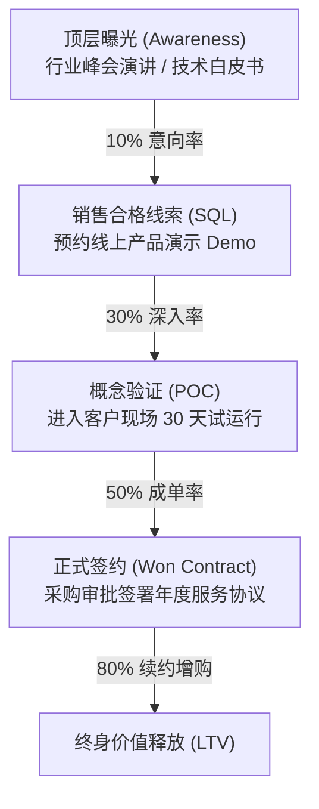

# Lec 10 营销方案实战模拟 (Marketing Plan Simulation Lab)

> MIT 15.390 · New Enterprises · 模块三：价值主张与产品规格

## TL;DR

- 营销方案模拟实验室旨在让学生在受控沙盘中检验市场切入假设与销售漏斗响应。
- 营销不仅是品牌宣传与公关曝光，更是从线索捕获（Lead Generation）到最终转化交付的可量化漏斗系统。
- 早期初创企业必须依靠高触摸度（High-Touch）直接互动积累第一批标杆客户，而非过早依赖被动式数字投放。
- 模拟推演要求团队量化计算线索流转速率、管道损耗率与销售代表月度产能上限。

## 营销漏斗的沙盘动态推演

在进入真实市场展开规模化投入前，15.390 组织了营销方案模拟沙盘（Simulation Lab），模拟新创企业在首个 180 天内的营销资源分配决策。

沙盘推演重点关注以下四大营销杠杆的动态联动效应：
1. **预算在品牌公关 vs. 直接转化之间的配比**：在未验证海滩阵地前，在广泛媒体上砸钱投放往往导致大量劣质线索涌入，迅速拖垮销售团队精力。
2. **销售合格线索（Sales Qualified Lead, SQL）的定义门槛**：线索质量要求过松会导致大量无效拜访；要求过严则可能导致漏斗干涸。
3. **概念验证（Proof of Concept, POC）的周期控制**：无偿 POC 是 B2B 初创企业的利润黑洞，必须设定明确的成功验收标准与转付费节点。
4. **早期客户转介绍系数（Referral Coefficient）**：首批种子客户能否主动为项目背书，是产品实现有机裂变的关键标志。

## 早期营销战略的三大实战法则

基于沙盘推演反馈，Bill Aulet 总结了新创企业启动营销的三条铁律：

::: definition 初创期营销法则 (Foundational Marketing Rules)
1. **创始人必须是头号销售员**：在商业模式未标准化之前，严禁外包销售或过早招聘纯职业经理人。创始人亲自跑客户才能在第一时间捕捉痛点反馈并推动产品快速重构。
2. **标杆客户（Lighthouse Customer）的战略重力**：拿下行业公认最严苛的头部机构（如麻省总医院或波音研发部）作为首个用例，后续销售的信任阻力将骤降 80%。
3. **教育市场不如顺应现有工作流**：千万不要试图重塑客户的底层认知；将新产品包装为“现有流程的无痛效率插件”，是缩短销售周期的最快捷径。
:::

::: insight
沙盘模拟暴露出的最普遍问题是团队的“乐观主义偏差”。初创团队常常假设线索转化率达到 20%、销售周期只需 3 周；而模拟沙盘引入真实世界中的官僚审批延迟、预算冻结与竞争对手恶意压价后，往往让虚构的完美报表迅速破产。
:::

::: pitfall
小心“虚荣指标（Vanity Metrics）”陷阱。网站点击量、应用下载量、推特粉丝数和新闻报道篇数不能支付办公室租金，只有真正打入银行账户的预付款与可收回支票才算数。
:::
