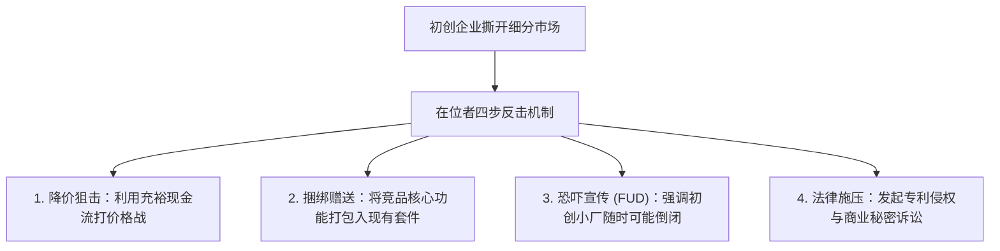

# Lec 11 持续竞争优势与护城河构建 (Sustainable Competitive Advantage and Barriers)

> MIT 15.390 · New Enterprises · 模块三：价值主张与产品规格

## TL;DR

- 真正的竞争优势不是短期领先，而是阻止有实力的竞争对手在未来蚕食利润的结构性护城河。
- 核心壁垒形态包括高转换成本（Switching Costs）、双边网络效应（Network Effects）与专有规模资产。
- 教科书出版商转型案例揭示：当技术基础发生范式转移时，传统在位者的分销网络优势会瞬间变成致命负担。
- 初创企业必须在执行摘要与路演中展示客观、严密的竞争评分表（Competition Score Sheet）。

## 竞争维度的深度透视：防守者如何反扑？

当你的商业构想取得初步成果后，市场上的巨头不会坐以待毙。Howard Anderson 指出，面对初创进攻者，行业在位者通常会采用以下四大反击策略：



初创企业若要在风暴中屹立不倒，必须尽早构筑起以下三大结构性壁垒：

### 1. 极高的转换成本（High Switching Costs）
一旦客户在你的系统上沉淀了深度数据、业务流程与员工操作习惯，迁移到竞品的代价将远超购买新软件本身的费用（如 SAP 在大型企业核心 ERP 领域的地位）。

### 2. 双向自增强网络效应（Two-Sided Network Effects）
平台的两端用户互相吸引，形成“用户越多 -> 供给越丰富 -> 吸引更多用户”的正向飞轮（如 Uber、Airbnb、Windows 开发者生态）。

### 3. 结构性低成本结构（Structural Low Cost）
通过颠覆性的技术路径，从底层将边际生产与服务交付成本削减至在位者固定成本的三分之一以下，使得对手即便跟进降价也必然严重失血。

## 经典行业案例：大学教科书出版商的数字化困境

课堂通过大学教科书出版行业的典型案例，展现了技术范式变迁对传统商业模式的摧毁性打击：

```text
[传统巨头 (培生/麦格劳希尔)]                 [数字互动初创平台]
- 定价：每本纸质教科书 180-250 美元          - 定价：每学期订阅费 45 美元
- 资产：巨额印刷厂投资、仓储与线下代理商网络 - 资产：云端交互系统、即时自适应题库
- 软肋：无法遏制二手书回流与盗版影印         - 优势：实时收集学生解题数据，向教授推送学情报表
- 组织困境：推行电子化会直接摧毁自身现有利润 - 优势：边际分发成本趋近于零，无历史包袱
```

::: definition 创新者的窘境 (The Innovator's Dilemma)
在位企业往往理性地做出了每一个“正确决策”——倾听现有最赚钱客户的意见、优化高毛利的高端产品，却因此忽视了低端破坏性技术的快速演进，最终被边缘创新彻底颠覆。
:::

## 竞争评分表（Competition Score Sheet）的设计与应用

初创团队必须建立客观的横向能力评分表，向投资者证明自身优势并非空中楼阁：

| 评估维度 | 权重 | 现状基准方案 (Status Quo) | 传统行业巨头 (Incumbent A) | 本初创方案 (Our Venture) |
| :--- | :--- | :--- | :--- | :--- |
| **首年综合拥有成本 (TCO)** | 30% | 3 分 ($80,000/年 人力维护) | 1 分 ($250,000 高昂软硬件) | 5 分 ($35,000 云端订阅) |
| **故障排查诊断耗时** | 25% | 2 分 (平均 48 小时停机排查) | 3 分 (平均 12 小时专家上门) | 5 分 (<15 分钟 自动定位) |
| **现有产线安装侵入性** | 20% | 5 分 (维持现状零停机) | 1 分 (需全线停工布线 2 周) | 4 分 (磁吸模组 2 小时搞定) |
| **行业头部客户标杆背书** | 15% | 4 分 (使用多年高度信赖) | 5 分 (全美前 50 强均采购) | 2 分 (仅 3 家区域试点) |
| **数据安全性与合规认证** | 10% | 4 分 (本地纯离线无外泄) | 5 分 (具备完整 SOC2/ISO 认证) | 4 分 (通过银行级安全审核) |
| **加权总得分** | 100% | **3.40 分** | **2.65 分** | **4.35 分** |

::: insight
竞争评分表不是用来麻痹自己的公关道具。在“行业标杆背书”一栏上诚实给自己打 2 分，并在附注中清晰写出“正与行业前三强展开深度试点”，远比所有项目虚假填满 5 分更能赢得成熟风险投资家的专业尊重。
:::

::: pitfall
切忌在商业计划书中写出“我们在这个领域没有任何竞争对手”。这在投资人眼中只意味着两种可能：要么市场空间根本不存在，要么创始人对行业现状缺乏最基础的调研认知。
:::
