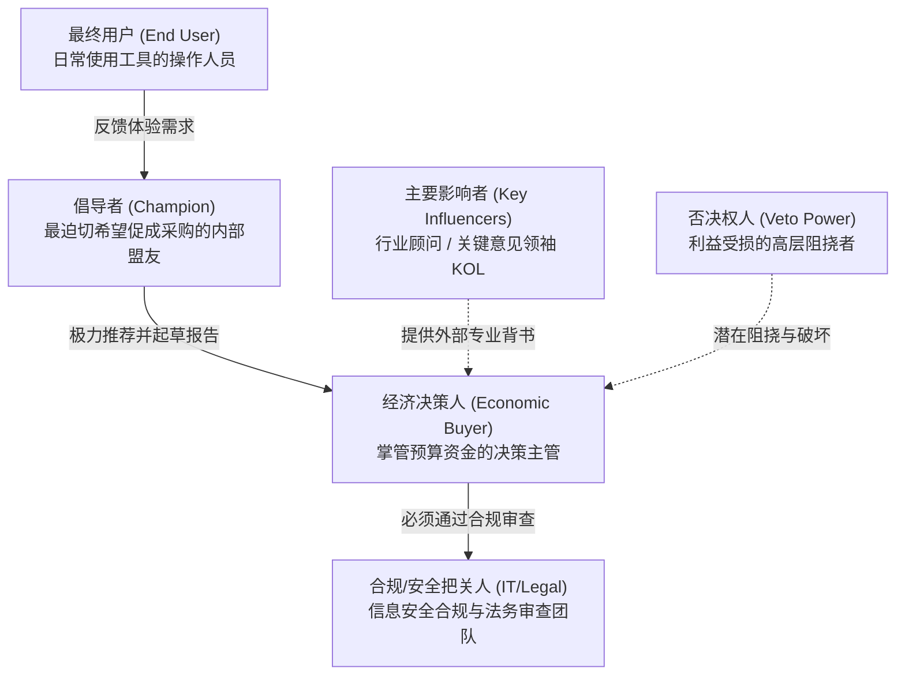

# Lec 12 客户决策购买单元与获客成本测算 (Decision-Making Unit and Cost of Customer Acquisition)

> MIT 15.390 · New Enterprises · 模块四：获客决策与商业模式

## TL;DR

- 掌握企业客户内部的决策购买单元（DMU）构成是破解 B2B 漫长销售周期的唯一钥匙。
- DMU 包含倡导者、经济决策者、最终用户、技术把关人、主要影响者以及拥有否决权的潜伏阻挠者。
- 获客成本（COCA）是初创企业生存的头号杀手，必须将全部营销与销售成本完整计入分摊。
- 客户终身价值（LTV）必须达到获客成本（COCA）的 3 倍以上，且回本周期应控制在 12 个月以内。

## 严谨创业法第 12 步：界定决策购买单元（DMU）

在复杂的机构客户采购中，敲定订单绝非“向一个人推销”那么简单。Bill Aulet 强调，团队必须像侦探绘制组织情报网一样，清晰绘制目标客户内部的 **决策购买单元（Decision-Making Unit, DMU）**：



::: definition 决策购买单元的核心角色划分
- **倡导者 (Champion)**：企业内部最希望看到方案落地的人，往往是因为你的系统能直接帮其达成关键 KPI 或争取晋升机会。
- **最终用户 (End User)**：每天具体坐在电脑前操作软件的人。
- **经济购买者 (Economic Buyer)**：真正对这笔开支签字画押的财务或业务主管。
- **否决权人 (Veto Power)**：有权力一票否决采购的利益相关方（如企业 IT 安全主管、工会代表或被抢夺话语权的中层）。
:::

::: insight
找到正确的倡导者是拿下 B2B 客户的决胜点。平庸的销售试图向所有人推销；顶尖的销售则是武装倡导者，给其提供精美的商业案例 PPT、ROI 测算模型与安全合规白皮书，让其在公司内部董事会上替你打胜仗。
:::

## 严谨创业法第 13 & 18 步：获客流程与获客成本（COCA）

### 1. 获客全流程图绘制（Process to Acquire a Paying Customer）
团队必须列出客户从初次接触到资金到账的每一个离散节点，精确标注每个阶段的**平均耗时、转化概率与执行责任人**。

### 2. 获客成本（COCA）的计算硬公理
许多初创团队错误地把数字广告点击单价当作获客成本，忽视了销售代表底薪、出差差旅费与售前工程师人力。

::: definition 获客成本 (Cost of Customer Acquisition, COCA)
在特定时间段内，为获取新客户所投入的全部销售与营销开支总和，除以该时间段内实际成功签约的新客户总数：
$$COCA = rac{Total\_Sales\_and\_Marketing\_Expenses}{Number\_of\_New\_Customers\_Acquired}$$
其中分子必须包含：销售人员薪酬奖金、营销人员薪酬、公关活动展会费、数字广告费、免费 POC 硬件折旧与售前技术支持人员成本。
:::

```text
[COCA 随企业生命周期的三阶段进化法则]
初期 (阶段一: 猎犬模式):
- 创始人与高级销售亲自出马，高触摸度拜访
- COCA 极高 (可能达 $50,000/单)，但为了拿下灯塔客户完全值得
中期 (阶段二: 漏斗优化):
- 提炼标准化销售套件，引入电话销售与线索分级
- COCA 显著回落，建立可预测的管道转化
成熟期 (阶段三: 飞轮自转):
- 客户自发转介绍，口碑裂变，线上自助注册试用
- COCA 降至极低水平，利润空间彻底释放
```

## 创业经济学的黄金死活线：$LTV / COCA$ 比例

投资人评估初创企业商业模式健康度时，最看重两大比率：

1. **价值成本比率**：
   $$rac{LTV}{COCA} \ge 3.0$$
   - 若 $LTV / COCA < 1.0$，公司每卖出一单都在净亏损，规模越大倒闭越快；
   - 若 $1.0 \le LTV / COCA < 3.0$，商业模型极其脆弱，稍微遇到宏观下行或获客成本上涨即告亏损；
   - 若 $LTV / COCA \ge 3.0$，模式健康，具备大规模资本注入扩张的前提；
   - 若 $LTV / COCA > 5.0$，可能意味着企业在营销扩张上过于保守，正在错失占领市场的黄金窗口。

2. **获客成本回本周期（Payback Period）**：
   $$Payback\_Period = rac{COCA}{Annual\_Gross\_Profit\_Per\_Customer} \le 12 	ext{ 个月}$$
   初创企业必须在 12 个月内通过毛利润收回获客成本，否则剧烈消耗的营运资金将使现金流迅速断裂。

::: pitfall
小心“隐形时间成本”拖垮初创公司。如果一个客户虽然最终愿意支付 2 万美元，但采购决策流程长达 18 个月并需要开 30 次现场协调会，其真实的 COCA 早就突破了 10 万美元，本质上是一笔亏本买卖。
:::
