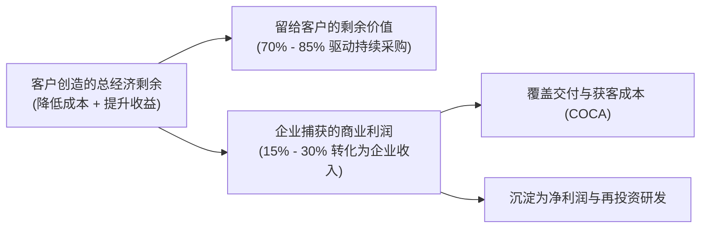

# Lec 13 商业模式设计与价值捕获定价 (Business Model Design and Value Capture Pricing)

> MIT 15.390 · New Enterprises · 模块四：获客决策与商业模式

## TL;DR

- 商业模式不是融资 PPT 上的空洞辞藻，而是企业从所创造的客户价值中捕获经济剩余的结构化契约。
- 经典商业模式包括剃刀与刀片（Razor & Blade）、SaaS 订阅制、使用量计费、双边撮合与免费增值（Freemium）。
- 定价的本质是价值分配而非会计成本加成；科学定价应当截取客户增量经济效益的 15% 至 30%。
- 客户终身价值（LTV）测算必须严格扣除交付毛利折损、客户流失率（Churn Rate）并纳入贴现折现率。

## 严谨创业法第 15 步：设计可持续的商业模式

许多创业者误以为“商业模式 = 如何赚钱”。Bill Aulet 纠正道：商业模式的核心在于**创造价值与捕获价值之间的动态平衡**。

### 17 种典型商业模式架构一览
1. **单次买断 + 维保合同 (One-Time Upfront + Maintenance)**：传统大型工业硬件与本地部署软件标配。
2. **耗材补充 / 剃刀与刀片 (Razor and Blade)**：主机平价甚至贴本销售，依靠专属耗材（如胶囊咖啡机、打印机硒鼓）获取终身高毛利。
3. **软件即服务订阅制 (SaaS / Subscription)**：按月/年收取固定的席位订阅费，提供持续云端升级与服务。
4. **按实际使用量计量 (Usage-Based / Metered)**：如 AWS 云计算按 CPU 核时/存储容量计费，与客户业务规模同步涨跌。
5. **免费增值模式 (Freemium)**：基础功能永久免费以极低成本吸引大众漏斗，高端专业功能向 2%-5% 核心重度用户收费。
6. **双边平台佣金 (Transaction Fee / Marketplaces)**：促成买卖双方撮合，按交易流水的固定百分比抽取服务费。

::: insight
商业模式的创新往往比纯粹的技术创新更具颠覆性。Salesforce 的真正革命不是它写出了多神奇的代码，而是它开创了“软件免安装、按月付费、随时退订”的 SaaS 模式，彻底粉碎了 Siebel 传统的百万美元本地预付授权壁垒。
:::

## 严谨创业法第 16 步：基于价值的定价策略（Pricing Framework）

初创公司最容易犯的定价错误是**成本加成法定价（Cost-Plus Pricing）**——核算自己的研发与服务器成本后加上 20% 利润率。

::: definition 科学定价核心法则
1. **基于客户价值定价 (Value-Based Pricing)**：价格完全取决于你帮客户省了多少钱或多赚了多少钱，与你的制作成本毫无关系。
2. **价值截取区间 (15% - 30% Rule)**：初创企业应将创造的量化净经济效益的 15% 至 30% 作为产品价格，将 70% 至 85% 的红利留给客户，以促成闪电般的采购决策。
3. **先易后难的弹性阶梯**：早期种子客户可以给予丰厚折扣，但合同上必须体现“名义原价 + 早期灯塔伙伴抵扣”，为后续提价保留法理空间。
:::

## 严谨创业法第 17 步：测算客户终身价值（LTV）

客户终身价值（Lifetime Value, LTV）代表一个新客户在与企业建立合作的整个生命周期中，能够为企业贡献的**折现净毛利现值**。

$$LTV = \sum_{t=1}^{T} rac{(Revenue_t - Cost_t)}{(1 + r)^t}$$

在典型的 SaaS 订阅制业务中，LTV 的经典估算公式可简化为：

$$LTV = rac{ARPU 	imes Gross\_Margin\%}{Churn\_Rate + r}$$

- **$ARPU$**：单客平均年度收益（Average Revenue Per User）；
- **$Gross\_Margin\%$**：交付服务毛利率（扣除云服务托管费、客服团队与运维成本）；
- **$Churn\_Rate$**：客户年流失率（若年流失率为 10%，客户平均生命周期为 10 年）；
- **$r$**：资本成本贴现率（初创企业通常取 10% - 20%）。

::: pitfall
在测算 LTV 时忽视客户流失（Churn）的毁灭性破坏。如果月流失率达到 5%，相当于每年超过 45% 的老客户流失离开，初创企业将变成漏水的吊桶，销售团队所有的获客努力只是在勉强填补流失的缺口。
:::
