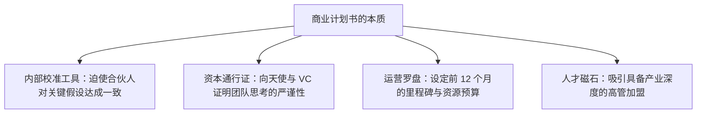

# Lec 14 商业计划书编写与商业模式精炼 (Designing a Business Model and Writing Business Plans)

> MIT 15.390 · New Enterprises · 模块四：获客决策与商业模式

## TL;DR

- 商业计划书的终极价值不在于文书本身，而在于迫使团队完成一次无死角、逻辑自洽的战略推演。
- 执行摘要（Executive Summary）是整份计划书的灵魂，必须在 2 分钟内清晰传达痛点、方案、市场与团队。
- 青年创业者常犯的 15 大致命失误，包括缺乏电梯路演能力、找容易答应的平庸顾问以及回避硬性财务推算。
- 戈登·马修斯（Gordon Mathews）语音信箱案例揭示：伟大专利若缺少商业计划的落地保护，极易被产业巨头抄袭侵吞。

## 商业计划书（Business Plan）的真正功用

在创业圈，常有人鼓吹“商业计划书无用论，唯有敏捷试错才重要”。Howard Anderson 对此提出严厉批判：不写计划书就盲目去市场上试错，是用真金白银和创业生命当炮灰。

::: definition 商业计划书黄金结构 (Standard Business Plan Outline)
1. **执行摘要 (Executive Summary)**：独立成篇的 2 页核心精华。
2. **问题定义与行业现状 (Problem & Opportunity)**：痛点迫切度与现有替代方案缺陷。
3. **解决方案与产品规格 (Solution & Product Spec)**：核心技术、高层规格与客户价值。
4. **目标市场与规模测算 (Market Analysis & TAM)**：海滩阵地、自下而上规模计算与发展路线。
5. **竞争格局与核心壁垒 (Competition & Core)**：二维定位图与结构性护城河。
6. **商业模式与定价 (Business Model & Economics)**：单笔交易单元经济模型与 $LTV/COCA$ 测算。
7. **市场进入策略 (Go-to-Market Strategy)**：DMU 触达路径与销售渠道方案。
8. **管理团队与顾问架构 (Team & Advisory Board)**：成员过往成功经验与权责分工。
9. **财务预测与融资需求 (Financial Projections & Milestones)**：未来 3 年损益表、现金流预测与资金用途。
:::

## 青年创业者常犯的 15 大致命失误

Howard Anderson 在审查了上千份商业计划后，列举了年轻创业者最常栽跟头的失误清单：

| 序号 | 致命失误 | 表现形式与后果 | 纠偏措施 |
| :--- | :--- | :--- | :--- |
| **1** | **缺乏电梯路演能力** | 讲了 5 分钟还没说清楚公司到底干什么 | 训练 30 秒一句话精炼表述：针对【客户】，解决【痛点】，通过【方案】 |
| **2** | **选择容易答应的平庸顾问** | 邀请自己的大学叔伯或同学充当顾问委员会 | 寻找行业公认的大咖，哪怕被拒绝 10 次也要追求顶尖专业背书 |
| **3** | **回避严肃的财务建模** | 宣称“我们是研发期科技公司，现在预测财务没有意义” | 投资人看财务不是看数字准确度，而是看你的**商业假设与算账逻辑** |
| **4** | **虚构十项全能的竞争优势** | 在所有指标上给自己打满分，声称没有竞争对手 | 诚实承认当前短板，重点突出一到两个关键决胜维度 |
| **5** | **团队股份均分** | 4 个合伙人各占 25%，没有核心领导核心 | 建立差异化股权架构与 4 年动态既得权协议（Vesting） |

## 经典教训案例：戈登·马修斯（Gordon Mathews）与语音信箱

戈登·马修斯（Gordon Mathews）是现代语音信箱系统（Voice Mail）的发明人，获得了全美核心基础专利：
- **致命失误**：他只关注专利申请与硬件组装，缺乏严密的商业分销计划、大客户直销团队与防御性现金流规划。
- **惨痛结局**：IBM、AT&T 等电信巨头直接推出替代性数字交换系统并提起专利无效诉讼。马修斯耗尽心血打了数年官司，最终虽勉强获赔，却永远失去了主导数十亿美元语音通信帝国的历史机遇。

::: insight
计划书的核心在**执行摘要（Executive Summary）**。90% 的投资人只读执行摘要。如果前两页无法在 90 秒内证明痛点的真实性、方案的独特性和商业回报的高倍数，整份计划书将直接被扔进垃圾桶。
:::

::: pitfall
切忌在商业计划书中大段复制行业宏观报告中的套话废话。投资人希望看到的是你们团队**亲自调研了哪些具体客户、获得了哪些一手反馈数据、算清了什么单位经济账**，而不是宏观层面的空洞抒情。
:::
