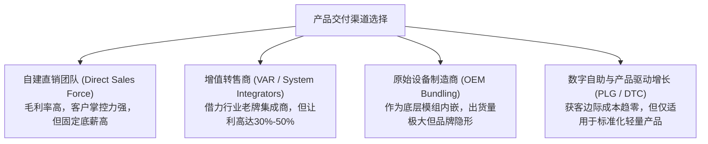

# Lec 15 销售渠道规划与分销策略 (Sales and Distribution Plans)

> MIT 15.390 · New Enterprises · 模块五：渠道进入与产品开发交付

## TL;DR

- 销售渠道选择直接决定了企业的毛利率结构、客户反馈回路与可扩张速度。
- 渠道模式涵盖自建直销团队、增值转售商（VAR）、独立软件分销商与线上自助 DTC。
- Wireless Waiter 点餐手持机案例展示了过早依赖传统餐饮设备代理商导致的惨痛渠道流产。
- 初创企业在早期必须坚持直销以打磨产品，只有当销售动作高度标准化后方可引入外部代理渠道。

## 销售渠道的核心形态与经济学权衡

产品研发完成后，如何以最高效率将产品送到目标客户手中？Howard Anderson 指出，创业者面临以下主流渠道选择：

| 渠道模式 | 适合产品形态 | 优劣势权衡 | 典型分成比例 |
| :--- | :--- | :--- | :--- |
| **内部直销 (Direct Field Sales)** | 客单价高 (> $50,000)、实施复杂的企业级系统 | 深度掌控客户关系与一手反馈；缺点是人均底薪高、规模化慢 | 销售提成 8% - 15% |
| **增值分销商 (VAR)** | 需要本地弱电布线、硬件施工的垂直行业方案 | 迅速覆盖全国本地客户；缺点是代理商同时代理多家竞品，缺乏推销动力 | 渠道分成 25% - 40% |
| **OEM 战略捆绑** | 核心算法芯片、中间件开发工具 | 一夜之间获得数万家装机量；缺点是丧失终端定价权与品牌存在感 | 批发折扣 50% - 70% |
| **自助线上订购 (PLG)** | 开发人员工具、协同办公软件、标准化 SaaS | 销售漏斗零人力摩擦，全球即时触达；缺点是不适用复杂审批业务 | 支付通道费 2% - 3% |

## 经典教训案例：无线服务生（Wireless Waiter）的点餐机之殇

课堂引入了波士顿著名的餐饮硬件初创项目 **Wireless Waiter**（早期的移动手持点餐平板）：

### 1. 商业构想与初期验证
创始人开发出一种无线掌上点餐终端，服务员可在餐桌前直接下单，后厨出票机实时出单，翻台率提升 20%，错单率降低 90%。波士顿顶级海鲜餐厅 Legal Sea Foods 的总裁 Roger Berkowitz 亲自试用并给出了极高赞誉。

### 2. 渠道选择的致命误判
- **盲目委托传统经销商**：创始人认为自建全国销售队伍成本过高，于是与全美最大的餐饮 POS 设备代理商签订独家分销协议。
- **代理商缺乏动力**：代理商主要收入来自传统大型笨重的收银机硬件加价（一台赚 3000 美元），而 Wireless Waiter 是轻量设备（单机利润仅 300 美元）。代理商销售员在见餐馆老板时，继续大力推销传统老机器，完全将 Wireless Waiter 抛在脑后。
- **服务支持灾难**：餐馆遇到网络断连或电池故障时，代理商无力排查，导致餐馆老板愤怒退货，最终拖垮了初创公司。

::: definition 渠道利益冲突 (Channel Conflict)
当你的创新产品在代理商体系内部与代理商现有最赚钱的成熟产品产生竞争，或者单机提成无法激发代理商一线销售代表的推销热情时，外部渠道会主动“雪藏”你的创新产品。
:::

::: insight
初创公司的前 50 个客户必须由创始人亲自直销拿下来。只有在直销过程中亲自摸透了客户的所有刁钻异议、定价底线与部署坑洼，并提炼出傻瓜式的标准化销售培训手册（Sales Playbook）之后，引入外部渠道代理才可能获得成功。
:::

::: pitfall
过早签署“独家区域分销协议（Exclusive Distribution Agreement）”。代理商往往为了防范竞品而囤积独家授权，若未在合同中设立惩罚性的最低年度销售配额考核（Minimum Quota），初创企业的命脉将被代理商彻底扼死。
:::
