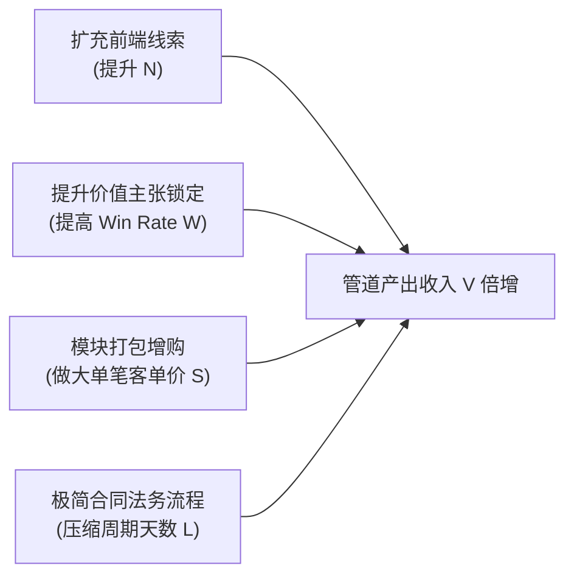

# Lec 16 市场进入实战模拟 (Go-to-Market Simulation Lab)

> MIT 15.390 · New Enterprises · 模块五：渠道进入与产品开发交付

## TL;DR

- GTM 实战模拟将渠道规划落入具体的人员配额、薪酬激励与销售管道健康度跟踪。
- 销售配额（Quota）通常设定为销售人员全额薪酬包（OTE）的 4 至 5 倍。
- 管道流速（Pipeline Velocity）受合格线索数量、平均交易额、赢单率与销售周期四大变量共同决定。
- 模拟推演表明：盲目扩充一线销售人数而未优化线索质量，是初创公司烧光现金的最快途径。

## 销售团队的人效与配额设计准则

在市场进入实战推演中，团队必须将战略转化为具体的财务预算与销售人效指标。Howard Anderson 讲授了硅谷与波士顿成熟高科技初创企业的薪酬设计公式：

```text
[B2B 销售代表典型薪酬结构 (OTE: On-Target Earnings)]
总薪酬包 (OTE) = 50% 基础底薪 (Base Salary) + 50% 浮动佣金 (Commission)
年度业绩配额 (Annual Quota) = 4 到 5 倍 OTE
例：底薪 $60,000 + 佣金 $60,000 = OTE $120,000
    该销售员年度必须完成的净签约业绩 = $500,000 - $600,000
```

::: definition 销售管道流速方程 (Pipeline Velocity Equation)
量化评估销售机器运转效率的黄金指标：
$$V = rac{N 	imes W 	imes S}{L}$$
- **$V$ (Velocity)**：销售管道每日/每月产生的预期新增收入；
- **$N$ (Number of Opportunities)**：管道中合格商机（SQL）的数量；
- **$W$ (Win Rate)**：商机的平均成交概率；
- **$S$ (Average Deal Size)**：单笔成交的平均订单金额；
- **$L$ (Sales Cycle Length)**：商机从初次接触到最终合同生效的平均周期天数。
:::



## 模拟沙盘常见危机复盘

在 15.390 的沙盘模拟实验中，学生团队经历了真实商业环境中的多重剧烈波动：

1. **“销售代表爬坡期（Ramp-Up Time）”忽视**：新招聘的销售代表前 3-6 个月几乎不贡献净利润，需要大量培训和陪跑；盲目以满负荷产能计算早期营收，导致现金流严重赤字。
2. **销售漏斗“虚胖”**：管道中充斥着“正在积极沟通”的僵尸客户，销售代表为了避免挨训而不愿关单释放资源。
3. **佣金跳点设计缺陷**：缺乏阶梯激励导致销售员在完成基础指标后故意压单到下个季度。

::: insight
提高销售业绩最便宜的方法往往不是增加销售员，而是**缩短销售周期（L）**。如果能通过标准化法务模板、无痛数据迁移工具将客户审批周期从 90 天压缩到 30 天，你的整条销售管道流速在不花一分额外广告费的前提下瞬间提升了 300%。
:::

::: pitfall
在商业模式未被验证前过早招募“销售副总裁（VP of Sales）”。一位年薪 30 万美元的大厂前 VP 习惯了依靠品牌影响力和庞大支持团队推进业务，无法在车库创业期赤膊上阵打电话拓客，只会加速公司的死亡。
:::
