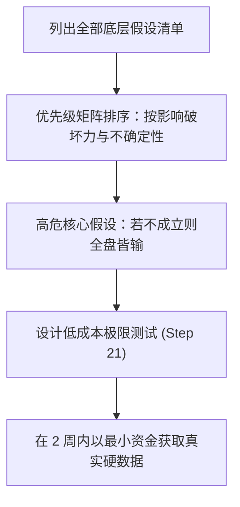

# Lec 17 最小可行产品与产品设计 (Designing and Building Your Product)

> MIT 15.390 · New Enterprises · 模块五：渠道进入与产品开发交付

## TL;DR

- 严谨创业法第 20 步与第 21 步要求在动工开发前全面识别并排查“未经验证的核心假设”。
- 最小可行商业产品（MVBP）必须同时满足三个硬性条件：客户获得价值、客户为此买单、建立反馈数据闭环。
- MVBP 绝非劣质半成品，而是能够支撑一个完整商业微循环的最精简版本。
- 通过低成本原型实验（如绿野仙踪法、门厅假门测试）能够在不写完整代码的前提下检验付费意愿。

## 严谨创业法第 20 & 21 步：核心假设识别与测试

工程师最容易犯的职业病是“先把东西做出来看大家用不用”。Bill Aulet 强调，在编写核心代码之前，团队必须列出 **关键假设清单（Key Assumptions）**：



### 必须排查的五大致命假设
1. **成本假设**：硬件 BOM 成本或云端算力消耗能否控制在单价的 20% 以下？
2. **监管假设**：产品是否需要漫长的 FDA、FCC 或行业准入认证才能合法销售？
3. **技术可行性假设**：算法在真实噪声环境下（而非实验室纯净数据集上）的召回率是否真能达到可用门槛？
4. **采购预算假设**：目标部门是否有无需董事会特殊审批的小额采购自由支配权？
5. **替换意愿假设**：客户是否真的痛恨现有供应商以至于愿意忍受数据迁移的痛苦？

## 最小可行商业产品（MVBP）的严谨定义

硅谷常谈的 MVP（Minimum Viable Product）往往被滥用为发布 Bug 百出的粗糙软件的借口。MIT 15.390 提出了更为严肃的概念：**MVBP（Minimum Viable Business Product，最小可行商业产品）**。

::: definition 最小可行商业产品 (MVBP)
一个合格的 MVBP 必须同时满足以下三大绝对支柱：
1. **客户能从中获得明确的量化价值**：产品能真正解决 Persona 的核心痛点，绝非虚构的摆设；
2. **客户愿意为此支付真金白银**：客户真正掏出信用卡付款、签署具备法律效力的采购意向书（LOI）或支付预付款；
3. **建立了快速的数据反馈与迭代闭环**：团队能实时追踪客户的使用行为与卡点，为下一版本迭代提供精准事实依据。
:::

```text
[经典极简原型验证方法]
1. 绿野仙踪法 (Wizard of Oz):
   - 前端展现高科技全自动界面，后台全靠创始人和实习生手工在 Excel 和纸上人工运算处理
   - 目的：先验证客户是否真的需要该输出结果，再投入资金将后台自动化
2. 门厅落地页假门测试 (Landing Page Fake Door):
   - 建立精美产品介绍页面，放置“立即付费订购”按钮
   - 统计实际点击支付比例与跳出率，检验广告宣传话术对真实意向的转化力
3. 礼宾服务模式 (Concierge MVP):
   - 创始人作为私人顾问深入客户现场，全程一对一手工提供服务
   - 目的：彻底摸透客户工作流中的每一个隐藏细节与脾气习惯
```

::: insight
如果你的第一个产品发布时你没有感到一丝羞愧，说明你发布得太晚了（里德·霍夫曼名言）。但前提是：核心价值必须坚挺。用户可以忍受界面简陋或按钮难看，但绝不能忍受核心数据算错或机器经常宕机。
:::

::: pitfall
把“免费试用”当成需求验证。如果客户只是因为免费才愿意试用你的产品，你得到的只是虚假的繁荣；只有当要求对方支付定金时，隐藏在礼貌背后的真实反对意见才会瞬间浮出水面。
:::
