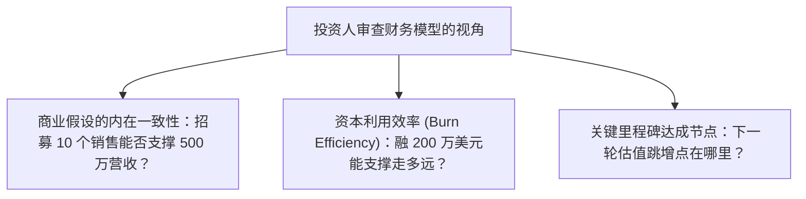

# Lec 18 初创企业财务报表与现金流规划 (Financial Plan and Cash Flow Statements)

> MIT 15.390 · New Enterprises · 模块五：渠道进入与产品开发交付

## TL;DR

- 创业失败的直接物理死因只有一条：账面现金耗尽（Running out of cash）。
- 初创企业财务计划的核心不是追求数字的绝对精准，而是展现商业假设的内在逻辑一致性。
- 损益表（P&L）盈利不等于企业安全，营运资金占用（Working Capital）与账期错配是吞噬现金流的隐形黑洞。
- 必须基于研发里程碑规划融资节奏，始终保持 6 个月以上的安全现金跑道（Runway）。

## 财务模型的底层逻辑：投资人在看什么？

许多科技背景创业者对财务报表感到畏惧或厌烦，视其为应付投资人的填表游戏。Howard Anderson 指出，成熟投资人审查财务模型不是为了验证 3 年后营收预测是否准确（所有人都知道预测一定不准），而是审查以下三大深层逻辑：



## 初创期财务三张表的实战精要

初创团队必须重点掌握以下核心财务工具：

### 1. 简要损益表（Pro-Forma Income Statement / P&L）
反映企业的盈利能力结构：
$$	ext{净利润} = 	ext{营业收入} - 	ext{销售成本 (COGS)} - 	ext{研发开支 (R\&D)} - 	ext{销售与营销 (S\&M)} - 	ext{日常行政管理 (G\&A)}$$
- **毛利率（Gross Margin）**：纯软件行业应在 75%-85% 以上；智能硬件通常在 35%-50% 之间。

### 2. 现金流量表（Cash Flow Statement）——生命线
会计利润基于权责发生制，而现金流基于收付实现制。企业在高速增长期最容易死于**营运资金陷阱（Working Capital Trap）**：
- 销售暴增意味着采购大量原料、垫付生产费用；若大企业客户账期长达 90-120 天，账面盈利的公司会因发不出下个月员工工资而瞬间破产。

::: definition 跑道 (Runway) 与 烧钱率 (Burn Rate)
- **净烧钱率 (Net Burn Rate)**：企业每月经营现金流的净流出额：
  $$	ext{Net Burn Rate} = 	ext{月度全部现金支出} - 	ext{月度实际现金回款}$$
- **现金跑道 (Runway)**：企业在不融新钱的前提下能够存活的剩余月数：
  $$	ext{Runway (Months)} = rac{	ext{当前银行账户可用现金储备}}{	ext{Net Burn Rate}}$$
:::

```text
[融资里程碑与现金跑道规划图]
现金储备 ($)
 ^
 | [种子轮资金到账: $1.5M]
 |    |    \ 稳步研发与团队搭建 (月烧 $80K)
 |      |      \ 达成里程碑 1: MVBP 上线，拿下 5 家付费标杆
 |       \==================> [A 轮融资启动窗口: 剩余 6 个月跑道]
 |        \                   - 谈判周期 3-4 个月
 |         \                  - 达成里程碑 2: ARR 突破 100 万美元
 |          \                 - A 轮资金 $5M 顺利交割！
 |           \   [危险死亡谷 (Danger Zone)]
 0------------------------------------------> 时间 (月份)
```

::: insight
永远不要在跑道少于 4 个月时才开始出去融资。当你的银行账户只剩 2 个月薪水时，投资人会从你的神色中嗅出绝望的血腥味，他们会无限拖延谈判，直到最后逼你接受极其苛刻的低估值清算条款。
:::

::: pitfall
在财务预测中采用“曲棍球棒式增长（Hockey Stick Growth）”——前三年平平无奇，第四年没有任何合理解释突然暴增 10 倍。这种不尊重商业规律的报表会立刻丧失专业投资人的信任。
:::
