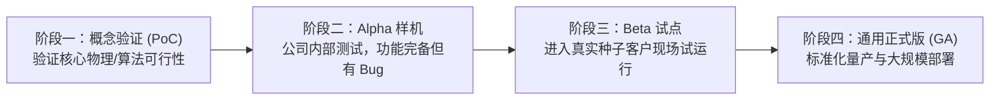

# Lec 19 从产品定义到交付全流程 (Product Definition, Development to Delivery)

> MIT 15.390 · New Enterprises · 模块五：渠道进入与产品开发交付

## TL;DR

- 从产品定义到最终用户交付，研发团队必须平衡功能完整性、上线速度与技术债。
- 软件与硬件开发遵循敏捷冲刺（Agile Sprint）与阶段门径（Stage-Gate）相结合的渐进迭代流程。
- 防范“第二系统综合征”——初创企业切忌在早期试图构建支持未来千万级并发的庞大架构。
- 交付流程不仅是代码上线或物流发货，更涵盖客户培训、数据迁移与运维健康度监控。

## 产品开发流程的四大递进阶段

将商业规格转化为交付实物需要严格的工程纪律。Bill Aulet 梳理了产品开发的四个核心阶段：



### 1. 概念验证（Proof of Concept, PoC）
- 聚焦单一最不确定的技术难点（如某特定算法能否在低功耗 MCU 上实时运行）。不考虑外观和交互，仅验证底层物理与代码可行性。

### 2. Alpha 阶段
- 系统的主要模块全部打通并能在受控环境下跑通完整用例，但系统未作压力优化，存在已知漏洞。

### 3. Beta 阶段（客户试点）
- 部署到 3 至 5 家友好种子客户的真实网络环境中，由真实 Persona 按照日常工作流深度使用，全面排查隐性边界条件。

### 4. 正式商用版（General Availability, GA）
- 具备自动化部署脚本、详尽用户帮助文档、标准化收费计费接口与 SLA 故障响应协议。

## 初创期工程管理的三大平衡艺术

初创公司的技术负责人（CTO）每天都在以下三对矛盾中做出生死权衡：

```text
[工程铁三角平衡]
           速度 (Speed to Market)
                 /        \
                /          \
               /   平衡取舍  \
              /              \
质量 (Quality/Robustness) ==== 成本 (Engineering Cost)
```

::: definition 技术债务 (Technical Debt)
为了追求业务快速上线验证，团队有意识地采取简陋的临时代码方案或架构妥协所欠下的隐形负债。若在业务爆发后不及时重构还债，日后每新增一个微小功能都将引发全局系统崩溃。
:::

### CTO 的自我防守底线
1. **绝不过度设计（YAGNI: You Aren't Gonna Need It）**：不要在只有 10 个企业客户时花费半年时间去搭建支撑 5000 万并发的微服务与分布式事务架构。
2. **核心业务资产绝不妥协**：涉及客户金融交易、医疗隐私数据安全的核心存储模块，必须做到绝对防御与多重备份。
3. **建立快速回滚机制**：部署流程必须支持一键回滚，确保新功能一旦出现重大隐患能在 60 秒内恢复基线运行。

::: insight
优秀的产品不是添加了所有能想到的功能，而是削减到再也无法减去任何一个零件。每一个多余的功能都会增加代码复杂性、引入潜在 Bug、增加客服支持成本，并稀释用户对产品核心价值的认知。
:::

::: pitfall
在没有真实客户需求驱动的情况下盲目进行技术重构。很多程序员出身的创始人往往在业务推进受阻时躲回舒适区，以“重写底层架构”为由拖延面向客户的痛苦验证。
:::
