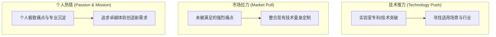

# Lec 2 商业创意生成与盘点 (Idea Generation and Opportunity Discovery)

> MIT 15.390 · New Enterprises · 模块一：创业启航与创意初筛

## TL;DR

- 创业构想源自三大驱动引擎：技术推力（Technology Push）、市场拉力（Market Pull）与个人激情（Passion/Mission）。
- 创始人通常表现为三大典型画像：苏西商业型（Susie Suit）、汤米技术型（Tommy Tech）与邦妮平衡型（Bonnie Balance），其能力互补是团队成败的关键。
- 评估创业构想必须进行技术能力盘点、应用领域界定与知识产权（IP）排查。
- 真正的商机必须具备价值创造空间、可行的变现逻辑以及对客户当前行为的清晰改良。

## 商业创意的三大发源引擎

优质的商业创意绝非凭空产生，其底层动力通常源于以下三大驱动力之一：



### 1. 技术推力（Technology Push）
- **特征**：创始人掌握了前沿算法、专利材料或新型制造工艺，寻求将其商业化。
- **优势**：具备极深的技术壁垒，竞品难以快速复制。
- **风险**：极易陷入技术自嗨，过度高估市场真实需求，耗费巨资开发出“没人愿意买单”的精妙产品。

### 2. 市场拉力（Market Pull）
- **特征**：创始人在特定垂直行业（如医疗器械采购、跨国物流清关）深耕多年，发现现有流程极其繁琐低效。
- **优势**：需求极其真实迫切，获客路径清晰，客户意愿强烈。
- **风险**：若技术壁垒不足，极易引来资本驱动的大型在位者跟进复制。

### 3. 个人热情与使命（Passion & Mission）
- **特征**：创始人对某种运动、艺术或环保事业拥有近乎偏执的热爱，旨在解决自身日常遇到的核心痛点。
- **优势**：创始人拥有超强的抗压耐力与敏锐的同理心，天然契合极客早期用户群体。
- **风险**：容易把小众爱好误判为大众刚需。

## 创业者三大典型人格画像

在 MIT 15.390 课堂上，Bill Aulet 将初创团队成员归纳为三类经典角色：

::: definition 创始人三大人格画像
1. **苏西商业型 (Susie Suit)**：擅长商业分析、财务建模、商务拓展、市场调研与路演表达。弱点是对底层技术实现细节缺乏直觉，容易轻信乐观的技术排期。
2. **汤米技术型 (Tommy Tech)**：掌握核心硬科技、代码架构、算法与硬件工程。弱点是往往轻视销售、市场营销与法律合约，认为“只要产品够好，客户自然会来”。
3. **邦妮平衡型 (Bonnie Balance)**：具备复合学科背景（如工程+MBA），兼通技术架构与商业运作，能够在工程师与投资人间充当翻译官与粘合剂。
:::

```text
[Susie Suit (商)] <====== 信任与分工 ======> [Tommy Tech (技)]
            \                                /
             \                              /
              \===> [Bonnie Balance (桥)] <=/
```

::: insight
最糟糕的初创团队是由三个背景完全相同的“汤米”或三个“苏西”组成的团队。前者的典型悲剧是把所有时间花在重构完美的代码架构上，直到账面资金耗尽也没有见一个真实客户；后者的悲剧是产出了一份精美绝伦的商业计划书，却没有任何人能写出第一行代码。
:::

## 商业创意的五维结构化卡片

在创意生成阶段，团队必须为每个备选创意填写五维卡片，避免模糊不清的定性畅想：

1. **产品/服务是什么（What is it?）**：用一句话说清产品形态（SaaS 平台、硬件模组、API 服务还是专业咨询）。
2. **它解决什么具体问题（What does it do?）**：量化陈述其功能边界，而不是泛泛的“提高效率”。
3. **目标客户是谁？数量有多少（Who are the customers & how many?）**：明确买方画像与初步受众规模。
4. **如何获得报酬（How do you get paid?）**：软件订阅、按次计量、硬件买断、耗材复购还是抽成抽佣。
5. **为何显著优于当前替代方案（Why is it better than status quo?）**：客户切换当前习惯的决定性理由（成本降低 80%、速度提升 10 倍还是合规必填）。

::: pitfall
在创意发散期过早进行批判会扼杀创新，但若在筛选期拒绝面对残酷的商业逻辑，则会将团队带入长达数年的资源泥潭。
:::
