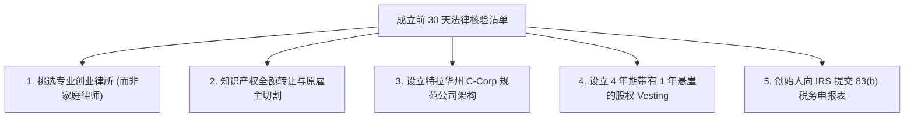

# Lec 20 成立前 30 天关键行动与法律架构 (The First 30 Days and Legal Considerations)

> MIT 15.390 · New Enterprises · 模块六：组织法律、规模化与逆境管理

## TL;DR

- 新企业成立的前 30 天是规避未来重大股权纠纷与法律隐患的黄金窗口期。
- 必须聘请专业的高科技初创律所，按行业标准设立特拉华州 C 类公司（Delaware C-Corp）。
- 创始人必须签署知识产权转让协议（IP Assignment），彻底切割与原雇主或大学的 IP 纠纷。
- 强制推行 4 年期伴随 1 年悬崖的股权动态既得权协议（Vesting），并在 30 天内提交 83(b) 税务申报。

## 成立前 30 天的五大法律生死门

科技创业者往往对法律与税务事务缺乏重视，认为“等融了钱再补办”。Howard Anderson 在本讲严肃指出，早期法律漏洞一旦铸成，在后续融资尽职调查（Due Diligence）中将成为致命死穴。



### 1. 挑选律师事务所的铁律
- **绝不使用亲友律师或诉讼律师**：处理高科技融资需要对硅谷与波士顿惯例（如优先股清算偏好、董事会席位分配、保密契约）极其精通的专业风险投资法律团队（如 Cooley, Goodwin Procter, WilmerHale）。
- **递延付费模式（Deferred Fee Arrangements）**：顶尖创业律所通常愿意为有潜力的团队垫付前期公司设立费用，待完成首轮融资时再结清账单。

### 2. 知识产权转让协议（IP Assignment Agreement）
- 所有创始人在入职第一天必须签署协议，明确声明：**凡是与公司业务相关的所有发明、专利、代码与技术文档，其知识产权 100% 归属于公司法人，而非创始人个人**。
- **排查原雇主竞业与大学产权归属**：若使用过大学实验室仪器、政府专项基金或在原雇主电脑上写过代码，必须由技术转移办公室（TTO）出具正式的 IP 放行与授权许可证明。

## 股权分配与 4 年动态既得机制（Vesting Schedule）

无论创始人私交多么亲密，绝对不能在第一天直接发放全额无约束股票。

::: definition 股权兑现与 1 年悬崖 (4-Year Vesting with 1-Year Cliff)
- **4 年兑现期 (4-Year Vesting)**：创始人的股权在 48 个月内按月均匀解锁（每月解锁 1/48）。
- **1 年悬崖期 (1-Year Cliff)**：若有创始人在加入公司未满 12 个月时离职或被开除，其不能获得任何股份（股权为 0）；满 12 个月整当天一次性解锁 25%，之后按月平滑兑现。
:::

```text
创始人股权解锁时间轨迹:
[加入当天] ------------ (未满12个月离职: 股权 0%)
     |
[满 12 个月 (Cliff)] ======> 瞬间解锁 25% 股权
     |
[满 24 个月] =============> 解锁 50% 股权
     |
[满 36 个月] =============> 解锁 75% 股权
     |
[满 48 个月] =============> 100% 股权全部解锁完全归属
```

::: definition 83(b) 税务申报条款 (Section 83(b) Election)
根据美国国税局（IRS）税法，获得有限制性股权（Restricted Stock）的创始人在签署股权协议后 **30 天内**，必须向 IRS 寄送 83(b) 选择声明。
- 作用：按照股票发放当天的极低票面价值（如每股 0.001 美元）预先纳税；日后公司估值暴涨至数亿美元股权兑现时，无需再按普通所得税税率缴纳数百万美元的巨额账面增值税。
:::

::: insight
83(b) 是没有任何救济程序的绝对硬性死线。错过成立后的 30 天申报窗口，日后公司融资时将引发灾难性的个人所得税账单，甚至直接迫使创始人破产抛售股票。
:::

::: pitfall
在没有设立任何退出与回购约定的情况下，将 30% 股权无条件赠予早期合伙人。如果该合伙人在 3 个月后因个人原因退出公司，他将带着 30% 的巨额“死股”离开，导致公司后续无法招募新高管，也没有任何风投敢于投资。
:::
